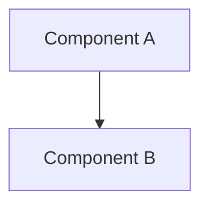

# 技術設計書テンプレート (Design Doc)

このドキュメントは `.sdd/specification/` 配下の技術設計書（Design Doc）を作成する際のテンプレートです。
ファイル名は `{機能名}_design.md` となります。

> **注意**: このテンプレートは `minimax-cli`（Rust CLI）用にカスタマイズ済みです
> （`/constitution sync` 適用済み、原則 v1.1.1 準拠）。プラグインの汎用テンプレートで上書きしないでください。
> 原則を改定したときは `/constitution sync` を再実行して同期します。

## 抽象仕様書との違い

| ドキュメント          | SDDフェーズ          | 役割と焦点                                               | 抽象度      |
|-----------------|------------------|-----------------------------------------------------|----------|
| `xxx_spec.md`   | **Specify（仕様化）** | **「何を作るか」「なぜ作るか」** - システムの抽象的な構造と振る舞いを定義。技術的詳細は含めない | 高（抽象的）   |
| `xxx_design.md` | **Plan（計画/設計）**  | **「どのように実現するか」** - 抽象仕様を実現するための具体的な技術設計。設計判断の透明性を確保 | 中〜低（具体的） |

---

# {機能名} `<MUST>`

**関連 Spec:** [xxx_spec.md へのリンク]
**関連 PRD:** [requirement/{機能名}.md へのリンク]
**準拠する原則バージョン:** [CONSTITUTION.md](../CONSTITUTION.md) v1.1.1

---

## 原則準拠チェックリスト `<MUST>`

設計を書き終えたら、この設計が [CONSTITUTION.md](../CONSTITUTION.md) の各原則を満たしていることを
1 項目ずつ確認します。**該当しない項目は「該当なし」と理由を書き、空欄で残さないでください。**

### B-001: 認証情報を AI エージェントの到達範囲に置かない（最優先・例外なし）

- [ ] トークンを stdout に出力する経路が設計に存在しない
- [ ] 値を引数で受け取るフラグ（`--token <VALUE>` 等）を設計していない。受け口は stdin のみ
- [ ] トークンを保持する型の `Display` / `Debug` を封じている（`secrecy` 等）
- [ ] エラーメッセージ・`Display` / `Debug` 実装にトークンが載らない
- [ ] 認証情報を環境変数で渡す運用を前提にしていない（環境変数は子プロセスに継承されるため
      AI エージェントのシェルツールから読める）
- [ ] HTTP クライアント / TLS クレートを追加した場合、`src/logging.rs` の `HTTP_LAYER_CRATES` にも追加した
      （この配列はテストからも参照するため、追加すれば `warn` 打ち止めの検証対象に自動で入る）

### B-002: stdout は成果物専用に保つ

- [ ] stdout へ書く経路が CONSTITUTION.md の**許可リスト**に載っているものだけである
- [ ] 経路を増やす場合、同じ PR で許可リストへ追記する計画になっている
- [ ] 成果物の書き出しに `writeln!(std::io::stdout().lock(), "{}", path.display())?` を使う
      （`#[expect(clippy::print_stdout, ...)]` は**付けない** — lint が発火せず
      `unfulfilled_lint_expectations` が `-D warnings` で hard error になる）
- [ ] 失敗時に stdout が空であることを結合テストで固定する設計になっている

### A-001: 境界層は薄く保ち、外部世界の読み取りをそこに閉じる

- [ ] `main.rs` にロジックを追加していない（`main_entry()` を呼ぶだけ）
- [ ] 環境変数・ファイル・ネットワーク・OS キーストアの読み取りが境界の型に集約されている
- [ ] 解決ロジックはプロセス環境を書き換えずに単体テストできる（値を引数で受け取る）
- [ ] 機能モジュール同士の相互依存を作っていない

### A-002: セキュリティに関わる仕組みを自作しない

- [ ] TLS は rustls（`reqwest` は `default-features = false` + `rustls-tls`）
- [ ] `openssl` / `openssl-sys` を依存グラフに持ち込まない
- [ ] シークレットの保存に独自のファイル形式・独自の暗号を使っていない
- [ ] Windows API は `windows-sys`（`windows` は `deny.toml` の `[bans]` で禁止）
- [ ] 追加した依存のライセンスが `deny.toml` の `[licenses] allow` に含まれる
      （含まれない場合は同じ PR で allow に追記する）

### D-001: 外形をテストで固定する

- [ ] 追加・変更したサブコマンドの終了コードを検証する結合テストがある
- [ ] 失敗時に stdout が空であることを検証している
- [ ] テストが実行環境の環境変数に影響されない（`bin()` が `LogEnv::NAMES` を回して `env_remove` する）
- [ ] テスト内で `std::env::set_var` / `remove_var` を呼んでいない（edition 2024 では unsafe、
      かつ結合テストはスレッド並列に走る）

### T-001: 実行時に落ちる余地を残さない

- [ ] `unsafe` を書いていない
- [ ] `unwrap()` / `expect()` を実装コードに追加していない（**現状 `src/*.rs` の本番コードは 0 件。
      この状態を維持する**）
- [ ] `todo!()` / `dbg!()` を残していない（未実装は `anyhow::bail!` でスタブ）
- [ ] 失敗を `Result` の型で表現し、意味の異なる失敗を別 variant に分けている

### 原則からの逸脱 `<OPTIONAL>`

逸脱がある場合のみ記載します。**B-001 に関わる逸脱は認められません。**

| 原則 ID | 逸脱内容 | 理由 | 補償手段 | 解消条件 | 追跡 Issue |
|:---|:---|:---|:---|:---|:---|
| [ID] | [内容] | [理由] | [補償] | [条件] | [#000] |

---

# 1. 実装ステータス `<MUST>`

**ステータス:** 🟢 実装済み / 🟡 部分実装 / 🔴 未実装

## 1.1. 実装進捗 `<OPTIONAL>`

| モジュール/機能 | ステータス    | 備考   |
|----------|----------|------|
| [モジュール]  | 🟢/🟡/🔴 | [備考] |

---

# 2. 設計目標 `<MUST>`

本設計が達成すべき主要な技術目標を記述します。

---

# 3. 技術スタック `<MUST>`

**なぜその技術を選んだのか** という判断の根拠を明確に残します。
CONSTITUTION.md の「技術スタック制約」で既に固定されている領域（引数パース = clap、ログ = tracing、
エラー = thiserror / anyhow、HTTP / TLS = reqwest + rustls、Windows API = windows-sys、配布 = cargo-dist）は
**再検討せず、その制約に従っていることを書きます**。

| 領域 | 採用クレート | バージョン | features | 選定理由 |
|:---|:---|:---|:---|:---|
| [領域] | [クレート] | [x.y] | [指定した feature / `default-features = false`] | [理由] |

依存を追加する場合は以下も記載します。

- [ ] `deny.toml` の `[licenses] allow` に無いライセンスが増えるか（増えるなら同じ PR で追記）
- [ ] `[bans]` の禁止クレート（`openssl` / `openssl-sys` / `windows`）を推移的に引き込まないか
- [ ] そのクレートの MSRV が `Cargo.toml` の `rust-version` 以下か
- [ ] 配布 4 ターゲットすべてでビルドできるか（クロスコンパイル可否。C ライブラリへのリンクが無いか）
- [ ] `Cargo.lock` を更新してコミットする（CI の cargo ジョブは `--locked`）

---

# 4. アーキテクチャ `<MUST>`

## 4.1. システム構成図



## 4.2. モジュール分割

CONSTITUTION.md のレイヤ構成（`main.rs` → `lib.rs::main_entry` → `lib.rs::run` → 機能モジュール → 外部）を
崩さないこと。層のスキップと循環依存は禁止です。

| モジュール（`src/*.rs`） | 責務 | 依存先 | 外部世界への到達 |
|:---|:---|:---|:---|
| [`tts`] | [責務] | [依存] | [MiniMax API / keychain / ファイルシステム / なし] |

---

# 5. データモデル `<OPTIONAL>`

```rust
use std::path::PathBuf;

/// MiniMax API へ送るリクエスト。serde の rename でフィールド名を API 側に合わせる。
#[derive(Debug, serde::Serialize)]
pub struct SynthesisRequest {
    pub model: String,
    pub text: String,
}
```

---

# 6. インターフェース定義 `<OPTIONAL>`

エラー型は**意味の異なる失敗を別 variant に分ける**こと（T-001）。とくに「値が無い」と
「読み取りに失敗した」を同じ variant に潰すと、呼び出し側が両者を区別できず、
認証情報を持たないまま処理を続行する事故につながります。

```rust
/// ライブラリ層のエラー。バイナリ層（`main_entry`）が anyhow で受けて終了コードに変換する。
#[derive(Debug, thiserror::Error)]
pub enum Error {
    /// 未登録。利用者には登録コマンドを案内する。
    #[error("no API token is registered")]
    TokenNotFound,

    /// キーストア自体にアクセスできなかった。未登録とは区別する。
    #[error("could not access the OS credential store")]
    CredentialStoreUnavailable(#[source] keyring::Error),
}
```

---

# 7. 非機能要件実現方針 `<OPTIONAL>`

| 要件   | 実現方針 |
|------|------|
| [要件] | [方針] |

---

# 8. テスト戦略 `<OPTIONAL>`

CONSTITUTION.md は**カバレッジの数値目標を設けていません**（計測未導入）。目標値の列は作らず、
「何を」「どのレベルで」固定するかを書きます。

| テストレベル | 対象 | 配置場所 | 固定する内容 |
|:---|:---|:---|:---|
| 結合（バイナリを spawn） | [サブコマンド] | `tests/cli.rs` | 終了コード / stdout・stderr の出し分け |
| 単体 | [純粋なロジック] | `src/*.rs` の `#[cfg(test)] mod tests` | [入出力の対応] |
| doc テスト | [公開 API の例] | doc コメント | [例が動くこと] |

- [ ] 環境変数を読む処理を追加した場合、設定解決層が値を**引数で**受け取る形にした（A-001）
- [ ] 結合テストが spawn する子プロセスの環境変数を外している（`bin()` が `LogEnv::NAMES` を回す）
- [ ] `std::fs::read_dir` の結果を比較する場合、安定キーでソートしている
- [ ] 相対パスを出力・比較する場合、`/` 区切りに正規化している（Windows レグ対策）
- [ ] まとまった出力（help 全文など）の回帰は `insta` のスナップショットで固定し、可変値
      （一時パス・バージョン・タイムスタンプ）を filters / redactions でマスクした

---

# 9. 設計判断 `<MUST>`

## 9.1. 決定事項

| 決定事項 | 選択肢 | 決定内容 | 理由   |
|------|-----|------|------|
| [事項] | [肢] | [決定] | [理由] |

## 9.2. 未解決の課題 `<OPTIONAL>`

| 課題   | 影響度 | 対応方針 |
|------|-----|------|
| [課題] | [度] | [方針] |

---

# 10. 変更履歴 `<OPTIONAL>`

## vX.X

**変更内容:**

- 変更1

**移行ガイド:**

```rust
// ❌ 旧コード
// ✅ 新コード
```

---

# セクション必須度の凡例

> **Note:** これらのマーカーはセクションの必須度を示す著者向けのガイド表記です。生成するドキュメントからは除去してください — 最終成果物に残してはいけません。

| マーク             | 意味 | 説明                   |
|-----------------|----|----------------------|
| `<MUST>`        | 必須 | すべての技術設計書で必ず記載してください |
| `<RECOMMENDED>` | 推奨 | 可能な限り記載することを推奨します    |
| `<OPTIONAL>`    | 任意 | 必要に応じて記載してください       |

---

# ガイドライン

## 含めるべき内容

- ✅ 実装ステータス・進捗
- ✅ 技術スタックの選定理由
- ✅ アーキテクチャ・モジュール構成
- ✅ 実装パターン・デザインパターンの適用
- ✅ ディレクトリ構造・ファイル配置
- ✅ テスト戦略・カバレッジ目標
- ✅ 設計判断の記録
- ✅ 変更履歴・移行ガイド

## 含めないべき内容（→ Spec へ）

- ❌ 機能の目的と背景
- ❌ ユーザーストーリー・ユースケース
- ❌ 公開API（インターフェース）の定義
- ❌ データモデルの論理構造
- ❌ 振る舞いの抽象的な記述
- ❌ 機能要件・非機能要件
- ❌ 用語集

## 書いてはいけない内容（原則違反）

- ❌ **カバレッジの数値目標**（CONSTITUTION.md が計測未導入のため設定しない）
- ❌ **`unwrap()` / `expect()` を含むコード例**（T-001。設計書の例はそのまま実装される）
- ❌ **トークンの実値を含む例**（B-001）
- ❌ **具体値の二重管理**: MSRV・ランナーラベル・配布ターゲット・フォーマット設定の数値は
      一次情報（`Cargo.toml` / `dist-workspace.toml` / `rustfmt.toml` / `ci.yml`）を参照する形で書く

---

# Pseudocode の完全性ルール

Design Doc に記載する pseudocode（データモデル・インターフェース定義・処理フロー等のコード例）は、
**verbatim でコピーしても動作する完全性**を維持してください。
実装への転記段階で細部が乖離すると、レビュー指摘や実行時エラーの原因になります。

## Rust 共通

- すべての `use` を明示する（型注釈で参照する型も含む）
- MSRV（`Cargo.toml` の `rust-version`）で通る API だけを使う。新しい安定化 API を書くとローカルでは
  通っても CI の msrv ジョブが落ちる
- **`unwrap()` / `expect()` を書かない**（T-001）。`?` と `Option` / `Result` で伝播させる。
  設計書のコード例に書くと実装にそのままコピーされる
- 意味の異なる失敗を同じ variant に潰さない。とくに「無い」と「読めなかった」を分ける
- `#[derive(Debug)]` を付ける型に認証情報を含めない（含める場合は `Debug` を手実装して封じる）

## clippy で hard error になる書き方（CI は `-D warnings`）

- `todo!()` / `dbg!()` を書かない。未実装のスタブは `anyhow::bail!("... is not implemented yet")`
- `&str` に `.to_string()` を使わない → `.to_owned()`（`str_to_string`）
- `format!("{}", x)` と書かない → `format!("{x}")`（`uninlined_format_args`）
- 変数名に `foo` / `bar` / `baz` / `tmp` を使わない（`clippy.toml` の `disallowed-names`）。
  一時変数でも使わない
- `#[expect(clippy::print_stdout, ...)]` を付けない（lint が発火せず
  `unfulfilled_lint_expectations` が hard error になる）

## tracing / ログ

- ログの出力先は stderr。タイムスタンプは出さない（`without_time()`。スナップショットの安定性のため）
- HTTP レイヤの上限（`warn` 打ち止め）を `add_directive` による後付け上書きで実装しない。
  `EnvFilter` と `filter::Targets` を `FilterExt::and` で **AND 結合**する
  （`add_directive` は `hyper::proto=trace` のような**より深い target で貫通する**）

## 環境変数

- 解決ロジックの内部で `std::env::var` を直接呼ばない。境界の型で読み、値を引数で渡す（A-001）
- edition 2024 では `std::env::set_var` / `remove_var` が unsafe。テストで書き換える設計にしない
- 空文字・空白のみの値は**未設定として扱う**正規化を境界で行う
  （`EnvFilter::try_new("")` は `Ok` になるため、弾かないと既定値を打ち消す）

---

# このプロジェクトでの運用

`minimax-cli`（Rust CLI）向けに以下を確定済みです。

1. **コード例の記法**: すべて Rust（```` ```rust ````）。シェルの例は ```` ```sh ````
2. **モジュール分割表のカラム**: `モジュール（src/*.rs）` / `責務` / `依存先` / `外部世界への到達`。
   crate は単一なのでパッケージ列は持たない
3. **技術スタック表**: `領域` / `採用クレート` / `バージョン` / `features` / `選定理由`。
   `features` 列は `default-features = false` の指定を見落とさないために必須
   （`reqwest` を既定 features で入れると `openssl-sys` を引き込み `audit.yml` が落ちる）
4. **Pseudocode の完全性ルール**: Rust / clippy / tracing / 環境変数の 4 節。
   実際に踏んだ落とし穴を追加していく。詳細な運用ルールは `CLAUDE.md` の
   「コードスタイル」「テスト構成」節が一次情報なので、ここでは**設計書のコード例で誤りやすい点**に絞る
5. **原則準拠チェックリスト**: 冒頭に置く（設計中に意識されるようにするため）。
   CONSTITUTION.md の原則を改定したら `/constitution sync` を再実行して同期する

---

**この Design Docは、AIエージェントが実装（Implement）フェーズで参照する、具体的なコード生成のための指針となります。**
