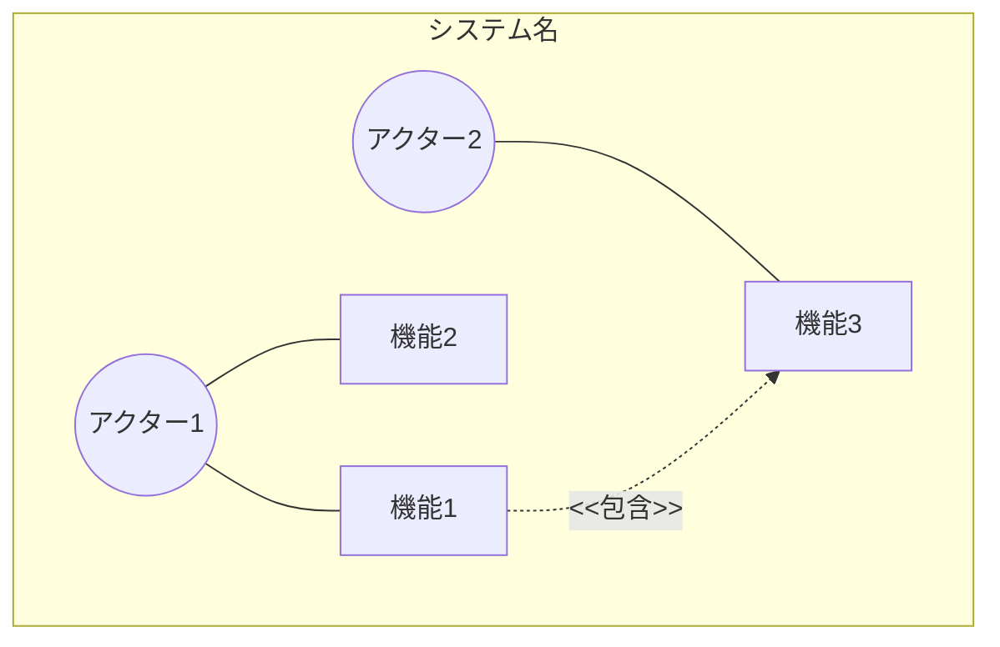
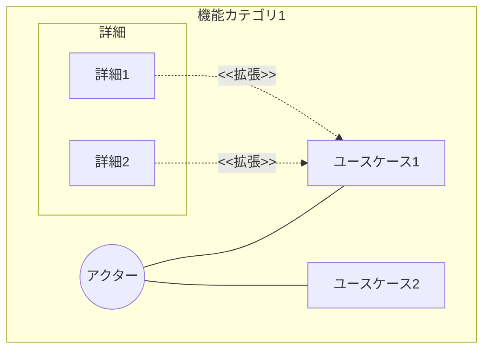
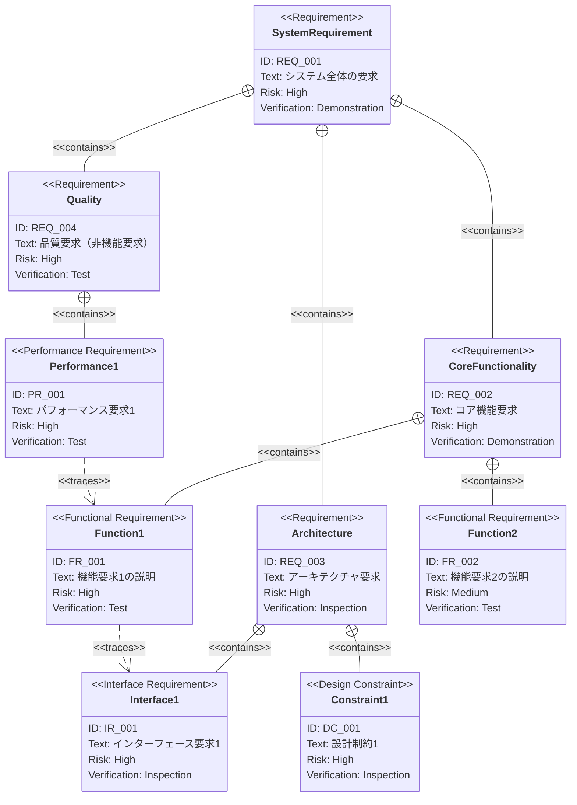
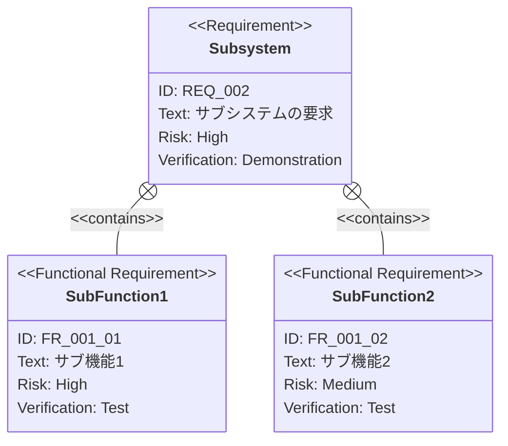

# PRD（要求仕様書）テンプレート

このドキュメントは `.sdd/requirement/` 配下のPRD（要求仕様書）を作成する際のテンプレートです。
ファイル名は `{機能名}.md` となります。

> **注意**: このテンプレートは `minimax-cli` 用にカスタマイズ済みです（`/constitution sync` 適用済み、
> 原則 v1.1.1 準拠）。プラグインの汎用テンプレートで上書きしないでください。
> 原則を改定したときは `/constitution sync` を再実行して同期します。

## 仕様書・設計書との違い

| ドキュメント             | SDDフェーズ          | 役割と焦点                                               | 抽象度      |
|--------------------|------------------|-----------------------------------------------------|----------|
| `requirement/*.md` | **Specify（仕様化）** | **「何を作るか」「なぜ作るか」** - ビジネス要求を定義。技術詳細は含めない            | 最高（抽象的）  |
| `xxx_spec.md`      | **Specify（仕様化）** | **「何を作るか」** - システムの抽象的な構造と振る舞いを定義。技術的詳細は含めない        | 高（抽象的）   |
| `xxx_design.md`    | **Plan（計画/設計）**  | **「どのように実現するか」** - 抽象仕様を実現するための具体的な技術設計。設計判断の透明性を確保 | 中〜低（具体的） |

---

# {機能名} 要求仕様書 `<MUST>`

## 概要 `<MUST>`

このドキュメントの目的と対象範囲を簡潔に説明します。

## 原則整合 `<MUST>`

このプロジェクトの非交渉原則は [CONSTITUTION.md](../CONSTITUTION.md)（v1.1.1）です。
要求を書く前に、最上位のビジネス原則との整合を確認します。
優先順位は **B-001 → B-002 → アーキテクチャ原則 → 開発手法原則 → 技術制約** です。

### ビジネス原則との整合チェック

- [ ] **B-001（認証情報を AI エージェントの到達範囲に置かない）**: この機能が扱う値に API トークンが
      含まれるか。含まれる場合、stdout・プロセス引数・ログ・環境変数のいずれにも載らない要求になっているか
- [ ] **B-001**: 値を引数で受け取るフラグ（`--token <VALUE>` 等）を要求していないか。受け口は stdin のみか
- [ ] **B-002（stdout は成果物専用）**: stdout への出力を要求する場合、それは成果物または機械可読な出力か。
      進捗・警告・エラーを stdout に出す要求になっていないか
- [ ] **B-002**: stdout へ書く経路を増やす場合、CONSTITUTION.md の**許可リストへの追記**を要求に含めたか
- [ ] **D-002（新機能は仕様書から始める）**: この PRD が D-002 の「必須」区分に該当するか確認したか
      （新規サブコマンド / 外部 API 連携 / 認証情報の扱いに関わる変更 / 配布ターゲットの増減 /
      既存サブコマンドの後方非互換な変更）

> **B-001 に関わる例外は認めません。** 整合しない要求は、実現手段ではなく**要求自体を見直します**。

### 参照する原則の明示 `<MUST>`

この PRD の要求が根拠とする原則 ID を列挙します。spec / design のトレーサビリティ表と対応させます。

| 原則 ID | 関係する要求 ID | 関係 |
|:---|:---|:---|
| [B-001] | [IR_001] | [この要求は B-001 を満たすために存在する / この要求は B-001 の制約を受ける] |

---

# 1. 要求図の読み方 `<RECOMMENDED>`

## 1.1. 要求タイプ

- **requirement**: 一般的な要求
- **functionalRequirement**: 機能要求
- **performanceRequirement**: パフォーマンス要求
- **interfaceRequirement**: インターフェース要求
- **designConstraint**: 設計制約

## 1.2. リスクレベル

- **High**: 高リスク（ビジネスクリティカル、実装困難）
- **Medium**: 中リスク（重要だが代替可能）
- **Low**: 低リスク（Nice to have）

## 1.3. 検証方法

- **Analysis**: 分析による検証
- **Test**: テストによる検証
- **Demonstration**: デモンストレーションによる検証
- **Inspection**: インスペクション（レビュー）による検証

## 1.4. 関係タイプ

- **contains**: 包含関係（親要求が子要求を含む）
- **derives**: 派生関係（要求から別の要求が導出される）
- **satisfies**: 満足関係（要素が要求を満たす）
- **verifies**: 検証関係（テストケースが要求を検証する）
- **refines**: 詳細化関係（要求をより詳細に定義する）
- **traces**: トレース関係（要求間の追跡可能性）

---

# 2. 要求一覧 `<MUST>`

## 2.1. ユースケース図（概要） `<RECOMMENDED>`

主要機能とアクターの関係を示す概要図です。

## 2.2. ユースケース図（詳細） `<OPTIONAL>`

### {機能カテゴリ1}

## 2.3. 機能一覧（テキスト形式） `<MUST>`

- 機能カテゴリ1
    - サブ機能1-1
        - 詳細1-1-1
        - 詳細1-1-2
    - サブ機能1-2
- 機能カテゴリ2
    - サブ機能2-1

---

# 3. 要求図（SysML Requirements Diagram） `<MUST>`

## 3.1. 全体要求図

## 3.2. 主要サブシステム詳細図 `<OPTIONAL>`

### {サブシステム名}

---

# 4. 要求の詳細説明 `<MUST>`

## 4.1. 機能要求

### FR_001: {機能要求名}

{機能の詳細な説明}

**含まれる機能:**

- FR_001_01: {サブ機能1}
- FR_001_02: {サブ機能2}

**検証方法:** テストによる検証

### FR_002: {機能要求名}

{機能の詳細な説明}

**検証方法:** テストによる検証

## 4.2. パフォーマンス要求 `<OPTIONAL>`

### PR_001: {パフォーマンス要求名}

{パフォーマンス要求の詳細な説明と目標値}

**検証方法:** テストによる検証

## 4.3. インターフェース要求 `<OPTIONAL>`

### IR_001: {インターフェース要求名}

{インターフェース要求の詳細な説明}

**検証方法:** インスペクションによる検証

## 4.4. 設計制約 `<OPTIONAL>`

### DC_001: {設計制約名}

{設計制約の詳細な説明}

**検証方法:** インスペクションによる検証

---

# 5. 制約事項 `<OPTIONAL>`

## 5.1. 技術的制約

- 技術的な制約

## 5.2. ビジネス的制約

- ビジネス的な制約（スケジュール、予算など）

---

# 6. 前提条件 `<OPTIONAL>`

- この機能が動作するための前提
- 依存する他システム・機能

---

# 7. スコープ外 `<OPTIONAL>`

以下は本PRDのスコープ外とします：

- この機能に含まれないこと
- 将来的に検討する可能性があるが、今回は対象外

---

# 8. 用語集 `<RECOMMENDED>`

> **注意**: 用語集が大きくなる場合は、別ファイル（`glossary.md`）として管理することを推奨します。

| 用語   | 定義   |
|------|------|
| [用語] | [定義] |

---

# セクション必須度の凡例

| マーク             | 意味 | 説明                 |
|-----------------|----|--------------------|
| `<MUST>`        | 必須 | すべてのPRDで必ず記載してください |
| `<RECOMMENDED>` | 推奨 | 可能な限り記載することを推奨します  |
| `<OPTIONAL>`    | 任意 | 必要に応じて記載してください     |

---

# ガイドライン

## 含めるべき内容

- ✅ 概要と目的
- ✅ ユースケース図（概要・詳細）
- ✅ SysML要求図（requirementDiagram構文）
- ✅ 要求の詳細説明（機能要求、パフォーマンス要求、インターフェース要求、設計制約）
- ✅ 要求間の関係（contains, derives, satisfies, verifies, refines, traces）
- ✅ 制約事項・前提条件
- ✅ スコープ外の明示
- ✅ 用語集

## 含めないべき内容（→ Spec / Design Doc へ）

- ❌ 技術的な実装詳細
- ❌ アーキテクチャ・モジュール構成
- ❌ クレートの選定と feature 指定（`Cargo.toml` の依存）→ Design Doc へ
- ❌ API定義・型定義（`thiserror` の variant 名、struct の形）→ Spec / Design Doc へ
- ❌ clap の属性・フラグの正確な綴り → Spec（真実は `src/cli.rs`）へ
- ❌ MiniMax API のリクエスト JSON の具体的なフィールド名 → Design Doc へ

> 要求としては「トークンの受け口は stdin のみ」と書き、`--token` を作らないという**手段**は
> Spec / Design Doc に落とします。ただし B-001 に直結する制約は要求（IR / DC）として明記します。

## 新規要件追加時の下流伝播チェックリスト

新規要件 ID（FR/PR/IR/DC 等）の追加・リネーム時に以下をすべて満たすこと：

- [ ] PRD 内の ID が昇順（`XX_001`, `XX_002`, ...）を保っている
- [ ] spec のトレーサビリティ表に対応行を追加した
- [ ] design のトレーサビリティ表に対応行を追加した
- [ ] ID 命名規約（プロジェクトで定義した規則。例: `FR_001`）を守っている
- [ ] requirement-analyzer エージェントを実行して整合確認した
- [ ] 3 層（PRD / spec / design）のトレース行が同一 PR に含まれている
- [ ] 「参照する原則の明示」表に、新規 ID が根拠とする原則 ID の行を追加した
- [ ] 追加した要求が B-001 / B-002 に触れる場合、CONSTITUTION.md の検証方法・許可リストを更新した

---

# このプロジェクトでの運用

`minimax-cli` 向けに以下を確定済みです。

1. **要求IDの命名規則**: `REQ_00X`（上位要求）/ `FR_00X`（機能要求）/ `PR_00X`（パフォーマンス要求）/
   `IR_00X`（インターフェース要求）/ `DC_00X`（設計制約）。プレフィックスは変えない
2. **PRD の分割単位**: 機能カテゴリごとに 1 ファイル（フラット構成）。`.sdd/requirement/` 直下に置き、
   サブディレクトリと `index.md` は使わない。CONSTITUTION.md の D-002 が仕様書を要求する単位
   （新規サブコマンド）と 1:1 で対応させる
3. **検証方法の使い分け**: 外形（終了コード・stdout / stderr の出し分け）は `Test`（D-001 が結合テストを
   要求するため）、原則準拠は `Inspection`、CLI の利用体験は `Demonstration`
4. **アクター**: 「利用者（人間）」と「AI エージェント」を必ず分けて描く。両者で stdout の扱いが
   変わることが B-002 の根拠であり、要求図でそれが見えている必要がある
5. **用語集**: PRD 内に含める（別ファイル化しない）。MiniMax API 側の用語（`voice_id`, `t2a`,
   `base_resp` 等）は初出の PRD で定義し、他の PRD からはその PRD を参照する。
   **参照する側の用語集にも 1 行を置く**（「詳細は〜を参照」）。参照行が無いと、
   その PRD だけを読んだ人が定義に到達できない
6. **front matter の `tags` と `category`**: `tags` は**アルファベット順**に並べる（diff ノイズを避けるため）。
   B-001 に直結する要求を持つ PRD には必ず `security` を含める。
   `category` は**関心の種類**を 1 語で表す（`credential` / `synthesis` 等）。
   技術名（`tts` / `keychain` 等）は `category` ではなく `tags` に入れる
7. **`contains` と `traces` の使い分け**: `contains` は**要求の階層**（上位要求が下位要求を含む）に使い、
   `traces` は階層を跨ぐ**参照関係**に使う。
   **すべての要求（FR / PR / IR / DC）が `contains` の親を 1 つ持つ**状態にする。
   `traces` の着地点にしかなっていない要求は、階層から孤立していて抜けに気づけない

---

**このPRDは、AIエージェントが仕様化（Specify）フェーズで参照する、ビジネス要求の真実の源となります。**
