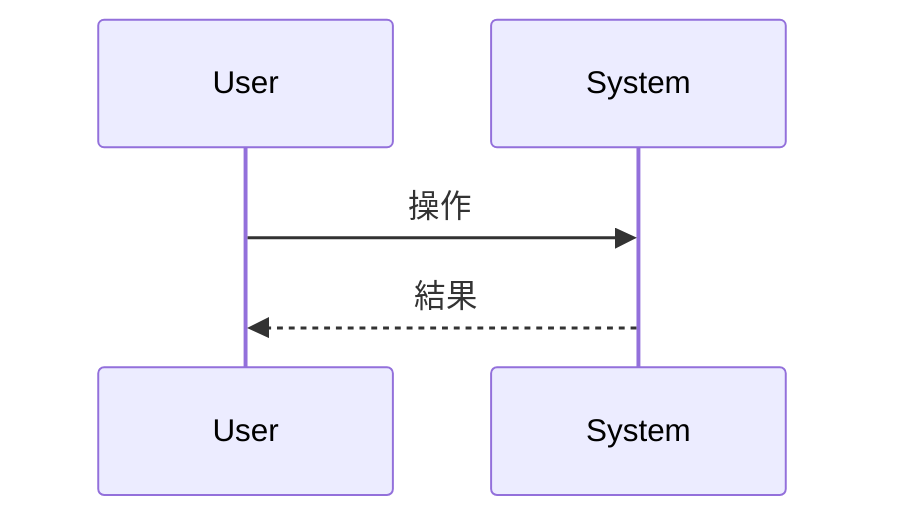

# 抽象仕様書テンプレート

このドキュメントは `.sdd/specification/` 配下の抽象仕様書を作成する際のテンプレートです。
ファイル名は `{機能名}_spec.md` となります。

> **注意**: このテンプレートは `minimax-cli`（Rust CLI）用にカスタマイズ済みです
> （`/constitution sync` 適用済み、原則 v1.1.1 準拠）。プラグインの汎用テンプレートで上書きしないでください。
> 原則を改定したときは `/constitution sync` を再実行して同期します。

## 技術設計書との違い

| ドキュメント          | SDDフェーズ          | 役割と焦点                                               | 抽象度      |
|-----------------|------------------|-----------------------------------------------------|----------|
| `xxx_spec.md`   | **Specify（仕様化）** | **「何を作るか」「なぜ作るか」** - システムの抽象的な構造と振る舞いを定義。技術的詳細は含めない | 高（抽象的）   |
| `xxx_design.md` | **Plan（計画/設計）**  | **「どのように実現するか」** - 抽象仕様を実現するための具体的な技術設計。設計判断の透明性を確保 | 中〜低（具体的） |

---

# {機能名} `<MUST>`

**関連 Design Doc:** [xxx_design.md へのリンク]
**関連 PRD:** [requirement/{機能名}.md へのリンク]

---

# 1. 背景 `<MUST>`

なぜこの機能が必要なのかを説明します。

# 2. 概要 `<MUST>`

機能の目的と主要な設計原則を説明します。
**技術的な実装詳細は含めず、「何を実現するか」に焦点を当てます。**

# 3. 原則への言及 `<MUST>`

この仕様が [CONSTITUTION.md](../CONSTITUTION.md)（v1.1.1）のどの原則に従って設計されているかを明記します。
**原則 ID を書くだけでは不十分で、この機能において原則が具体的に何を意味するかを書きます。**

## 3.1. 適用する原則

| 原則 ID | この仕様における意味 | 対応する要求 ID |
|:---|:---|:---|
| [B-001] | [例: トークンは stdin からのみ受け取り、`SecretString` で保持して Display / Debug を封じる] | [IR_001] |
| [B-002] | [例: 成果物のパスのみ stdout に 1 行。それ以外の出力はすべて stderr] | [IR_002] |
| [A-001] | [例: プロセス環境と keychain の読み取りは境界の型に閉じ、解決ロジックには値を引数で渡す] | [DC_001] |
| [T-001] | [例: 失敗はすべて型付きエラーで表現し、`unwrap` / `expect` を使わない] | [DC_002] |

## 3.2. stdout / stderr の出し分け `<MUST>`

B-002 は非交渉です。この機能が書き込む出力をすべて列挙します。

| 出力内容 | 出力先 | 根拠 |
|:---|:---|:---|
| [例: 生成した音声ファイルのパス] | stdout（1 行） | 成果物。CONSTITUTION.md の許可リストに記載 |
| [例: 進捗・警告・エラー] | stderr | B-002 |

- [ ] stdout へ書く経路が CONSTITUTION.md の**許可リスト**に載っている（載っていない経路を増やす場合は
      同じ PR で許可リストへ追記する）
- [ ] **失敗時に stdout が空**であることを結合テストで固定する要求になっている（D-001）

## 3.3. 原則からの逸脱 `<OPTIONAL>`

原則に従えない箇所がある場合のみ記載します。**B-001 に関わる逸脱は認められません。**

| 原則 ID | 逸脱内容 | 理由 | 補償手段 | 解消条件 |
|:---|:---|:---|:---|:---|
| [DC] | [内容] | [理由] | [補償] | [条件] |

# 4. 要求定義 `<RECOMMENDED>`

## 4.1. トレーサビリティ `<MUST>`

PRD の要求 ID とこの仕様の対応を示します。

| PRD の要求 ID | この仕様での実現箇所 | 検証方法 |
|:---|:---|:---|
| [FR_001] | [セクション番号 / API 名] | [結合テスト / 単体テスト / レビュー] |

## 4.2. 機能要件 (Functional Requirements)

| ID     | 要件   | 優先度 | 根拠   |
|--------|------|-----|------|
| FR-001 | [要件] | 必須  | [理由] |

## 4.3. 非機能要件 (Non-Functional Requirements) `<OPTIONAL>`

| ID      | カテゴリ | 要件   | 目標値  |
|---------|------|------|------|
| NFR-001 | 性能   | [要件] | [目標] |

> **カバレッジの数値目標は書かないでください。** CONSTITUTION.md は計測を導入していない数値目標を
> 原則・要求に含めない方針です（メトリクス節の未設定項目として扱う）。

# 5. CLI インターフェース `<MUST>`

利用者から見た CLI の外形を定義します。**真実の源は `src/cli.rs`** なので、実装後に食い違ったら
こちらを直します。

## 5.1. サブコマンドとフラグ

| サブコマンド | フラグ / 引数 | 必須 | 説明（英語で書く。`--help` にそのまま出る） |
|:---|:---|:---|:---|
| [`tts`] | [`--voice <ID>`] | 必須 | [Voice ID to synthesize with] |

## 5.2. 終了コード `<MUST>`

D-001 が結合テストでの固定を要求します。

| 状況 | 終了コード | stdout | stderr |
|:---|:---|:---|:---|
| [成功] | 0 | [成果物のパス 1 行] | [ログのみ] |
| [失敗] | 1 | **空** | [エラーメッセージ] |

# 6. 公開 API `<MUST>`

lib 側の公開 API を表形式で記載します。

| モジュール（`src/*.rs`） | 型 / 関数 | 可視性 | 概要 |
|:---|:---|:---|:---|
| [`logging`] | [`LogEnv::from_process`] | `pub` | [プロセス環境からログ設定を読む境界] |

## 6.1. 型定義 `<OPTIONAL>`

```rust
/// 認証情報を保持する型。Display / Debug は封じる（B-001）。
pub struct ApiToken(secrecy::SecretString);

/// ライブラリ層のエラー。バイナリ層が anyhow で受けて終了コードに変換する。
#[derive(Debug, thiserror::Error)]
pub enum Error {
    /// トークンが未登録。利用者には `minimax auth login` を案内する。
    #[error("no API token is registered")]
    TokenNotFound,
}
```

> **`unwrap()` / `expect()` を含む例を書かないでください**（T-001）。`Option` / `Result` を
> 素直に伝播させる形で示します。

# 7. 用語集 `<OPTIONAL>`

| 用語   | 説明   |
|------|------|
| [用語] | [説明] |

# 8. 使用例 `<RECOMMENDED>`

利用者が実際に打つコマンドを示します。**トークンの実値を例に含めないでください**（B-001）。

```sh
# 認証情報の登録（受け口は stdin のみ。--token フラグは作らない）
pbpaste | minimax auth login --region global

# 生成
minimax tts --voice <VOICE_ID> --model <MODEL> --output out.mp3 "読み上げるテキスト"
```

# 9. 振る舞い図 `<OPTIONAL>`

Mermaid形式で振る舞いを記述します。



# 10. 制約事項 `<OPTIONAL>`

ビジネス制約や技術的制約を記載します。

---

# セクション必須度の凡例

> **Note:** これらのマーカーはセクションの必須度を示す著者向けのガイド表記です。生成するドキュメントからは除去してください — 最終成果物に残してはいけません。

| マーク             | 意味 | 説明                 |
|-----------------|----|--------------------|
| `<MUST>`        | 必須 | すべての仕様書で必ず記載してください |
| `<RECOMMENDED>` | 推奨 | 可能な限り記載することを推奨します  |
| `<OPTIONAL>`    | 任意 | 必要に応じて記載してください     |

---

# ガイドライン

## 含めるべき内容

- ✅ 機能の目的と背景
- ✅ **原則への言及（どの原則に従い、この機能で何を意味するか）**
- ✅ **stdout / stderr の出し分けの全列挙**
- ✅ **CLI の外形（サブコマンド・フラグ・終了コード）**
- ✅ ユーザーストーリー・ユースケース
- ✅ 公開API（インターフェース）の定義
- ✅ データモデルの論理構造
- ✅ 振る舞いの抽象的な記述
- ✅ 機能要件・非機能要件
- ✅ 用語集

## 含めないべき内容（→ Design Doc へ）

- ❌ 実装ステータス・進捗
- ❌ 技術スタックの選定理由（クレート名・feature 指定・バージョン）
- ❌ アーキテクチャ・モジュール構成
- ❌ 実装パターン・デザインパターンの適用
- ❌ ディレクトリ構造・ファイル配置
- ❌ テスト戦略
- ❌ 設計判断の記録
- ❌ 変更履歴・移行ガイド
- ❌ **カバレッジの数値目標**（CONSTITUTION.md が計測未導入のため要求にしない）
- ❌ **トークンの実値を含む例**（B-001）

---

# このプロジェクトでの運用

`minimax-cli`（Rust CLI）向けに以下を確定済みです。

1. **型定義の記法**: Rust（```` ```rust ````）。`unwrap()` / `expect()` を含む例は書かない（T-001）
2. **使用例の記法**: シェル（```` ```sh ````）。実際に打つコマンドを示し、トークンの実値は含めない
3. **API 表のカラム**: `モジュール（src/*.rs）` / `型 / 関数` / `可視性` / `概要`。
   crate は単一なのでパッケージ列は持たない
4. **CLI の説明文の言語**: `--help` に出る文字列（サブコマンド・フラグの説明・エラーメッセージ）は**英語**。
   仕様書本文と表のヘッダは日本語（`.sdd-config.json` の `lang: ja`）
5. **リンク形式**: ファイルは `[ファイル名.md](相対パス)`、ディレクトリは `[ディレクトリ名](相対パス/index.md)`
   （`.claude/rules/ai-sdd-instructions.md` の規約）
6. **9 節（振る舞い図）で使う図の種類**: `sequenceDiagram`（正常系・異常系の経路）と
   `stateDiagram-v2`（状態遷移。特に「失敗時に成果物を残さない」等の不変条件）を使う。
   データ構造図（bdd 相当）は 6 節の Rust 型定義で代替し、アクティビティ図（act 相当）は
   本節の sequence / state 図で代替する。単一クレート・単一プロセスの CLI であり、
   bdd / act 専用の図を別途起こす価値が低いための判断（実装量ではなく、この構成での
   情報の重複を避けるための判断）
