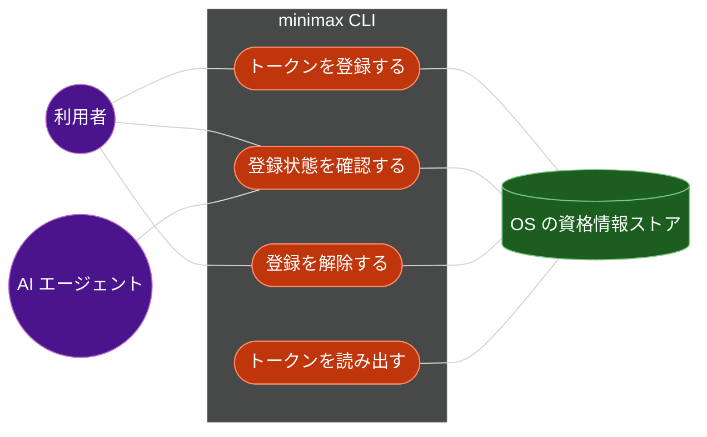
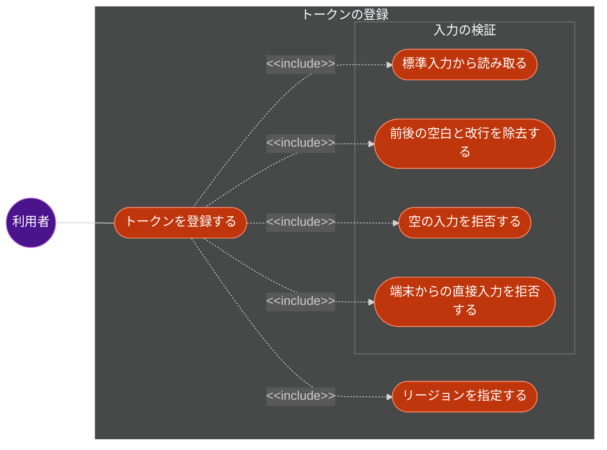
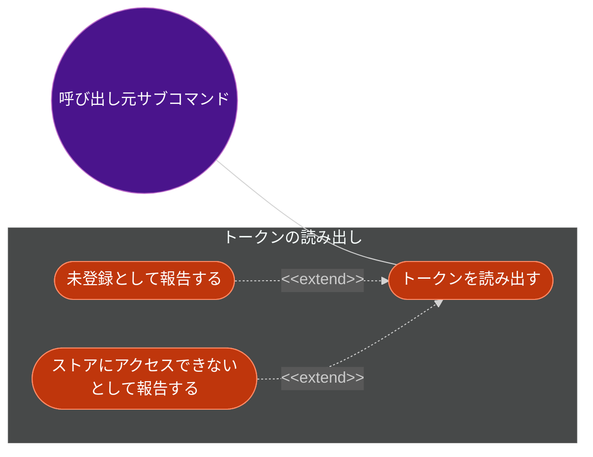
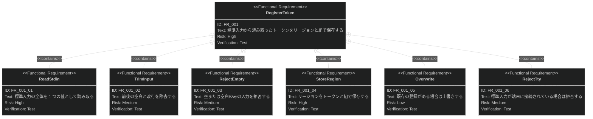

# 認証情報管理 要求仕様書

## 概要

MiniMax API のトークンを OS のセキュアな保存領域に登録・確認・解除する機能の要求を定義します。

このプロジェクトの存在理由は **認証情報の非露出** です。本 PRD が扱う範囲は、その中核である
「トークンを AI エージェントの到達範囲に置かずに保持し、CLI プロセス内でだけ読み出す」仕組みです。
音声合成そのものの要求は [tts-synthesis.md](tts-synthesis.md) が扱います。

対象は `minimax auth` 配下のサブコマンド（`login` / `status` / `logout`）と、
他のサブコマンドがトークンを読み出す内部インターフェースです。

## 原則整合

このプロジェクトの非交渉原則は [CONSTITUTION.md](../CONSTITUTION.md)（v1.1.1）です。
優先順位は **B-001 → B-002 → アーキテクチャ原則 → 開発手法原則 → 技術制約** です。

### ビジネス原則との整合チェック

- [x] **B-001（認証情報を AI エージェントの到達範囲に置かない）**: 本 PRD は API トークンそのものを扱う。
      トークンを stdout・プロセス引数・ログ・環境変数のいずれにも載せない要求（IR_001 / DC_002 / DC_005）を明記した
- [x] **B-001**: 値を引数で受け取るフラグを要求していない。受け口は標準入力のみ（IR_001）
- [x] **B-002（stdout は成果物専用）**: stdout に出すのは `auth status` の**リージョン 1 行のみ**で、
      これは機械可読な出力に該当する（IR_002）。進捗・警告・エラーはすべて stderr
- [x] **B-002**: stdout へ書く経路を 1 つ増やすため、本 PRD の実装 PR で
      CONSTITUTION.md の**許可リストへ追記する**ことを要求に含めた（IR_002）
- [x] **D-002（新機能は仕様書から始める）**: 新規サブコマンドの追加であり、かつ認証情報の扱いに
      関わる変更のため、D-002 の「必須」区分に該当する

> **B-001 に関わる例外は認めません。** 整合しない要求は、実現手段ではなく要求自体を見直します。

### 参照する原則の明示

| 原則 ID | 関係する要求 ID | 関係 |
|:---|:---|:---|
| B-001 | IR_001, DC_002, DC_005 | これらの要求は B-001 を満たすために存在する |
| B-002 | IR_002 | この要求は B-002 の制約を受ける（許可リストへの追記が必須） |
| A-001 | DC_006 | この要求は A-001 を満たすために存在する |
| A-002 | DC_001 | この要求は A-002 を満たすために存在する |
| D-001 | FR_001〜FR_005, IR_002, IR_003 | 各要求の検証方法が D-001 の結合テストに対応する |
| D-002 | （PRD 全体） | この PRD の存在自体が D-002 の「必須」区分への対応である |
| T-001 | DC_003 | この要求は T-001 を満たすために存在する |

---

# 1. 要求図の読み方

## 1.1. 要求タイプ

- **requirement**: 一般的な要求
- **functionalRequirement**: 機能要求
- **performanceRequirement**: パフォーマンス要求
- **interfaceRequirement**: インターフェース要求
- **designConstraint**: 設計制約

## 1.2. リスクレベル

- **High**: 高リスク（ビジネスクリティカル、実装困難）
- **Medium**: 中リスク（重要だが代替可能）
- **Low**: 低リスク（Nice to have）

## 1.3. 検証方法

- **Analysis**: 分析による検証
- **Test**: テストによる検証
- **Demonstration**: デモンストレーションによる検証
- **Inspection**: インスペクション（レビュー）による検証

## 1.4. 関係タイプ

- **contains**: 包含関係（親要求が子要求を含む）
- **derives**: 派生関係（要求から別の要求が導出される）
- **satisfies**: 満足関係（要素が要求を満たす）
- **verifies**: 検証関係（テストケースが要求を検証する）
- **refines**: 詳細化関係（要求をより詳細に定義する）
- **traces**: トレース関係（要求間の追跡可能性）

---

# 2. 要求一覧

## 2.1. ユースケース図（概要）

**AI エージェントが「トークンを登録する」に接続していないことが、この機能の設計意図です。**
AI エージェントはトークンの値を持たないため登録できません。エージェントに許すのは
「登録されているか」の確認（UC2）と、内部的な読み出し（UC4、`tts` 実行時に CLI プロセス内で起きる）だけです。

### アクター

| アクター | 説明 | この機能での役割 |
|:---|:---|:---|
| 利用者（人間） | `platform.minimax.io` で API キーを取得した開発者 | トークンを登録・確認・解除する。トークンの値を知っている唯一の主体 |
| AI エージェント | Claude Code 等。CLI をシェル経由で実行する | 登録状態を確認する。トークンの値には到達できない |
| OS の資格情報ストア | macOS Keychain / Windows Credential Manager / Linux kernel keyring | トークンの保存先（外部システム） |

### ユースケース

| ID | ユースケース | アクター | 概要 |
|:---|:---|:---|:---|
| UC1 | トークンを登録する | 利用者 | 標準入力から受け取ったトークンをリージョンと組で保存する |
| UC2 | 登録状態を確認する | 利用者 / AI エージェント | 登録の有無とリージョンを確認する。トークンの値は返さない |
| UC3 | 登録を解除する | 利用者 | 保存済みのトークンを削除する |
| UC4 | トークンを読み出す | （内部） | 他のサブコマンドが API 呼び出しのために読み出す |

## 2.2. ユースケース図（詳細）

### トークンの登録

### 失敗の識別

**この 2 つを区別することが要求です。** 同じ失敗として扱うと、ストアが読めなかった場合に
「未登録」と誤って報告し、認証情報を持たないまま処理を続行する事故につながります
（同種の不具合が他の CLI で現に発生しています。詳細は FR_005 を参照）。

## 2.3. 機能一覧（テキスト形式）

- 認証情報の登録
    - 標準入力からのトークン読み取り
        - 前後の空白・改行の除去
        - 空・空白のみの入力の拒否
        - 端末からの直接入力の拒否
    - リージョンの指定と保存
    - 既存の登録の上書き
- 認証情報の確認
    - 登録の有無の判定
    - 登録済みリージョンの出力
- 認証情報の解除
    - 保存済みトークンの削除
    - 未登録時の冪等な扱い
- 認証情報の読み出し（内部インターフェース）
    - トークンとリージョンの組の取得
    - 未登録とストアアクセス失敗の区別

---

# 3. 要求図（SysML Requirements Diagram）

## 3.1. 全体要求図

```mermaid
%%{init: {'theme': 'dark'}}%%
requirementDiagram
    requirement CredentialManagement {
        id: REQ_001
        text: "MiniMax API トークンを AI エージェントに露出させずに管理する"
        risk: high
        verifymethod: demonstration
    }

    requirement TokenLifecycle {
        id: REQ_002
        text: "トークンの登録・確認・解除・読み出しを提供する"
        risk: high
        verifymethod: test
    }

    requirement NonExposure {
        id: REQ_003
        text: "認証情報を AI エージェントの到達範囲に置かない"
        risk: high
        verifymethod: inspection
    }

    requirement FailureIdentifiability {
        id: REQ_004
        text: "失敗の原因を呼び出し元と利用者が識別できる"
        risk: high
        verifymethod: test
    }

    functionalRequirement RegisterToken {
        id: FR_001
        text: "標準入力から読み取ったトークンをリージョンと組で保存する"
        risk: high
        verifymethod: test
    }

    functionalRequirement ShowStatus {
        id: FR_002
        text: "登録の有無と登録済みリージョンを確認できる"
        risk: medium
        verifymethod: test
    }

    functionalRequirement RemoveToken {
        id: FR_003
        text: "保存済みトークンを削除できる"
        risk: medium
        verifymethod: test
    }

    functionalRequirement ReadToken {
        id: FR_004
        text: "他のサブコマンドがトークンとリージョンの組を読み出せる"
        risk: high
        verifymethod: test
    }

    functionalRequirement DistinguishFailure {
        id: FR_005
        text: "未登録とストアアクセス失敗を区別して報告する"
        risk: high
        verifymethod: test
    }

    interfaceRequirement StdinOnly {
        id: IR_001
        text: "トークンの受け口は標準入力のみとし、値を引数で受け取るフラグを設けない"
        risk: high
        verifymethod: inspection
    }

    interfaceRequirement StatusOutput {
        id: IR_002
        text: "登録済みリージョンを stdout に 1 行出力し、許可リストへ追記する"
        risk: medium
        verifymethod: test
    }

    interfaceRequirement ExitCodes {
        id: IR_003
        text: "登録状態と失敗の種別を終了コードで区別する"
        risk: medium
        verifymethod: test
    }

    designConstraint UseOsStore {
        id: DC_001
        text: "OS 標準の資格情報ストアを使い、独自の保存形式や暗号を作らない"
        risk: high
        verifymethod: inspection
    }

    designConstraint SealDebug {
        id: DC_002
        text: "トークンを保持する型の文字列表現に値が出ないようにする"
        risk: high
        verifymethod: inspection
    }

    designConstraint TypedFailure {
        id: DC_003
        text: "未登録とストアアクセス失敗を別のエラー型で表現する"
        risk: high
        verifymethod: inspection
    }

    designConstraint AcceptVolatileLinux {
        id: DC_004
        text: "Linux では再起動でトークンが失われることを許容し、利用者に明示する"
        risk: medium
        verifymethod: inspection
    }

    designConstraint NoEnvVarSource {
        id: DC_005
        text: "認証情報を環境変数から読まない"
        risk: high
        verifymethod: inspection
    }

    designConstraint BoundaryIsolation {
        id: DC_006
        text: "資格情報ストアへのアクセスを境界層に閉じ、解決ロジックには値を引数で渡す"
        risk: medium
        verifymethod: inspection
    }

    designConstraint KeepMsrv {
        id: DC_007
        text: "依存の追加で MSRV を引き上げない"
        risk: medium
        verifymethod: test
    }

    CredentialManagement - contains -> TokenLifecycle
    CredentialManagement - contains -> NonExposure
    CredentialManagement - contains -> FailureIdentifiability
    CredentialManagement - contains -> BoundaryIsolation
    CredentialManagement - contains -> KeepMsrv
    TokenLifecycle - contains -> RegisterToken
    TokenLifecycle - contains -> ShowStatus
    TokenLifecycle - contains -> RemoveToken
    TokenLifecycle - contains -> ReadToken
    TokenLifecycle - contains -> UseOsStore
    TokenLifecycle - contains -> StatusOutput
    TokenLifecycle - contains -> AcceptVolatileLinux
    FailureIdentifiability - contains -> DistinguishFailure
    FailureIdentifiability - contains -> TypedFailure
    FailureIdentifiability - contains -> ExitCodes
    NonExposure - contains -> StdinOnly
    NonExposure - contains -> SealDebug
    NonExposure - contains -> NoEnvVarSource
    RegisterToken - traces -> StdinOnly
    RegisterToken - traces -> BoundaryIsolation
    ShowStatus - traces -> StatusOutput
    ShowStatus - traces -> ExitCodes
    ShowStatus - traces -> BoundaryIsolation
    RemoveToken - traces -> ExitCodes
    RemoveToken - traces -> BoundaryIsolation
    ReadToken - traces -> DistinguishFailure
    ReadToken - traces -> BoundaryIsolation
    UseOsStore - traces -> AcceptVolatileLinux
    UseOsStore - traces -> KeepMsrv
```

## 3.2. 主要サブシステム詳細図

### トークンの登録

---

# 4. 要求の詳細説明

## 4.1. 機能要求

### FR_001: トークンの登録

利用者が `minimax auth login --region <REGION>` を実行し、標準入力からトークンを渡すと、
そのトークンとリージョンを OS の資格情報ストアに保存します。

**含まれる機能:**

- **FR_001_01: 標準入力からの読み取り** — 標準入力の内容全体を 1 つのトークンとして読み取ります。
- **FR_001_02: 前後の空白と改行の除去** — `echo` やクリップボード経由の入力には末尾の改行が付くため、
  前後の空白文字を除去します。除去しないと保存された値が API 側で無効になり、
  原因の分かりにくい認証エラーになります。
- **FR_001_03: 空・空白のみの入力の拒否** — 除去した結果が空になる入力を拒否します。
  空文字を保存すると、以降の実行が「登録済みだが認証に失敗する」状態になり、
  未登録と区別できなくなります（REQ_004 に反する）。
- **FR_001_04: リージョンの保存** — MiniMax はグローバル版と中国本土版で API ホストが分かれており、
  **API キーとホストが一致しないと認証エラーになります**。トークン単体を保存すると
  「キーは正しいがホストが違う」状態を検出できないため、リージョンをトークンと組で保存します。
- **FR_001_05: 既存の登録の上書き** — 既に登録がある場合は確認を求めずに上書きします。
  対話的な確認は AI エージェントから実行されたときに応答できずハングするため設けません。
  上書きが起きたことは stderr に警告として出します。
- **FR_001_06: 端末からの直接入力の拒否** — 標準入力が端末に接続されている場合は、
  トークンを読み取らずにエラーで終了し、パイプでの渡し方を案内します。
  端末から直接入力させるとトークンが画面とスクロールバックに残るため、
  入力のエコーを抑止する仕組みが必要になります。それは追加の依存を要し、v0.1.0 の範囲を超えます。

**検証方法:** テストによる検証（結合テストで終了コードと stdout / stderr の出し分けを固定する）

### FR_002: 登録状態の確認

`minimax auth status` で、トークンが登録されているかと、登録済みのリージョンを確認できます。
**トークンの値そのものは出力しません**（B-001）。

- 登録済みの場合: リージョンを stdout に 1 行出力し、終了コード 0 で終了します（IR_002）
- 未登録の場合: stdout には何も出力せず、案内を stderr に出して終了コード 1 で終了します
- ストアにアクセスできない場合: FR_005 に従い、未登録とは区別して報告します

**検証方法:** テストによる検証

### FR_003: 登録の解除

`minimax auth logout` で保存済みのトークンを削除します。
未登録の状態で実行した場合も**成功として扱います**（冪等）。「削除されている」という
目的が達成されているためです。ただし削除対象が無かったことは stderr に出します。

**検証方法:** テストによる検証

### FR_004: トークンの読み出し

他のサブコマンド（`tts` 等）が、API を呼び出すためにトークンとリージョンの組を読み出します。
これは CLI プロセス内部のインターフェースであり、**利用者向けのサブコマンドとしては公開しません**。
トークンを標準出力に出すサブコマンドを作らないことは B-001 の要求です。

**検証方法:** テストによる検証

### FR_005: 未登録とストアアクセス失敗の区別

トークンの読み出しが失敗したとき、原因を次の 2 つに区別して報告します。

| 失敗の種別 | 意味 | 利用者への案内 |
|:---|:---|:---|
| 未登録 | ストアにアクセスできたが、エントリが存在しない | 登録コマンドを案内する |
| ストアアクセス失敗 | ストア自体にアクセスできなかった | 原因の区分（ストアが利用できない / 権限が不足している / Linux で再起動によりキーリングが失われた）を提示する |

**この区別は必須です。** 両者を同じ失敗として扱うと、ストアが読めなかった場合に「未登録」と
誤って報告することになります。さらに危険なのは、読み取りエラーを捨てて処理を続行する実装で、
**認証情報を持たないまま API リクエストを送る**という不具合につながります。
実際に他の広く使われている CLI で、資格情報ストアの読み取り失敗時に認証ヘッダなしで
リクエストを送る不具合が報告されています（原因は読み取りエラーを破棄していたこと）。
本要求はその再発を設計段階で防ぐためのものです。

いずれの場合も API リクエストは送りません。

**検証方法:** テストによる検証

## 4.2. パフォーマンス要求

**該当なし。** 本機能に測定可能なパフォーマンス目標は設定しません。資格情報ストアへのアクセスは
1 回の CLI 実行につき 1 回であり、利用者が体感する遅延の主因は API 呼び出し側にあります。
CONSTITUTION.md の方針に従い、計測を導入していない数値目標は要求に含めません。

## 4.3. インターフェース要求

### IR_001: 受け口は標準入力のみ

トークンの受け口を標準入力に限定し、`--token <VALUE>` のように**値を引数で受け取るフラグを設けません**。

理由は 2 つあります。プロセス引数は同一ホストの他プロセスから読み取れること、そして
AI エージェントがコマンドを組み立てると**トークンが会話ログに永久に残る**ことです。
後者はこのプロジェクトが解こうとしている問題そのものです。

なお、標準入力がトークンの受け口であるのは**本 PRD のスコープ内に限られます**。
他のサブコマンドでは標準入力が別の意味を持ちます（`tts` では読み上げ対象のテキスト）。
この多義性は仕様書で明示的に切り分けます。詳細は [tts-synthesis.md](tts-synthesis.md) を参照してください。

**検証方法:** インスペクションによる検証

### IR_002: `auth status` の出力先と許可リストへの追記

`auth status` は登録済みリージョンを **stdout に 1 行**出力します。これは B-002 が
stdout に許す「機械可読な出力」に該当します。それ以外の出力（案内・警告・エラー）はすべて stderr です。

この機能は stdout へ書く経路を 1 つ増やすため、**実装 PR で CONSTITUTION.md の
「stdout への許可リスト」へ追記することを本要求に含めます**。追記を伴わない実装は B-002 違反です。

**検証方法:** テストによる検証（成功時の stdout が 1 行であること、失敗時に stdout が空であること）

### IR_003: 終了コード

| 状況 | 終了コード | stdout |
|:---|:---|:---|
| `auth login` 成功 | 0 | 空 |
| `auth status` 登録済み | 0 | リージョン 1 行 |
| `auth status` 未登録 | 1 | 空 |
| `auth logout` 成功（未登録の場合も含む） | 0 | 空 |
| 入力の検証エラー・ストアアクセス失敗 | 1 | 空 |

失敗時に stdout が空であることは D-001 が結合テストでの固定を要求します。

**検証方法:** テストによる検証

## 4.4. 設計制約

### DC_001: OS 標準の資格情報ストアを使う

保存先は OS が提供する資格情報ストアとし、独自のファイル形式・独自の暗号・平文ファイルを使いません（A-002）。

**検証方法:** インスペクションによる検証

### DC_002: トークンの文字列表現に値を出さない

トークンを保持する型は、文字列化・デバッグ出力のいずれでも値が出ないようにします。
書式指定でうっかりログに出す経路を**型のレベルで**塞ぐためです。エラーメッセージにも値を載せません。

実現手段（どの trait を封じるか、どのクレートを使うか）は仕様書と設計書で特定します。
CONSTITUTION.md は B-001 の準拠例として同じ趣旨を挙げています。

**検証方法:** インスペクションによる検証

### DC_003: 失敗を別のエラー型で表現する

FR_005 の区別を、実行時の分岐ではなく**型**で表現します。呼び出し側が区別を強制される形にします（T-001）。

**検証方法:** インスペクションによる検証

### DC_004: Linux での揮発性を許容し、明示する

Linux では、配布 4 ターゲット全てでビルドでき、かつ許可ライセンス・禁止クレートの制約を満たす
保存方式がカーネルキーリングに限られます。この方式は**再起動でトークンが失われます**。

本要求はこれを制約として受け入れます。ただし利用者が原因不明の未登録状態に見舞われないよう、
**両 README とエラーメッセージでこの挙動を明示する**ことを要求に含めます。
再起動を越えた永続化は本 PRD のスコープ外です（7 節）。

**検証方法:** インスペクションによる検証

### DC_005: 環境変数から認証情報を読まない

トークンを環境変数から読む経路を設けません。環境変数は子プロセスに継承されるため、
AI エージェントがシェルツールを実行すると読み取れてしまいます（B-001）。
ストアが読めなかった場合に環境変数へフォールバックすることも認めません。

**検証方法:** インスペクションによる検証

### DC_006: ストアへのアクセスを境界層に閉じる

資格情報ストアの読み書きは境界の型に集約し、判断ロジックには値を引数で渡します（A-001）。
ロジックがストアに直接触ると、テストが実行環境の資格情報ストアの状態に依存します。

**検証方法:** インスペクションによる検証

### DC_007: MSRV を引き上げない

本機能のために追加する依存は、現在の MSRV（`Cargo.toml` の `rust-version`）で動作するものに限ります。
MSRV の引き上げは本機能の目的とは無関係な変更であり、CI・両 README・`CLAUDE.md` の
記述をすべて揃える作業を伴うためです。

**検証方法:** テストによる検証（CI の MSRV ジョブ）

---

# 5. 制約事項

## 5.1. 技術的制約

- 資格情報ストアを扱う手段は、MSRV・許可ライセンス・禁止依存・配布ターゲット全体でのビルド可否を
  **すべて同時に満たすもの**に限られる。この制約が Linux の保存方式を実質的に決めている（DC_004）。
  採用する具体的な手段と各制約の一次情報は仕様書・設計書で特定する
- サプライチェーンに関する制約（許可ライセンス・禁止依存・依存の固定）は CONSTITUTION.md の
  「開発標準」と `CLAUDE.md` が一次情報であり、本 PRD では制約が存在することのみを述べる

> 詳細は DC_004（Linux での揮発性）と DC_007（MSRV の維持）に一本化しています。
> ここは制約の存在を示す要約に留めます。

## 5.2. ビジネス的制約

- 単独メンテナンスのため、プラットフォーム別の分岐は少ないほどよい
- crates.io へは publish しない。配布は GitHub Release のみ

---

# 6. 前提条件

- 利用者が [platform.minimax.io](https://platform.minimax.io/) で API キーを取得済みであること
- 利用者が自分の API キーがグローバル版と中国本土版のどちらのものか把握していること
- OS の資格情報ストアが利用可能であること
    - macOS: Keychain
    - Windows: Credential Manager
    - Linux: カーネルキーリング（再起動で失われる。DC_004）

---

# 7. スコープ外

以下は本 PRD のスコープ外とします。

- **登録時のトークン有効性検証** — 登録時に API を呼んでキーとリージョンの整合を確認することはしません。
  リージョン不一致は `tts` 実行時の認証エラーとして検出し、そのメッセージでリージョンの確認を促します
  （[tts-synthesis.md](tts-synthesis.md) 側の要求）
- **Linux での再起動を越えた永続化** — 外部コマンド（`secret-tool` / `pass` 等）への委譲による永続化は
  将来の拡張として検討します。v0.1.0 では DC_004 の制約を受け入れます
- **複数プロファイルの管理** — 複数の API キーを名前で切り替える機能は扱いません。登録は 1 組のみです
- **トークンのローテーション** — 有効期限の管理・自動更新は扱いません
- **環境変数によるトークンの受け渡し** — B-001 に反するため、将来も導入しません（DC_005）
- **音声合成そのものの要求** — [tts-synthesis.md](tts-synthesis.md) が扱います

---

# 8. 用語集

| 用語 | 定義 |
|:---|:---|
| API キー / トークン | MiniMax の API を呼び出すための認証情報。`platform.minimax.io` の Account > API Keys で取得する |
| リージョン | MiniMax の API ホストの系統。グローバル版と中国本土版があり、API キーとホストが一致しないと認証エラーになる |
| 資格情報ストア | OS が提供するシークレットの保存領域。macOS Keychain / Windows Credential Manager / Linux カーネルキーリング |
| カーネルキーリング | Linux カーネルが提供するプロセス外のシークレット保持機構。プロセスをまたいで参照できるが、**再起動で失われる** |
| 未登録 | 資格情報ストアにアクセスできたが、このアプリのエントリが存在しない状態 |
| ストアアクセス失敗 | 資格情報ストア自体にアクセスできなかった状態。未登録とは区別する（FR_005） |
| 端末（TTY） | 標準入力がキーボードに接続されている状態。パイプやリダイレクトの場合は端末ではない |
