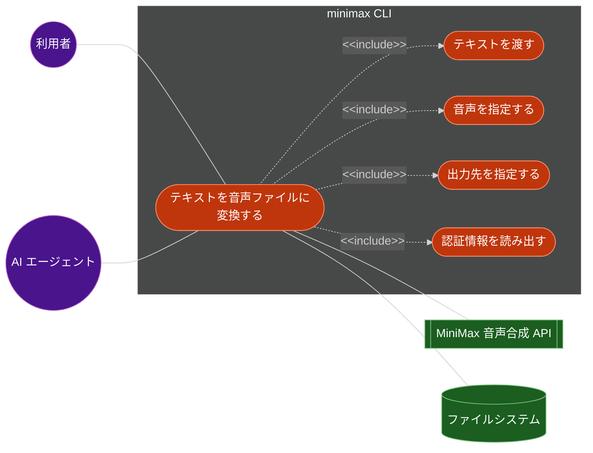
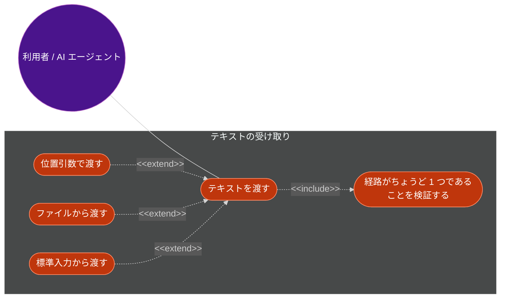
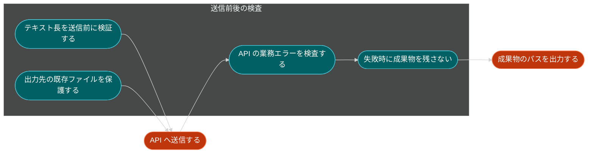
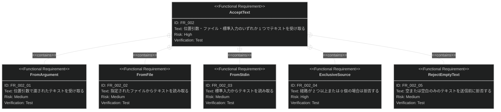
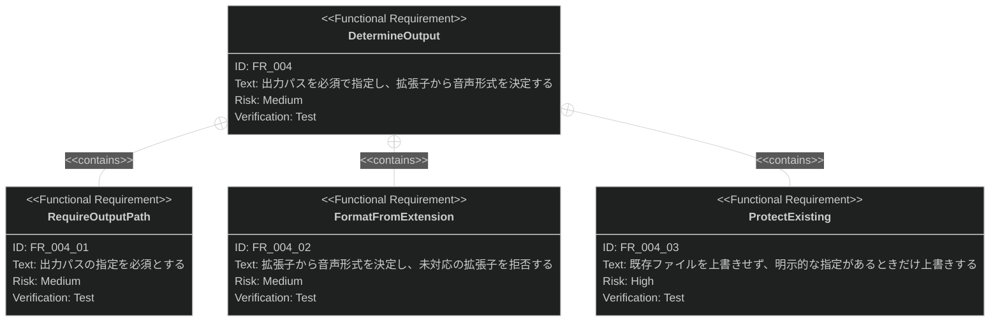
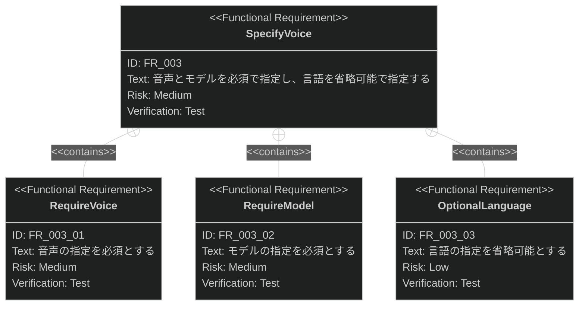

# 音声合成 要求仕様書

## 概要

テキストを MiniMax の音声合成 API に送り、読み上げ音声ファイルを生成する機能の要求を定義します。

このプロジェクトの目的は「AI エージェントに認証情報を渡さずに音声ファイルを生成すること」であり、
本 PRD はその**成果物を作る側**を扱います。認証情報の保存と読み出しは
[credential-management.md](credential-management.md) が扱い、本機能はそこから読み出したトークンを使います。

対象は `minimax tts` サブコマンドです。同期 API による 1 回の呼び出しで 1 つの音声ファイルを作る範囲に限り、
長文の分割・非同期 API・音声一覧の取得は扱いません（7 節）。

## 原則整合

このプロジェクトの非交渉原則は [CONSTITUTION.md](../CONSTITUTION.md)（v1.1.1）です。
優先順位は **B-001 → B-002 → アーキテクチャ原則 → 開発手法原則 → 技術制約** です。

### ビジネス原則との整合チェック

- [x] **B-001（認証情報を AI エージェントの到達範囲に置かない）**: 本機能はトークンを API リクエストの
      認証ヘッダに載せる。トークンを stdout・プロセス引数・ログ・エラーメッセージに出さない要求
      （IR_003 / DC_002 / DC_006）を明記した
- [x] **B-001**: 値を引数で受け取るフラグを要求していない。トークンは資格情報ストアからのみ取得する（IR_003）
- [x] **B-002（stdout は成果物専用）**: stdout に出すのは**生成した音声ファイルのパス 1 行のみ**（IR_001）。
      進捗・警告・エラーはすべて stderr。音声バイナリを stdout に流す要求は含めない
- [x] **B-002**: この経路は CONSTITUTION.md の許可リストに「（TTS 実装後）生成した音声ファイルのパス 1 行」として
      **既に記載済み**のため、追記は不要
- [x] **D-002（新機能は仕様書から始める）**: 新規サブコマンドの追加であり、かつ外部 API との連携のため、
      D-002 の「必須」区分に該当する

> **B-001 に関わる例外は認めません。** 整合しない要求は、実現手段ではなく要求自体を見直します。

### 参照する原則の明示

| 原則 ID | 関係する要求 ID | 関係 |
|:---|:---|:---|
| B-001 | IR_003, DC_002, DC_006 | これらの要求は B-001 を満たすために存在する |
| B-002 | IR_001 | この要求は B-002 の制約を受ける（許可リストに既載） |
| A-001 | DC_007 | この要求は A-001 を満たすために存在する |
| A-002 | DC_001 | この要求は A-002 を満たすために存在する |
| D-001 | FR_001〜FR_008, IR_001, IR_002 | 各要求の検証方法が D-001 の結合テストに対応する |
| D-002 | （PRD 全体） | この PRD の存在自体が D-002 の「必須」区分への対応である |
| T-001 | FR_006, DC_005, DC_008, DC_009 | これらの要求は T-001 を満たすために存在する |

---

# 1. 要求図の読み方

## 1.1. 要求タイプ

- **requirement**: 一般的な要求
- **functionalRequirement**: 機能要求
- **performanceRequirement**: パフォーマンス要求
- **interfaceRequirement**: インターフェース要求
- **designConstraint**: 設計制約

## 1.2. リスクレベル

- **High**: 高リスク（ビジネスクリティカル、実装困難）
- **Medium**: 中リスク（重要だが代替可能）
- **Low**: 低リスク（Nice to have）

## 1.3. 検証方法

- **Analysis**: 分析による検証
- **Test**: テストによる検証
- **Demonstration**: デモンストレーションによる検証
- **Inspection**: インスペクション（レビュー）による検証

## 1.4. 関係タイプ

- **contains**: 包含関係（親要求が子要求を含む）
- **derives**: 派生関係（要求から別の要求が導出される）
- **satisfies**: 満足関係（要素が要求を満たす）
- **verifies**: 検証関係（テストケースが要求を検証する）
- **refines**: 詳細化関係（要求をより詳細に定義する）
- **traces**: トレース関係（要求間の追跡可能性）

---

# 2. 要求一覧

## 2.1. ユースケース図（概要）

**利用者と AI エージェントが同じユースケースに接続していることが、この機能の要点です。**
[credential-management.md](credential-management.md) と違い、音声合成は AI エージェントに実行させたい操作です。
そのためエージェントが取り込む stdout の内容（IR_001）と、失敗時に stdout を汚さないこと（IR_002）が
要求として重要になります。「認証情報を読み出す」（UC5）は CLI プロセス内部で起きるため、
エージェントはトークンの値に到達しません。

### アクター

| アクター | 説明 | この機能での役割 |
|:---|:---|:---|
| 利用者（人間） | 読み上げ音声を作りたい開発者 | コマンドを実行し、生成された音声ファイルを使う |
| AI エージェント | Claude Code 等。CLI をシェル経由で実行する | コマンドを組み立てて実行し、stdout の成果物パスを次の処理に使う |
| MiniMax 音声合成 API | 外部 API（グローバル版 / 中国本土版） | テキストを音声データに変換する |
| ファイルシステム | ローカルのファイルシステム | 音声ファイルの書き出し先 |

### ユースケース

| ID | ユースケース | アクター | 概要 |
|:---|:---|:---|:---|
| UC1 | テキストを音声ファイルに変換する | 利用者 / AI エージェント | 同期 API を 1 回呼び、音声ファイルを 1 つ作る |
| UC2 | テキストを渡す | 利用者 / AI エージェント | 位置引数・ファイル・標準入力のいずれかで渡す |
| UC3 | 音声を指定する | 利用者 / AI エージェント | 音声・モデル・言語を指定する |
| UC4 | 出力先を指定する | 利用者 / AI エージェント | 出力パスを指定する。形式は拡張子から決まる |
| UC5 | 認証情報を読み出す | （内部） | 資格情報ストアからトークンとリージョンを読み出す |

## 2.2. ユースケース図（詳細）

### テキストの受け取り

### 課金と成果物を守るための検査

**API の課金は文字数ベースです。** 送信してから失敗するのではなく、送信前に落とせる検査
（テキスト長・出力先の衝突）を先に行うことが要求です（FR_005 / FR_004_03）。

## 2.3. 機能一覧（テキスト形式）

- テキストの受け取り
    - 位置引数からの受け取り
    - ファイルからの受け取り
    - 標準入力からの受け取り
    - 経路の排他検証
- 音声パラメータの指定
    - 音声の指定（必須）
    - モデルの指定（必須）
    - 言語の指定（省略可）
- 出力先の決定
    - 出力パスの指定（必須）
    - 拡張子からの音声形式の決定
    - 既存ファイルの保護
- 送信前の検証
    - テキスト長の上限検査
    - 空のテキストの拒否
- API 呼び出し
    - リージョンに応じたホストの選択
    - 認証ヘッダの付与
    - 業務エラーの検査
- 成果物の書き出し
    - 音声データのデコード
    - ファイルへの書き出し
    - 失敗時の後始末
    - 成果物パスの出力

> **「送信前の検証」はこの一覧では 1 グループですが、3.1 節の SysML 要求図では
> 異なる親に分かれます。** テキスト長の上限検査（`FR_005`）は `FailureAndCost` の子、
> 空のテキストの拒否（`FR_002_05`）はテキストの受け取り（`FR_002: AcceptText`）の子です。
> 両者とも「API を呼ぶ前に完結する検査」という機能上の役割は同じですが、
> 要求の出自（テキストの形式に関する検査か、コストに関する検査か）が異なるため、
> 要求図では親を分けています。この一覧はテキスト形式での概観であり、
> 要求 ID の親子関係の正は 3.1 節です。

---

# 3. 要求図（SysML Requirements Diagram）

## 3.1. 全体要求図

```mermaid
%%{init: {'theme': 'dark'}}%%
requirementDiagram
    requirement TtsSynthesis {
        id: REQ_001
        text: "テキストから読み上げ音声ファイルを生成する"
        risk: high
        verifymethod: demonstration
    }

    requirement CoreSynthesis {
        id: REQ_002
        text: "同期 API を 1 回呼び、音声ファイルを 1 つ作る"
        risk: high
        verifymethod: test
    }

    requirement OutputSafety {
        id: REQ_003
        text: "成果物と診断の出力が AI エージェントにとって安全であり、認証情報を漏らさない"
        risk: high
        verifymethod: test
    }

    requirement FailureAndCost {
        id: REQ_004
        text: "失敗を識別でき、無駄な課金と壊れた成果物を生まない"
        risk: high
        verifymethod: test
    }

    functionalRequirement Synthesize {
        id: FR_001
        text: "テキストを音声ファイルに変換する"
        risk: high
        verifymethod: test
    }

    functionalRequirement AcceptText {
        id: FR_002
        text: "位置引数・ファイル・標準入力のいずれか 1 つでテキストを受け取る"
        risk: high
        verifymethod: test
    }

    functionalRequirement SpecifyVoice {
        id: FR_003
        text: "音声とモデルを必須で指定し、言語を省略可能で指定する"
        risk: medium
        verifymethod: test
    }

    functionalRequirement DetermineOutput {
        id: FR_004
        text: "出力パスを必須で指定し、拡張子から音声形式を決定する"
        risk: medium
        verifymethod: test
    }

    functionalRequirement ValidateLength {
        id: FR_005
        text: "送信前にテキスト長の上限を検証する"
        risk: high
        verifymethod: test
    }

    functionalRequirement CheckApiError {
        id: FR_006
        text: "HTTP ステータスとは別に API の業務エラーを検査する"
        risk: high
        verifymethod: test
    }

    functionalRequirement WriteAudio {
        id: FR_007
        text: "音声データをデコードしてファイルに書き出す"
        risk: high
        verifymethod: test
    }

    functionalRequirement ReportPath {
        id: FR_008
        text: "生成した音声ファイルのパスを stdout に 1 行出力する"
        risk: high
        verifymethod: test
    }

    interfaceRequirement StdoutArtifactOnly {
        id: IR_001
        text: "stdout に出すのは成果物のパス 1 行のみとする"
        risk: high
        verifymethod: test
    }

    interfaceRequirement ExitCodes {
        id: IR_002
        text: "失敗時は終了コード 1 とし、stdout を空にする"
        risk: high
        verifymethod: test
    }

    interfaceRequirement CredentialFromStore {
        id: IR_003
        text: "トークンは資格情報ストアからのみ取得し、フラグや環境変数で受け取らない"
        risk: high
        verifymethod: inspection
    }

    designConstraint RustlsOnly {
        id: DC_001
        text: "TLS は rustls に固定し、native-tls 系を依存グラフに入れない"
        risk: high
        verifymethod: test
    }

    designConstraint HttpLogCeiling {
        id: DC_002
        text: "HTTP レイヤのログ上限を維持し、新しい HTTP クレートを上限の対象に追加する"
        risk: high
        verifymethod: test
    }

    designConstraint NoRetry {
        id: DC_003
        text: "失敗したリクエストを自動で再送しない"
        risk: medium
        verifymethod: inspection
    }

    designConstraint HostByRegion {
        id: DC_004
        text: "保存されたリージョンに対応する API ホストを選択する"
        risk: high
        verifymethod: test
    }

    designConstraint NoPartialArtifact {
        id: DC_005
        text: "失敗時に不完全な音声ファイルを残さない"
        risk: high
        verifymethod: test
    }

    designConstraint NoTokenInDiagnostics {
        id: DC_006
        text: "ログとエラーメッセージにトークンを載せない"
        risk: high
        verifymethod: inspection
    }

    designConstraint BoundaryIsolation {
        id: DC_007
        text: "API 呼び出しとファイル書き出しを境界層に閉じる"
        risk: medium
        verifymethod: inspection
    }

    designConstraint PreserveFailureKind {
        id: DC_008
        text: "認証情報の未登録とストアアクセス失敗の区別を保ったまま報告する"
        risk: high
        verifymethod: test
    }

    designConstraint TypedApiError {
        id: DC_009
        text: "API の業務エラー区分を型で表現し、呼び出し側に区別を強制する"
        risk: medium
        verifymethod: inspection
    }

    designConstraint KeepMsrv {
        id: DC_010
        text: "依存の追加で MSRV を引き上げない"
        risk: medium
        verifymethod: test
    }

    TtsSynthesis - contains -> CoreSynthesis
    TtsSynthesis - contains -> OutputSafety
    TtsSynthesis - contains -> FailureAndCost
    TtsSynthesis - contains -> BoundaryIsolation
    TtsSynthesis - contains -> KeepMsrv
    CoreSynthesis - contains -> Synthesize
    CoreSynthesis - contains -> AcceptText
    CoreSynthesis - contains -> SpecifyVoice
    CoreSynthesis - contains -> DetermineOutput
    CoreSynthesis - contains -> HostByRegion
    OutputSafety - contains -> ReportPath
    OutputSafety - contains -> StdoutArtifactOnly
    OutputSafety - contains -> ExitCodes
    OutputSafety - contains -> CredentialFromStore
    OutputSafety - contains -> RustlsOnly
    OutputSafety - contains -> HttpLogCeiling
    OutputSafety - contains -> NoTokenInDiagnostics
    FailureAndCost - contains -> ValidateLength
    FailureAndCost - contains -> CheckApiError
    FailureAndCost - contains -> WriteAudio
    FailureAndCost - contains -> NoPartialArtifact
    FailureAndCost - contains -> NoRetry
    FailureAndCost - contains -> PreserveFailureKind
    FailureAndCost - contains -> TypedApiError
    Synthesize - traces -> CredentialFromStore
    Synthesize - traces -> HostByRegion
    Synthesize - traces -> RustlsOnly
    Synthesize - traces -> HttpLogCeiling
    Synthesize - traces -> BoundaryIsolation
    Synthesize - traces -> PreserveFailureKind
    CheckApiError - traces -> NoRetry
    CheckApiError - traces -> NoTokenInDiagnostics
    CheckApiError - traces -> TypedApiError
    WriteAudio - traces -> NoPartialArtifact
    ReportPath - traces -> StdoutArtifactOnly
```

## 3.2. 主要サブシステム詳細図

### テキストの受け取り

### 出力先の決定

### 音声パラメータの指定

**「送信前の検証」「API 呼び出し」「成果物の書き出し」に詳細図を置いていない理由:**
「送信前の検証」は 2.3 節の注記のとおり単一の親を持たないため、この形式の詳細図に馴染みません。
「API 呼び出し」（`FR_006`）の業務エラー区分は 4.1 節の表で説明しており、区分ごとの要求 ID は
設けていません（区分の追加はモデル・料金体系側の変更に追随するものであり、要求としての安定した
サブ要求ではないため）。「成果物の書き出し」（`FR_007`）はこれ以上分解できない単一の要求です。

---

# 4. 要求の詳細説明

## 4.1. 機能要求

### FR_001: 音声合成

`minimax tts` を実行すると、テキストを MiniMax の同期音声合成 API に送り、音声ファイルを 1 つ生成します。

1 回の実行が API の 1 回の呼び出しに対応します。テキストの分割・複数ファイルの生成・
非同期 API のポーリングは扱いません（7 節）。

**検証方法:** テストによる検証

### FR_002: テキストの受け取り

テキストは 3 つの経路のいずれかで受け取ります。

**含まれる機能:**

- **FR_002_01: 位置引数** — 短いテキストをそのまま渡す経路です
- **FR_002_02: ファイル** — 長いテキストや改行を含むテキストを渡す経路です。
  シェルの引数長上限とクォート処理を回避できます
- **FR_002_03: 標準入力** — パイプで他のコマンドの出力を渡す経路です
- **FR_002_04: 経路の排他検証** — 指定された経路が**ちょうど 1 つ**でない場合は拒否します。
  2 つ以上指定されたときにどれを優先するかを暗黙に決めると、利用者が意図しないテキストを
  課金付きで合成することになります。0 個の場合も拒否します
- **FR_002_05: 空のテキストの拒否** — 空または空白のみのテキストは送信前に拒否します

> **`auth login` の標準入力とは意味が異なります。** [credential-management.md](credential-management.md) では
> 標準入力はトークンの受け口であり、`tts` では読み上げ対象のテキストです。
> この 2 つが混線しないことは仕様で明示的に切り分けます。

**検証方法:** テストによる検証

### FR_003: 音声パラメータの指定

**含まれる機能:**

- **FR_003_01: 音声の指定を必須とする** — 既定値を置きません。
  本 CLI が既定値を持つと、MiniMax 側の音声ライブラリの変更で壊れる依存を抱えます
- **FR_003_02: モデルの指定を必須とする** — 既定値を置きません。
  **モデルによって課金単価が異なるため**、本 CLI が利用者の代わりに選ぶことをしません
- **FR_003_03: 言語の指定を省略可能とする** — 省略した場合は API 側の自動判定に委ねます。
  日本語テキストの読みの安定に効くため露出します

| パラメータ | 対応する ID | 必須 | 既定値 |
|:---|:---|:---|:---|
| 音声（識別子） | FR_003_01 | 必須 | なし |
| モデル | FR_003_02 | 必須 | なし |
| 言語 | FR_003_03 | 省略可 | API 側の自動判定 |

その他の音声パラメータは v0.1.0 では露出しません。対象は 7 節に列挙しています。

**検証方法:** テストによる検証

### FR_004: 出力先の決定

**含まれる機能:**

- **FR_004_01: 出力パスの指定を必須とする** — 省略時に自動命名しません。
  AI エージェントに実行させたとき、ファイルがどこに作られるかが常に明示的である必要があります
- **FR_004_02: 拡張子からの音声形式の決定** — 出力パスの拡張子で音声形式を決めます。
  対応しない拡張子は拒否します。形式を指定する別のフラグと拡張子が食い違う余地を作らないため、
  形式の指定手段は拡張子 1 つに絞ります
- **FR_004_03: 既存ファイルの保護** — 出力先に既存のファイルがある場合は、**送信前に**拒否します。
  上書きは明示的な指定があるときだけ許します。送信後に拒否すると課金だけが発生します

**検証方法:** テストによる検証

### FR_005: 送信前のテキスト長の検証

同期 API にはテキスト長の上限があります。上限を超える入力は**リクエストを送る前に**拒否し、
上限を超えた場合の代替手段（非同期 API の存在）をエラーメッセージで案内します。

送信してから API 側のエラーで失敗させるのではなく手元で落とすのは、
**課金が文字数ベース**であり、失敗するリクエストに料金を払う理由がないためです。

**検証方法:** テストによる検証

### FR_006: API の業務エラーの検査

この API は **HTTP ステータスが 200 でも本文に業務エラーを返します**。HTTP ステータスだけで
成功と判断すると、エラー応答を音声データとして扱い、壊れたファイルを作ることになります。

レスポンス本文のステータスコードを必ず検査し、値に応じて利用者向けのメッセージに変換します。
少なくとも次を区別します。

| 区分 | 利用者への案内 |
|:---|:---|
| 認証の失敗 | トークンとリージョンの不一致の可能性を案内する（登録済みリージョンの確認を促す） |
| 残高不足 | アカウントの残高確認を案内する |
| レート制限 | 時間を置いて再実行するよう案内する（自動再送はしない。DC_003） |
| 入力に起因するエラー | 該当する入力を案内する |
| その他 | コードとメッセージをそのまま提示する |

**認証の失敗を「トークンが無効」とだけ案内してはいけません。** リージョンとキーの不一致でも
同じ失敗になるため、[credential-management.md](credential-management.md) の登録内容の確認を促します。

上記の区分は実行時の文字列比較ではなく**型**で表現します（T-001。DC_009）。

**検証方法:** テストによる検証

### FR_007: 音声データの書き出し

API のレスポンスに含まれる音声データをデコードし、指定された出力パスに書き出します。

書き出しが途中で失敗した場合、**不完全なファイルを残しません**（DC_005）。
壊れた音声ファイルが成功時と同じパスに存在すると、利用者と AI エージェントが成功と誤認します。

**検証方法:** テストによる検証

### FR_008: 成果物パスの出力

生成に成功したとき、音声ファイルのパスを **stdout に 1 行だけ**出力します。
AI エージェントがこの 1 行をそのまま次の処理の入力に使えることが要求です。

**検証方法:** テストによる検証

## 4.2. パフォーマンス要求

**該当なし。** 応答時間は API 側に支配されるため、本 CLI に測定可能な目標を設定しません。
CONSTITUTION.md の方針に従い、計測を導入していない数値目標は要求に含めません。

なお API にはレート制限がありますが、本機能は 1 回の実行で 1 回しか呼び出さないため、
並行度の制御は要求に含めません（自動再送もしません。DC_003）。

## 4.3. インターフェース要求

### IR_001: stdout は成果物のパスのみ

成功時の stdout は**音声ファイルのパス 1 行だけ**です。進捗・警告・API のエラー内容・
デバッグ情報はすべて stderr に出します。

この経路は CONSTITUTION.md の「stdout への許可リスト」に
「（TTS 実装後）生成した音声ファイルのパス 1 行」として既に記載されているため、追記は不要です。
**音声バイナリを stdout に流す経路は作りません**（許可リストに無い新しい種類の出力になるため）。

**検証方法:** テストによる検証

### IR_002: 終了コードと失敗時の stdout

| 状況 | 終了コード | stdout |
|:---|:---|:---|
| 生成成功 | 0 | 音声ファイルのパス 1 行 |
| 入力の検証エラー（経路の重複・空テキスト・長さ超過・未対応の拡張子・既存ファイル） | 1 | 空 |
| 認証情報の未登録（stderr で登録コマンドを案内する） | 1 | 空 |
| ストアアクセス失敗（stderr で原因の区分を提示する） | 1 | 空 |
| API の業務エラー・通信エラー | 1 | 空 |
| ファイル書き出しの失敗 | 1 | 空 |

**失敗時に stdout が空であることは D-001 が結合テストでの固定を要求します。**
AI エージェントは stdout をそのまま取り込むため、失敗時に何か出ていると成果物と誤認されます。

**検証方法:** テストによる検証

### IR_003: 認証情報の取得経路

トークンは [credential-management.md](credential-management.md) が定義する資格情報ストアからのみ取得します。
`--token` のようなフラグも、環境変数からの読み取りも設けません（B-001）。

未登録・ストアアクセス失敗の区別は credential-management 側の要求（FR_005）に従い、
本機能は**その区別を保ったまま**利用者に報告します（DC_008）。

**検証方法:** インスペクションによる検証

## 4.4. 設計制約

### DC_001: TLS は rustls 固定

HTTP クライアントは rustls を使い、native-tls 系の実装を依存グラフに入れません。
`openssl` / `openssl-sys` は禁止されており、混入するとサプライチェーンのチェックが失敗します（A-002）。

**検証方法:** テストによる検証（`cargo deny check bans`）

### DC_002: HTTP レイヤのログ上限を維持する

`src/logging.rs` は、環境変数で指定されたログフィルタの上に HTTP レイヤの上限を重ねることで、
**どんなフィルタ値でも認証ヘッダがワイヤレベルのトレースに出ないようにしています**。

本機能は HTTP クライアントを新たに導入するため、**追加した HTTP / TLS クレートを
その上限の対象に加えることを要求に含めます**。対象に加えなければ、
ログフィルタの指定次第で `Authorization` ヘッダが stderr に出る可能性が生まれます（B-001 違反）。

**検証方法:** テストによる検証（既存の上限テストが新しいクレートも対象にすること）

### DC_003: 自動再送をしない

再送可能な種別のエラー（レート制限・タイムアウト等）であっても、自動で再送しません。
課金が文字数ベースであり、**非冪等な課金 API を自動で再送すると二重課金のリスクがある**ためです。
再送は呼び出し側（シェル・CI）の責務とし、エラーメッセージで再実行を案内します。

**検証方法:** インスペクションによる検証

### DC_004: リージョンに応じたホストの選択

API ホストは、保存されたリージョンに対応するものを選択します。
**API キーとホストが一致しないと認証エラーになる**ため、両者を独立に決められる設計にしません。

**検証方法:** テストによる検証

### DC_005: 失敗時に不完全な成果物を残さない

音声データの書き出しが途中で失敗した場合、出力パスに不完全なファイルを残しません。
また、API 呼び出しが失敗した時点では出力パスに一切触れません。
「成功したかどうか」がファイルの存在で判定できる状態を保ちます（T-001）。

**検証方法:** テストによる検証

### DC_006: 診断出力にトークンを載せない

ログ・エラーメッセージ・パニックメッセージにトークンを載せません。
リクエストの内容をログに出す場合も、認証ヘッダは対象外とします（B-001）。

**検証方法:** インスペクションによる検証

### DC_007: API 呼び出しとファイル書き出しを境界層に閉じる

ネットワークとファイルシステムへの到達を境界層に閉じ、判断ロジックには値を引数で渡します（A-001）。
リクエストの組み立て・レスポンスの解釈・長さの検証といった純粋なロジックは、
通信せずに単体テストできる形にします。

**検証方法:** インスペクションによる検証

### DC_008: 認証情報の失敗区分を保つ

[credential-management.md](credential-management.md) の FR_005 は「未登録」と「ストアアクセス失敗」を
別のエラー型で表現することを要求しています。本機能はトークンを読み出す側として、
**その区別を潰さずに利用者へ報告します**（T-001）。

2 つをまとめて「認証情報がありません」と報告すると、ストアが読めないだけの状態で
利用者が登録をやり直すことになり、原因に到達できません。
終了コードはどちらも 1 ですが、stderr の案内は区別します（IR_002）。

**検証方法:** テストによる検証

### DC_009: 業務エラー区分を型で表現する

FR_006 で区別する業務エラーの区分を、実行時の文字列比較ではなく**型**で表現し、
呼び出し側に区別を強制します（T-001）。区分の追加漏れがコンパイル時に分かる形にします。

**検証方法:** インスペクションによる検証

### DC_010: MSRV を引き上げない

本機能は HTTP クライアントという比較的大きな依存を導入します。追加する依存は現在の MSRV
（`Cargo.toml` の `rust-version`）で動作するものに限ります。

MSRV の引き上げは本機能の目的とは無関係な変更であり、CI・両 README・`CLAUDE.md` の記述を
すべて揃える作業を伴います。[credential-management.md](credential-management.md) の DC_007 と同じ制約です。

**検証方法:** テストによる検証（CI の MSRV ジョブ）

---

# 5. 制約事項

## 5.1. 技術的制約

- HTTP クライアントは rustls 構成でのみ依存グラフに入れる（DC_001）
- 追加する依存は現在の MSRV で動作するものに限る（DC_010）。サプライチェーンに関する制約
  （許可ライセンス・禁止依存・依存の固定）は CONSTITUTION.md の「開発標準」と `CLAUDE.md` が一次情報
- 同期 API のテキスト長上限と、対応する音声形式の集合は MiniMax API 側の仕様に従う。
  仕様が変わった場合は本 PRD ではなく実装と仕様書を追随させる
- API のレスポンスは音声データを直接返さず、本文の中に埋め込んだ形で返す。
  デコード処理が必要になる（FR_007）
- レート制限が存在するが、上限値の一部は公式に公開されていない。
  クライアント側で並行度を上げる設計にしない

## 5.2. ビジネス的制約

- **課金は文字数ベース**。失敗するリクエストを送らない設計が金銭面の要求になる（FR_005 / FR_004_03 / DC_003）
- 単独メンテナンスのため、扱う API のバリエーションは最小限にする

---

# 6. 前提条件

- [credential-management.md](credential-management.md) の機能により、トークンとリージョンが登録済みであること
- 利用者が使用する音声の識別子とモデル名を把握していること
  （音声一覧を取得する機能は本 PRD のスコープ外。7 節）
- 出力先のディレクトリが存在し、書き込み可能であること

---

# 7. スコープ外

以下は本 PRD のスコープ外とします。

- **音声一覧の取得** — 利用可能な音声を一覧するサブコマンドは扱いません。
  利用者は MiniMax のドキュメントまたはコンソールで音声を確認します。将来の拡張として検討します
- **長文の分割と非同期 API** — テキスト長の上限を超える入力は拒否します（FR_005）。
  分割・結合や非同期 API のタスク作成とポーリングは扱いません
- **ストリーミング再生** — 逐次再生や WebSocket 経由の合成は扱いません
- **音声パラメータの全露出** — 速度・音量・音高・感情・サンプリングレート・ビットレート・
  チャンネル数・字幕・発音辞書・音声加工は v0.1.0 では露出しません。将来の後方互換な追加として検討します
- **音声バイナリの標準出力への出力** — B-002 の許可リストに新しい種類の経路を追加しないため作りません
- **自動再送** — DC_003 のとおり実装しません
- **Voice Cloning / Voice Design** — 音声そのものを作る API は扱いません
- **複数ファイルの一括生成** — 1 回の実行で 1 ファイルです

---

# 8. 用語集

| 用語 | 定義 |
|:---|:---|
| 音声合成（TTS） | テキストを読み上げ音声に変換する処理。MiniMax の API 名では T2A（Text to Audio） |
| 同期 API | 1 回のリクエストで音声データを受け取る API。テキスト長に上限がある |
| 非同期 API | タスクを作成してポーリングし、完成後にファイルを取得する API。より長いテキストを扱えるが本 PRD のスコープ外 |
| 音声（voice） | 読み上げに使う声の識別子。MiniMax が提供するものと、利用者が作成したものがある。API のリクエストでは音声の識別子として渡す |
| モデル | 音声合成に使うモデル。品質と課金単価が異なる |
| 業務エラー | HTTP ステータスが 200 でもレスポンス本文に含まれるエラー。HTTP レイヤのエラーとは区別する（FR_006） |
| リージョン | MiniMax の API ホストの系統。詳細は [credential-management.md](credential-management.md) の用語集を参照 |
| トークン / 資格情報ストア / 未登録 / ストアアクセス失敗 | いずれも [credential-management.md](credential-management.md) の用語集で定義する。本 PRD はその定義を継承する |
| 課金対象文字数 | 課金の単位となる文字数。レスポンスに実際の課金対象文字数が含まれる |
