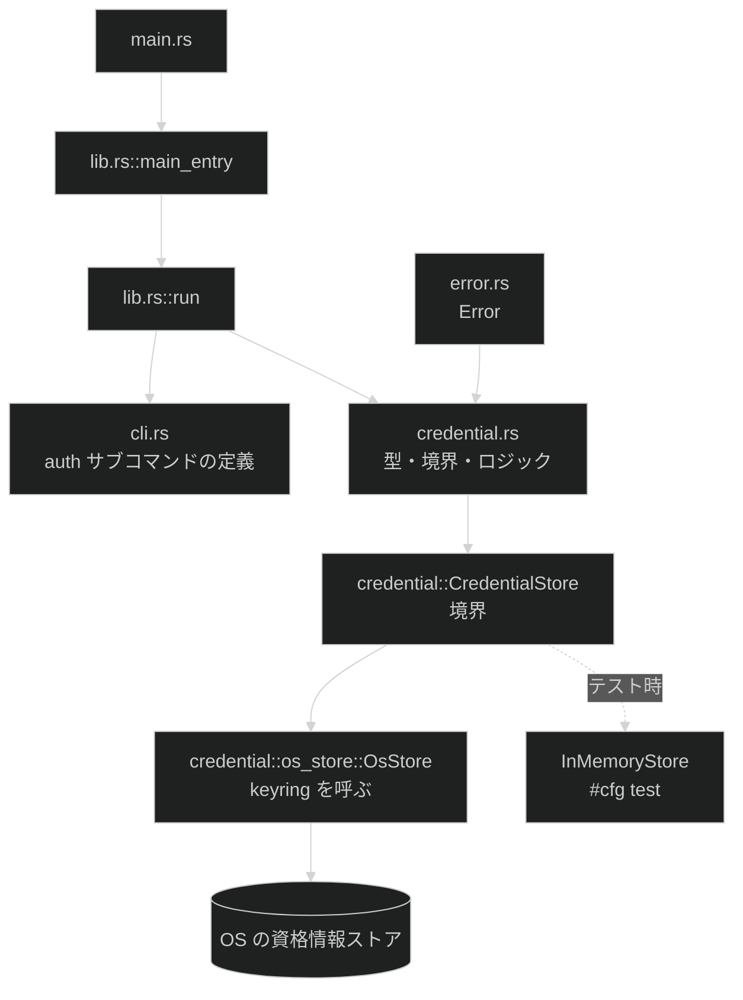

# 認証情報管理

**関連 Spec:** [credential-management_spec.md](credential-management_spec.md)
**関連 PRD:** [credential-management.md](../requirement/credential-management.md)
**準拠する原則バージョン:** [CONSTITUTION.md](../CONSTITUTION.md) v1.1.1

---

## 原則準拠チェックリスト

### B-001: 認証情報を AI エージェントの到達範囲に置かない（最優先・例外なし）

- [x] トークンを stdout に出力する経路が設計に存在しない（stdout に出るのは `Region` の識別子のみ）
- [x] 値を引数で受け取るフラグを設計していない。受け口は標準入力のみ（`cli.rs` に `--token` を定義しない）
- [x] トークンを保持する型の `Display` / `Debug` を封じている（`secrecy::SecretString` を内包し、
      `ApiToken` の `Debug` は `"ApiToken(<redacted>)"` を返す手実装）
- [x] エラーメッセージ・`Display` / `Debug` 実装にトークンが載らない（`CredentialError` はトークンを保持しない）
- [x] 認証情報を環境変数で渡す運用を前提にしていない（環境変数を読む経路を実装しない）
- [x] **該当なし**: HTTP クライアント / TLS クレートを追加しないため `HTTP_LAYER_CRATES` の変更は不要。
      HTTP を導入するのは [tts-synthesis](../requirement/tts-synthesis.md) 側

### B-002: stdout は成果物専用に保つ

- [x] stdout へ書く経路が許可リストに載っているものだけであること
      → `auth status` の 1 行を CONSTITUTION.md の許可リストへ追記済み（解消）
- [x] 経路を増やす場合、同じ PR で許可リストへ追記する計画になっている（上記）
- [x] 成果物の書き出しに `writeln!(std::io::stdout().lock(), ...)` を使う。
      `#[expect(clippy::print_stdout, ...)]` は付けない
- [x] 失敗時に stdout が空であることを結合テストで固定する設計になっている（8 節）

### A-001: 境界層は薄く保ち、外部世界の読み取りをそこに閉じる

- [x] `main.rs` にロジックを追加していない（`main_entry()` を呼ぶだけを維持）
- [x] OS キーストアの読み取りが境界の型に集約されている（`CredentialStore` trait と `OsStore` 実装）
- [x] 解決ロジックはプロセス環境を書き換えずに単体テストできる（`parse_token` は純粋関数、
      `store` / `load` / `remove` は `&impl CredentialStore` を受け取る）
- [x] 機能モジュール同士の相互依存を作っていない（`credential` は `error` にのみ依存）

### A-002: セキュリティに関わる仕組みを自作しない

- [x] **該当なし**: TLS を使わない（HTTP は tts 側）
- [x] `openssl` / `openssl-sys` を依存グラフに持ち込まない（3 節の検証結果を参照）
- [x] シークレットの保存に独自のファイル形式・独自の暗号を使っていない（OS の機構に委譲）
- [x] Windows API は `windows-sys`（`keyring` の `windows-native` feature は `windows-sys` 系を使う。
      `windows` クレートは引き込まれない。3 節で検証済み）
- [x] 追加した依存のライセンスが `deny.toml` の `[licenses] allow` に含まれる
      （MIT / Apache-2.0 のみ。allow の変更は不要。3 節で検証済み）

### D-001: 外形をテストで固定する

- [ ] **部分達成。** 追加したサブコマンドの終了コードを結合テストで検証する
      → `auth login` の**早期失敗経路**（TTY・空入力・stdin 読み取り失敗・`--region` 未指定 / 不正値・help）は
      結合テストで固定する。**`auth status` / `auth logout` の成功経路と `login` の保存経路は
      結合テストの対象外**で、境界を差し替えた単体テストで担保する（8.1 の逸脱記録を参照）
- [x] 失敗時に stdout が空であることを検証している（結合テスト対象の経路について）
- [x] テストが実行環境の環境変数に影響されない（`bin()` が `LogEnv::NAMES` を回して `env_remove` する）
- [x] テスト内で `std::env::set_var` / `remove_var` を呼んでいない
- [x] **追加の制約**: 結合テストは**実際の OS 資格情報ストアに書き込まない**（8 節の理由を参照）

### T-001: 実行時に落ちる余地を残さない

- [x] `unsafe` を書いていない
- [x] `unwrap()` / `expect()` を実装コードに追加していない（**本番コード 0 件を維持する**）
- [x] `todo!()` / `dbg!()` を残していない
- [x] 失敗を `Result` の型で表現し、意味の異なる失敗を別 variant に分けている
      （`NotFound` と `StoreUnavailable` の分離が本機能の中核。9 節の設計判断 D-4）

### 原則からの逸脱

**B-001 に関わる逸脱はありません。** B-001 は例外を認めない最上位原則であり、この機能はトークンを
AI エージェントに渡す経路を 1 つも持ちません。

**B-002 の逸脱は実装 PR で解消済みです。D-001 には、恒久的な妥協として受け入れた 1 件の
正式な逸脱があります。** CONSTITUTION.md の例外プロセス（文書化・正当化・緩和・レビュー・
追跡・計画）に従い、以下の表に記録します。

| 原則 ID | 逸脱内容 | 理由 | 補償手段 | 解消条件 | 追跡 |
|:---|:---|:---|:---|:---|:---|
| B-002 | `auth status` の stdout 1 行が CONSTITUTION.md の許可リストに未追記 | 本設計書の作成時点では許可リストへの追記がまだ行われていない | 実装 PR で許可リストへ追記する（3.2 の計画） | **解消済み**（実装 PR で許可リストへ追記した） | 本機能の実装 PR |
| D-001 | `auth status` / `auth logout` の成功経路と `auth login` の保存経路が結合テスト（バイナリ spawn）でカバーされず、単体テスト（境界を差し替えた `InMemoryStore`）のみで担保される。加えて `auth login` の TTY 判定失敗経路も結合テスト対象外（D-10） | 実ストアへの書き込みを伴う結合テストは、開発者の実キーチェーンを汚す・CI 環境依存・並列実行での競合という副作用を持つ（8.1）。TTY 判定経路は 3 OS CI で pty を使わずに固定する手段が無い（D-10） | `CredentialStore` を差し替えた単体テストで、ストアに書き込む経路のロジックを担保する（D-4 の回帰テストを含む）。TTY 判定は `is_terminal` を引数化した純粋関数の単体テストで担保する | **恒久的な妥協として受け入れる**（テスト専用 feature でバイナリの境界を差し替える代替案は 9.2 の未解決課題として残す） | なし（設計判断として確定。9 節 D-6 / D-10） |

---

# 1. 実装ステータス

**ステータス:** 🟢 実装済み

## 1.1. 実装進捗

| モジュール/機能 | ステータス | 備考 |
|:---|:---|:---|
| `src/credential.rs`（型・境界・ロジック） | 🟢 | 新規 |
| `src/credential/os_store.rs`（OS ストア実装） | 🟢 | 新規 |
| `src/cli.rs` の `auth` サブコマンド | 🟢 | 既存ファイルに追加 |
| `src/error.rs` の `Error` | 🟢 | 骨格のみで未使用の状態を解消した（9 節 D-7） |
| `src/lib.rs` の `run()` の arm | 🟢 | 既存ファイルに追加 |
| `tests/auth.rs`（結合テスト） | 🟢 | 新規テストバイナリ |
| 両 README の CLI リファレンス表 | 🟢 | Linux の揮発性の明示を含む（spec の FR-010） |
| `CHANGELOG.md` の `[Unreleased]` | 🟢 | 英語 1 行 |
| CONSTITUTION.md の stdout 許可リスト | 🟢 | `auth status` の 1 行を追記済み（B-002） |

---

# 2. 設計目標

1. **トークンがプロセス外に漏れる経路を実装レベルで作らない** — 受け口は標準入力のみ、
   保持は `secrecy`、stdout に出すのはリージョンのみ
2. **「無い」と「読めない」を型で分ける** — 呼び出し側が両者を区別せずにコンパイルを通せない形にする
3. **配布 4 ターゲットすべてで動き、MSRV を上げない** — 依存追加が CI のどのジョブも壊さないこと
4. **資格情報ストアに触れずにロジックをテストできる** — 境界を trait で切り、テストで差し替える
5. **現フェーズの例外を 1 つ解消する** — `src/error.rs` の `Error` を使い始める

---

# 3. 技術スタック

CONSTITUTION.md の「技術スタック制約」で固定されている領域（引数パース = clap、ログ = tracing、
エラー = thiserror / anyhow）はそれに従います。本機能で新規に追加するのは次の 2 つです。

| 領域 | 採用クレート | バージョン | features | 選定理由 |
|:---|:---|:---|:---|:---|
| OS 資格情報ストア | `keyring` | 3.6 | `default-features = false` + `apple-native` + `windows-native` + `linux-native` | この組み合わせだけが MSRV 1.85・許可ライセンス・禁止クレート・4 ターゲットのクロスビルドを同時に満たす（下記の検証結果） |
| シークレットの保持 | `secrecy` | 0.10 | （既定） | `SecretString` が `Debug` を封じている。自作の Zeroize 実装を避ける（A-002） |
| 端末判定 | （標準ライブラリ） | — | — | `std::io::IsTerminal`（Rust 1.70 安定化）。`atty` / `is-terminal` の依存追加が不要 |

## 3.1. 依存追加時の検証結果

- [x] **`deny.toml` の `[licenses] allow` に無いライセンスが増えるか** → **増えない。**
      追加される依存は MIT / Apache-2.0 のみ。`allow` の 4 ライセンスの範囲内なので `deny.toml` の変更は不要
- [x] **`[bans]` の禁止クレートを推移的に引き込まないか** → **引き込まない。**
      `windows-native` は `windows-sys` 系を使い、禁止されている `windows` クレートは入らない。
      `openssl` / `openssl-sys` も入らない
- [x] **MSRV が `Cargo.toml` の `rust-version` 以下か** → **1.85 で動作する**（実ビルドで確認済み）
- [x] **配布 4 ターゲットすべてでビルドできるか** → **できる。**
      C ライブラリへのリンクが無い（後述のとおり Secret Service 系を使わないため）
- [ ] **`Cargo.lock` を更新してコミットする**（実装時に実施。CI の cargo ジョブは `--locked`）

## 3.2. feature を絞る理由

`keyring` は既定 features で Linux の Secret Service バックエンドを有効にしますが、
本プロジェクトではそれを**使いません**。

| Secret Service 系の選択肢 | 採用しない理由 |
|:---|:---|
| `sync-secret-service` | `libdbus` に C リンクするためクロスコンパイルできない（配布ターゲットのビルドが壊れる） |
| `dbus-secret-service` | 同上。加えて `libdbus` 本体のライセンス（AFL-2.1 / GPL-2.0+）は cargo-deny の検査対象外で、`vendored` で静的リンクすると影響が広がる |
| `async-secret-service` + `crypto-rust` | pure Rust で通るが、依存が約 100 クレートに増え、`subtle` の BSD-3-Clause を `deny.toml` の allow に追加する必要がある。さらに tokio ランタイム上でメインスレッドから呼ぶとデッドロックしうるという既知の注意事項が付く |

`linux-native`（カーネルキーリング）に絞ることで、上記すべてを回避します。
代償は **Linux で再起動するとトークンが失われること**です。これは PRD の DC_004 として
要求段階で受け入れており、利用者への明示を仕様（FR-010）に含めています。

---

# 4. アーキテクチャ

## 4.1. システム構成図



## 4.2. モジュール分割

CONSTITUTION.md のレイヤ構成（`main.rs` → `lib.rs::main_entry` → `lib.rs::run` → 機能モジュール → 外部）を
崩しません。層のスキップと循環依存はありません。

| モジュール（`src/*.rs`） | 責務 | 依存先 | 外部世界への到達 |
|:---|:---|:---|:---|
| `credential` | 型の定義、入力の正規化・検証、失敗の分類、境界 trait の定義 | （なし） | **なし**（純粋） |
| `credential::os_store` | `CredentialStore` の実装。`keyring` を呼ぶ | `credential` | OS の資格情報ストア |
| `cli` | `auth` サブコマンドとフラグの定義 | （なし） | なし |
| `error` | ライブラリ層のエラー型。`credential` のエラーを集約 | `credential` | なし |
| `lib.rs::run` | サブコマンドのディスパッチ、stdout / stderr への書き分け | `cli`, `credential`, `error` | stdout / stderr |

**依存の方向は `error → credential` です**（`credential` が `error` に依存するのではない）。
`error::Error` が `#[from] credential::CredentialError` で `credential` の型を取り込むため、
依存の矢印はエラー集約の方向を向きます。`credential` 本体は他モジュールに依存しない純粋な境界です。

**`credential` 本体が外部世界に到達しないことが A-001 の要点です。** ストアに触るコードは
`credential::os_store` の 1 モジュールに閉じ込め、それ以外は `&impl CredentialStore` を経由します。

---

# 5. データモデル

```rust
use secrecy::SecretString;

/// MiniMax の API ホストの系統。
#[derive(Debug, Clone, Copy, PartialEq, Eq)]
pub enum Region {
    Global,
    China,
}

impl Region {
    /// stdout に書く識別子（`auth status` の出力。B-002 の許可リスト対象）。
    pub fn as_str(self) -> &'static str {
        match self {
            Self::Global => "global",
            Self::China => "china",
        }
    }
}

/// API トークン。
///
/// `SecretString` を内包し、`Debug` は値を出さない形で手実装する。
/// `Display` は**実装しない**（B-001 / PRD DC_002）。
pub struct ApiToken(SecretString);

impl std::fmt::Debug for ApiToken {
    fn fmt(&self, f: &mut std::fmt::Formatter<'_>) -> std::fmt::Result {
        f.write_str("ApiToken(<redacted>)")
    }
}

/// 保存する単位。トークン単体では保存しない（PRD FR_001_04）。
#[derive(Debug)]
pub struct StoredCredential {
    pub region: Region,
    pub token: ApiToken,
}
```

`ApiToken` に `#[derive(Debug)]` を使わないのは、derive が内部の `SecretString` を辿って
表示しようとするためです。`SecretString` 自体も値を出しませんが、**型の側で二重に封じます**。

---

# 6. インターフェース定義

エラー型は**意味の異なる失敗を別 variant に分ける**こと（T-001）。とくに「値が無い」と
「読み取りに失敗した」を同じ variant に潰すと、呼び出し側が両者を区別できず、
認証情報を持たないまま処理を続行する事故につながります（9 節 D-4）。

```rust
use std::io::IsTerminal;

/// 認証情報の取得・保存・削除で起きる失敗。
#[derive(Debug, thiserror::Error)]
pub enum CredentialError {
    /// ストアには到達できたが、このアプリのエントリが無い。
    #[error("no API token is registered")]
    NotFound,

    /// ストア自体に到達できなかった。`NotFound` とは区別する。
    /// `StoreFailure` の定義は 6.1 節を参照。
    #[error("could not access the OS credential store: {0}")]
    StoreUnavailable(StoreFailure),

    /// 標準入力から受け取った値が空または空白のみ。
    #[error("the token read from standard input is empty")]
    InvalidToken,

    /// 標準入力が端末に接続されている。
    #[error("standard input is a terminal; pipe the token instead")]
    InteractiveInputRejected,

    /// 標準入力の読み取り自体に失敗した。
    ///
    /// **`StoreUnavailable` に絶対に変換しない。** 標準入力の I/O 失敗を資格情報ストアの失敗として
    /// 報告すると、この機能が防ごうとしている「原因の誤報告」（D-4）を自ら犯すことになる。
    #[error("failed to read the token from standard input: {0}")]
    StdinRead(#[source] std::io::Error),
}

/// 資格情報ストアへの到達を表す境界（A-001 / PRD DC_006）。
/// `StoreFailure`（エラー型）の定義は 6.1 節を参照。
pub trait CredentialStore {
    /// 保存する。既存があれば上書きする（PRD FR_001_05）。
    fn set(&self, region: Region, token: &ApiToken) -> Result<(), StoreFailure>;

    /// 読み出す。エントリが無い場合は `Ok(None)` を返し、
    /// **到達できない場合は `Err` を返す**（この 2 つを混同しないことが要求）。
    fn get(&self) -> Result<Option<StoredCredential>, StoreFailure>;

    /// 削除する。エントリが無い場合も `Ok(false)` で成功として扱う（PRD FR_003）。
    fn delete(&self) -> Result<bool, StoreFailure>;
}

/// 標準入力から読み取った文字列を正規化・検証する純粋関数（FR-002 / FR-003）。
///
/// # Errors
///
/// 前後の空白を除去した結果が空の場合 `InvalidToken` を返す。
pub fn parse_token(raw: &str) -> Result<ApiToken, CredentialError> {
    let trimmed = raw.trim();
    if trimmed.is_empty() {
        return Err(CredentialError::InvalidToken);
    }
    Ok(ApiToken(SecretString::from(trimmed.to_owned())))
}

/// 標準入力からトークンを読む。端末に接続されている場合は拒否する（FR-005）。
///
/// # Errors
///
/// 標準入力が端末の場合、読み取りに失敗した場合、値が空の場合にエラーを返す。
pub fn read_token_from<R: std::io::Read>(
    mut reader: R,
    is_terminal: bool,
) -> Result<ApiToken, CredentialError> {
    if is_terminal {
        return Err(CredentialError::InteractiveInputRejected);
    }
    let mut raw = String::new();
    reader
        .read_to_string(&mut raw)
        .map_err(CredentialError::StdinRead)?;
    parse_token(&raw)
}
```

`read_token_from` が `is_terminal` を**引数で受け取る**のは A-001 のためです。
プロセスの標準入力を見るのは境界（`lib.rs::run`）の 1 行だけにします。

```rust
// lib.rs::run 側の呼び出し（プロセスの状態を見るのはここだけ）
let stdin = std::io::stdin();
let token = credential::read_token_from(stdin.lock(), stdin.is_terminal())?;
```

## 6.1. `keyring` のエラーの対応付け

`keyring` のエラーを `StoreFailure` に落とします。**この対応は完全ではありません。**

| `keyring::Error` | `StoreFailure` | 備考 |
|:---|:---|:---|
| `NoEntry` | （`Ok(None)` にする） | **エラーにしない。** これが `NotFound` の源 |
| `NoStorageAccess` | `PermissionDenied(String)` | 元のメッセージを保持する。「多くは権限の問題だが常にではない」ため断定しない |
| `PlatformFailure` | `Unavailable(String)` | 元のメッセージを保持する |
| `Ambiguous` | `Other(String)` | 複数の登録が検出された旨。個別分岐は将来の拡張として検討する |
| その他 | `Other(String)` | 元のメッセージを添える |

```rust
/// ストアに到達できなかった原因の区分。利用者への案内を変えるために分ける。
///
/// 各 variant が元のメッセージを保持するのは、デバッグ時に `keyring::Error` の詳細を
/// 失わないため（原因の断定はせず、判明した事実のみを運ぶ）。
#[derive(Debug, thiserror::Error)]
pub enum StoreFailure {
    #[error("the credential store is unavailable on this system: {0}")]
    Unavailable(String),
    #[error("permission denied by the credential store: {0}")]
    PermissionDenied(String),
    #[error("the credential store failed: {0}")]
    Other(String),
}
```

> **`keyring` は「ストアの機構自体が存在しない」を表す variant を持ちません。**
> Linux で Secret Service が無い場合も `PlatformFailure` に潰れます。そのため
> `Unavailable` のメッセージには原因の断定を書かず、元の詳細を併記します。
> Linux では「再起動でキーリングが失われた可能性」も案内に含めます（spec の FR-010）。

## 6.2. `store` / `load` / `remove`（D-4 の中核）

`load` の `Ok(None) -> Err(NotFound)` への変換が、**「未登録」と「ストアアクセス失敗」を
分離する**という要求（PRD FR_005 / DC_003）を実際に満たす箇所です。

```rust
/// 登録する。既存があれば上書きする（PRD FR_001_05）。
///
/// # Errors
///
/// ストアに到達できなかった場合 `StoreUnavailable` を返す。
pub fn store(
    credential_store: &impl CredentialStore,
    credential: StoredCredential,
) -> Result<(), CredentialError> {
    credential_store
        .set(credential.region, &credential.token)
        .map_err(CredentialError::StoreUnavailable)
}

/// 読み出す。
///
/// `CredentialStore::get` が返す `Ok(None)`（エントリが無い）を `NotFound` に変換する。
/// **この変換が唯一の `NotFound` の生成箇所であり、`Err`（到達できない）とは経路を分ける。**
///
/// # Errors
///
/// エントリが無い場合 `NotFound`、ストアに到達できなかった場合 `StoreUnavailable` を返す。
pub fn load(credential_store: &impl CredentialStore) -> Result<StoredCredential, CredentialError> {
    match credential_store.get() {
        Ok(Some(credential)) => Ok(credential),
        Ok(None) => Err(CredentialError::NotFound),
        Err(failure) => Err(CredentialError::StoreUnavailable(failure)),
    }
}

/// 削除する。エントリが無い場合も成功として扱う（PRD FR_003）。
///
/// # Errors
///
/// ストアに到達できなかった場合 `StoreUnavailable` を返す。戻り値の `bool` は
/// 実際に削除が行われたかを示す（利用者への案内の分岐に使う。5.2 参照）。
pub fn remove(credential_store: &impl CredentialStore) -> Result<bool, CredentialError> {
    credential_store
        .delete()
        .map_err(CredentialError::StoreUnavailable)
}
```

**回帰させてはならない性質:** `credential_store.get()` が `Err` を返したとき、`load` が
`NotFound` を返すことは絶対にありません。この対応が崩れると、ストアが読めない状況を
「未登録」と誤って報告し、`gh` cli/cli#13317 と同種の事故（認証情報なしでリクエストを送る）
につながります（8 節の回帰テストで固定します）。

## 6.3. `auth status` の出力（B-002 の実装箇所）

```rust
// lib.rs::run 側の呼び出し（B-002 の許可リスト対象の出力）
use std::io::Write as _;

match credential::load(&credential::os_store::OsStore) {
    Ok(credential) => {
        writeln!(std::io::stdout().lock(), "{}", credential.region.as_str())?;
        Ok(())
    }
    Err(credential::CredentialError::NotFound) => {
        tracing::error!("no API token is registered; run `minimax auth login`");
        std::process::exit(1);
    }
    Err(err) => {
        tracing::error!("{err}");
        std::process::exit(1);
    }
}
```

stdout に書くのは `credential.region.as_str()` の 1 行だけで、それ以外の分岐は
すべて stderr（`tracing::error!`）経由です。

---

# 7. 非機能要件実現方針

| 要件 | 実現方針 |
|:---|:---|
| NFR-001（トークンが漏れない） | `ApiToken` の `Debug` 手実装 + `Display` 未実装 + `CredentialError` がトークンを保持しない設計。stdout へ書くのは `Region::as_str()` のみ |
| NFR-002（移植性） | `keyring` の 3 つの native feature で 4 ターゲットを覆う。C リンクを持つ feature を有効化しない |
| NFR-003（テスト独立性） | `CredentialStore` trait を差し替える。結合テストは実ストアに触らない経路のみ（8 節） |

---

# 8. テスト戦略

CONSTITUTION.md はカバレッジの数値目標を設けていません。何をどのレベルで固定するかを書きます。

| テストレベル | 対象 | 配置場所 | 固定する内容 |
|:---|:---|:---|:---|
| 単体 | `parse_token` | `src/credential.rs` の `#[cfg(test)]` | 前後の空白・改行の除去、空・空白のみの拒否 |
| 単体 | `read_token_from` | 同上 | `is_terminal = true` で `InteractiveInputRejected`、パイプ相当で成功 |
| 単体 | `store` / `load` / `remove` | 同上（`InMemoryStore` を注入） | 上書き、未登録時の `NotFound`、削除の冪等性 |
| 単体 | 失敗の分類 | 同上 | ストア側が `Err` を返したとき `NotFound` に**ならない**こと（D-4 の回帰テスト） |
| 単体 | `ApiToken` の `Debug` | 同上 | `format!("{:?}")` にトークンの値が含まれないこと |
| 結合 | `auth login` / `auth status` / `auth logout` | `tests/auth.rs` | 終了コードと stdout / stderr の出し分け |

## 8.1. 結合テストが実ストアに触らない理由

結合テストはバイナリを spawn するため、`CredentialStore` の差し替えが効きません（子プロセスは
自分で `OsStore` を組み立てます）。実ストアに書き込むテストを書くと次の問題が起きます。

- **開発者の実キーチェーンを汚す**（テストが本物のトークンを消す可能性がある）
- CI のランナーで資格情報ストアが利用できるとは限らず、環境依存で落ちる
- テストは並列に走るため、単一のストアエントリを共有すると競合する

そのため結合テストは、**ストアに到達する前に完結する経路**に限定します。

| 結合テストで検証する経路 | ストアに触るか |
|:---|:---|
| `auth login` で標準入力が端末（`--region` 指定あり） | 触らない（TTY 判定で先に失敗） |
| `auth login` で空の入力をパイプ | 触らない（検証で先に失敗） |
| `auth login` で `--region` 未指定 | 触らない（clap が先に失敗） |
| `auth login` で `--region` に不正な値 | 触らない（clap が先に失敗） |
| `auth --help` / `auth login --help` | 触らない |
| **失敗時に stdout が空であること**（上記すべて） | 触らない |

`auth status` / `auth logout` の成功経路と、`login` の保存経路は**単体テストで担保します**。
この非対称は D-001 の「全サブコマンドの終了コードを結合テストで固定する」を部分的にしか
満たさない**正式な逸脱**です（原則準拠チェックリストの「原則からの逸脱」表に記録済み）。
実ストアへの副作用を持つテストを CI に置く代償のほうが大きいと判断しました（9 節 D-6）。
より良い代替（テスト専用 feature で `OsStore` を差し替え可能にする）は 9.2 の未解決課題として残します。

**`auth login` の TTY 判定（標準入力が端末である経路）も結合テストの対象外とします（D-10）。**
`read_token_from` は `is_terminal` を引数で受け取る純粋関数であり（A-001）、この経路は
Phase 2 の単体テストで既に固定済みです。結合テストでこの経路を固定するには、子プロセスの
標準入力を実際の疑似端末（pty）に割り当てる必要がありますが、CI は 3 OS（Ubuntu / macOS /
Windows）で走り、Unix の pty と Windows の ConPTY は API が異なるため、単一の軽量な手段が
ありません。テスト実行環境の標準入力を継承する方式（ローカルでは TTY、CI では非 TTY になる）は、
環境依存でテスト結果が変わる典型的なフレーク要因であり、本プロジェクトが他所（`LogEnv` の
境界化等）で明示的に避けている失敗パターンと同種です。

## 8.2. その他の注意点

- [x] 環境変数を読む処理を追加しない（本機能は環境変数を一切読まない。DC_005）
- [x] 結合テストが spawn する子プロセスの環境変数を外している（既存の `bin()` を使う）
- [ ] **該当なし**: `std::fs::read_dir` を使わない
- [ ] **該当なし**: 相対パスを出力・比較しない
- [ ] `auth --help` の全文回帰は `insta` のスナップショットで固定する（現状 `tests/` に `insta` は未導入。
      本機能で導入するかは実装時に判断する。導入する場合はバージョン文字列を filters でマスクする）

---

# 9. 設計判断

## 9.1. 決定事項

| # | 決定事項 | 選択肢 | 決定内容 | 理由 |
|:---|:---|:---|:---|:---|
| D-1 | 資格情報ストアの手段 | `keyring` v3 / `keyring` v4 / `security-framework` 等を直接 / 外部コマンド委譲 | **`keyring` 3.6** | v4 は MSRV 1.88。1.85 のまま v4 を部分採用すると Windows と Secret Service の両ストアが落ちる。外部コマンド委譲は利用者に事前セットアップを課す |
| D-2 | Linux のバックエンド | keyutils / `async-secret-service` / `dbus-secret-service` / 外部コマンド | **keyutils（`linux-native`）** | 他はクロスビルド不能・ライセンス検査外の C ライブラリ・依存 100 増と allow 追加のいずれかに当たる（3.2） |
| D-3 | MSRV | 1.85 維持 / 1.88 へ引き上げ | **1.85 維持** | v4 の `CredentialPersistence`（「再起動で消える」を実行時に検出できる）は魅力だが、MSRV 引き上げは本機能と無関係な変更で、CI・両 README・`CLAUDE.md` の追随を伴う |
| D-4 | 失敗の表現 | 単一の variant / `NotFound` と `StoreUnavailable` を分離 | **分離** | 分離しないと「ストアが読めない」を「未登録」と誤報告する。さらに読み取りエラーを捨てる実装にすると**認証情報なしでリクエストを送る**事故になる。同種の不具合が広く使われている CLI で現に報告されている（読み取りエラーを破棄していたことが原因） |
| D-5 | 端末入力の扱い | 拒否 / エコーを抑止してプロンプト / そのまま読む | **拒否** | プロンプトのエコー抑止は依存追加を要する。そのまま読むとトークンが画面とスクロールバックに残る。パイプ必須なら依存ゼロで漏洩経路も無い |
| D-6 | 結合テストの範囲 | 実ストアに書き込む / ストアに触らない経路のみ | **触らない経路のみ** | 開発者の実キーチェーンを汚す、CI 環境依存、並列実行での競合。書き込み経路は境界を差し替えた単体テストで担保（8.1） |
| D-7 | `src/error.rs` の扱い | 未使用のまま `anyhow` を使う / `Error` を使い始める | **`Error` を使い始める** | CONSTITUTION.md が「TTS 実装時に解消する」とした未達項目。本機能は v0.1.0 の縦切りの一部なので、ここで `Error::Credential` を追加して集約を始める |
| D-8 | トークンの内部表現 | `String` / `secrecy::SecretString` / 自前の Zeroize | **`secrecy::SecretString`** | A-002（セキュリティに関わる仕組みを自作しない）。`Debug` が封じられており、ドロップ時のゼロ化も委譲できる |
| D-9 | 端末判定の手段 | `std::io::IsTerminal` / `atty` / `is-terminal` | **標準ライブラリ** | Rust 1.70 で安定化済みで MSRV 1.85 の範囲内。依存を増やさない |
| D-10 | `auth login` の TTY 判定経路の結合テスト範囲 | pty クレート（`portable-pty` 等）を追加して結合テストで固定 / 単体テストのみで担保し結合テストの対象外にする | **単体テストのみで担保** | Unix pty と Windows ConPTY の API 差異、3 OS CI での実装コスト、テスト実行環境依存によるフレークのリスクが、pty クレート追加の効用を上回る。`is_terminal` を引数化した設計（A-001）により、この経路は既に純粋関数の単体テストで固定できている（8.1 節） |
| D-11 | `OsStore` が `Region` と `ApiToken` を keyring にどう保存するか | 単一の `keyring::Entry` にリージョンとトークンを区切り文字で結合してシリアライズ / 同じ `service` の下で `user` を分けた2つの `keyring::Entry`（`token` / `region`） | **2つの `Entry` に分離**（`user: "token"` / `user: "region"`） | 単一エントリへの結合はトークン内に区切り文字が現れた場合の曖昧さを持つ。2つの `Entry` に分けることで曖昧さを排除でき、`keyring::Error` の対応（6.1 節）もエントリ単位でそのまま適用できる。代償として `set` / `delete` が2回の呼び出しになり、片方だけ失敗する部分的な不整合の可能性が残るが、`get` は `token` 側の `NoEntry` を優先して判定するため「未登録」の判定は破綻しない |

> **`--region` の必須性は技術選定ではなく UX 上の決定**であり、[credential-management_spec.md](credential-management_spec.md) の
> 5.1 節で確定済みです（既定値を置くと誤登録に気づけない）。この設計書では再掲しません。

## 9.2. 未解決の課題

| 課題 | 影響度 | 対応方針 |
|:---|:---|:---|
| D-001 の逸脱（`auth status` / `auth logout` / `login` の保存経路が結合テストでカバーされない）をより良く解消する代替案 | 中 | テスト専用の Cargo feature（例: `test-store`）で `OsStore` を `InMemoryStore` に差し替え可能にし、`cargo test --all-features` 時のみ有効化する案がある。本番ビルドでは feature 無効のため `OsStore` のみが組み込まれ、A-001 / B-001 に触れる新しい実行時分岐は増えない。次回の設計見直しで採用を検討する |
| Linux で再起動後にトークンが消えた場合、`keyring` からは「未登録」として返るため、利用者には通常の未登録と区別できない | 中 | `NotFound` のメッセージに、Linux では再起動で失われる旨を併記する（`cfg(target_os = "linux")` で分岐）。根本解決には外部コマンド委譲が必要で、それは将来の拡張 |
| `secrecy` 0.10 の `SecretString::from(String)` がそのまま通るか未確認（コンストラクタ API はバージョン間で変わった経緯がある） | 中 | 実装着手時に最初のタスクとしてこの 1 行を単体テストで確認する。DESIGN_DOC_TEMPLATE.md の Pseudocode 完全性ルールにより、この節のコード例は verbatim で動く前提だが実測はまだしていない |
| `insta` を `tests/` に導入するか | 低 | 本機能の実装時に判断する。導入しない場合は `predicates` の部分一致で進める |
| `auth status` の stdout 1 行が将来 JSON 化を求められる可能性 | 低 | 現状は識別子 1 行。JSON が必要になった時点で `--json` を後方互換に追加する（許可リストへの追記を伴う） |

---

# 10. 変更履歴

## v0.1.0（未リリース）

**変更内容:**

- 認証情報管理の初回設計。`keyring` 3.6 + `secrecy` 0.10 による OS 資格情報ストアへの保存
- `src/error.rs` の `Error` を使い始め、CONSTITUTION.md の「現フェーズの例外」を 1 件解消する
