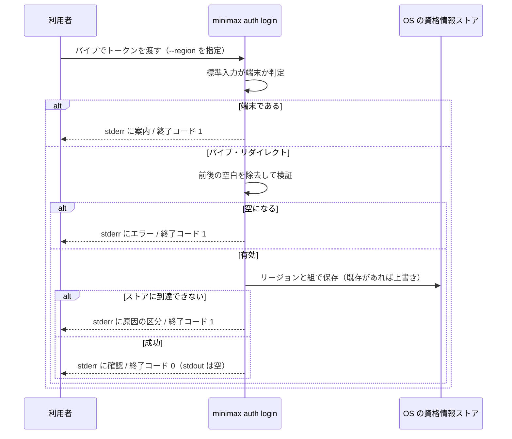
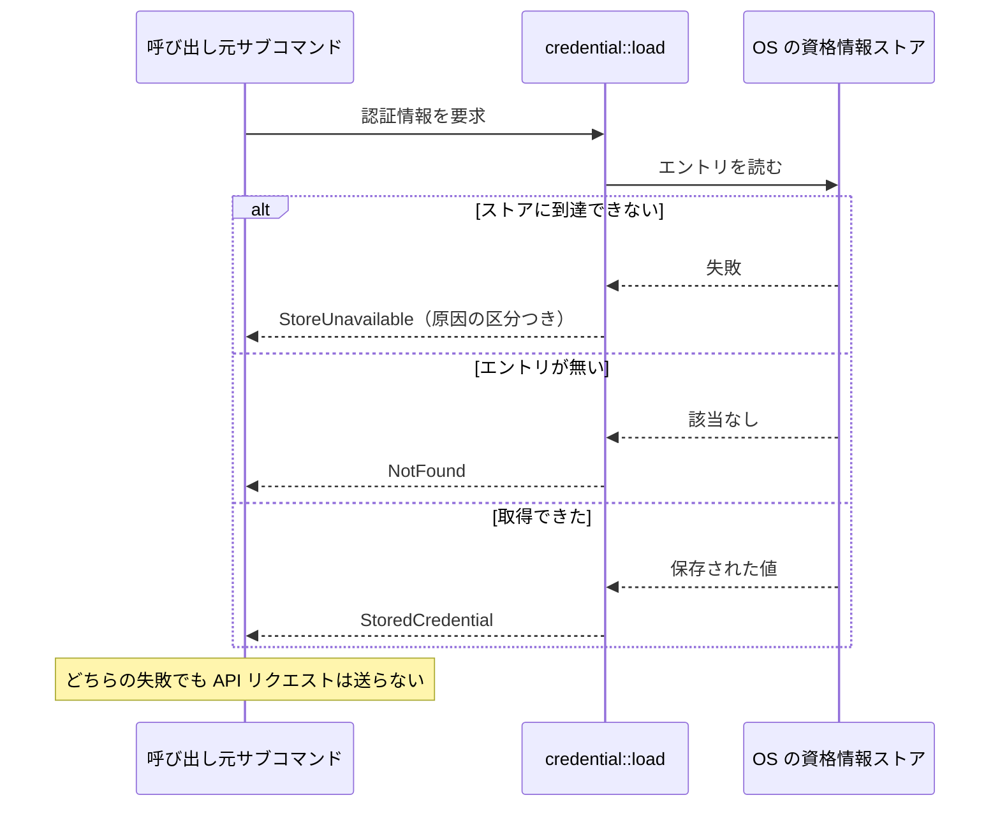

# 認証情報管理

**関連 Design Doc:** [credential-management_design.md](credential-management_design.md)
**関連 PRD:** [credential-management.md](../requirement/credential-management.md)

---

# 1. 背景

このプロジェクトの存在理由は **認証情報の非露出** です。MiniMax の API トークンを AI エージェントに
渡さずに音声ファイルを生成するために作っています。

AI エージェントに CLI を実行させる場合、トークンをどう渡すかが問題になります。
コマンドライン引数で渡すとエージェントの会話ログに永久に残り、環境変数で渡すとエージェントの
シェルツールから `env` で読めます。どちらもトークンがエージェントの到達範囲に入ります。

そこで、トークンを **OS の資格情報ストアに置き、CLI プロセス内でだけ読み出す** 経路を用意します。
トークンを知っているのは人間だけで、エージェントは「登録されているか」しか分かりません。

# 2. 概要

`minimax auth` 配下のサブコマンドで、API トークンの登録・確認・解除を行います。
他のサブコマンドは、公開された内部インターフェース経由でトークンを読み出します。

この仕様が実現することは 3 つです。

1. **受け口を標準入力 1 つに絞る** — トークンが引数・環境変数・会話ログに載る経路を作らない
2. **トークンとリージョンを組で扱う** — MiniMax は API キーとホストが一致しないと認証に失敗するため、
   両者を独立に設定できる形にしない
3. **「未登録」と「ストアが読めない」を別の失敗として扱う** — この 2 つを混同すると、
   認証情報を持たないまま処理を続行する事故につながる

# 3. 原則への言及

この仕様が [CONSTITUTION.md](../CONSTITUTION.md)（v1.1.1）のどの原則に従って設計されているかを示します。

## 3.1. 適用する原則

| 原則 ID | この仕様における意味 | 対応する要求 ID |
|:---|:---|:---|
| B-001 | トークンの受け口は標準入力のみ。`--token` 相当のフラグを定義しない。トークンを保持する型は文字列表現に値を出さない。環境変数からは読まない | IR_001, DC_002, DC_005 |
| B-002 | stdout に書くのは `auth status` の**リージョン 1 行だけ**。登録の成否・警告・エラーはすべて stderr。この 1 行は許可リストへの追記を要する | IR_002 |
| A-001 | 資格情報ストアへの到達を境界の型に閉じ、判断ロジック（入力の正規化・検証・失敗の分類）には値を引数で渡す | DC_006 |
| A-002 | 保存機構は OS のものを使い、独自のファイル形式・独自の暗号を作らない | DC_001 |
| D-001 | 3 つのサブコマンドすべてについて、終了コードと stdout / stderr の出し分けを結合テストで固定する | FR_001〜FR_005, IR_002, IR_003 |
| D-002 | この仕様書と設計書が実装より先に存在する | （仕様書全体） |
| T-001 | 「未登録」と「ストアアクセス失敗」を別の型で表現し、呼び出し側に区別を強制する。`unwrap` / `expect` を使わない | DC_003 |

## 3.2. stdout / stderr の出し分け

B-002 は非交渉です。この機能が書き込む出力をすべて列挙します。

| 出力内容 | 出力先 | 根拠 |
|:---|:---|:---|
| `auth status`（登録済み）: リージョンの識別子 1 行 | **stdout**（1 行） | 機械可読な出力。**許可リストへの追記が必要** |
| `auth status`（未登録）: 登録コマンドの案内 | stderr | 成果物ではない |
| `auth login` 成功時: 登録したリージョンの確認 | stderr | 成果物ではない |
| `auth login`: 既存の登録を上書きした警告 | stderr | B-002 |
| `auth logout`: 削除対象が無かった旨 | stderr | B-002 |
| すべてのエラー・診断 | stderr | B-002 |

- [ ] **未達。** stdout へ書く経路が CONSTITUTION.md の**許可リスト**に載っていること
      → 現在の許可リストは help / version / 音声ファイルのパスの 3 つで、`auth status` の 1 行は**未追記**。
      **実装 PR で CONSTITUTION.md へ追記して解消する**（追記を伴わない実装は B-002 違反）
- [x] **失敗時に stdout が空**であることを結合テストで固定する（D-001。5.2 の終了コード表）

> **トークンの値を stdout に出す経路は 1 つも定義しません。** `auth status` が返すのはリージョンの
> 識別子（`global` / `china`）だけです。

## 3.3. 原則からの逸脱

**逸脱はありません。** B-001 / B-002 / A-001 / A-002 / D-001 / T-001 のすべてに準拠します。

ただし Linux では、保存したトークンが**再起動で失われます**（PRD の DC_004）。
これは原則からの逸脱ではなく、保存方式の制約を要求として受け入れたものです。
利用者への明示（両 README とエラーメッセージ）を仕様に含めます（4.2 の FR-010）。

# 4. 要求定義

## 4.1. トレーサビリティ

PRD の要求 ID とこの仕様の対応を示します。

PRD の親 requirement ノード（`REQ_001`〜`REQ_004`）は、PRD 側の `contains` 関係で子要求
（FR / IR / DC）に分解されています。この表では**子要求の行で充足を示し**、親ノードには
対応する実装箇所を持たせません。

| PRD の要求 ID | この仕様での実現箇所 | 検証方法 |
|:---|:---|:---|
| REQ_001（親） | 仕様書全体。子要求 REQ_002〜REQ_004 の充足による | — |
| REQ_002（親） | FR_001〜FR_004 / DC_001 / IR_002 の各行による | — |
| REQ_003（親） | IR_001 / DC_002 / DC_005 の各行による | — |
| REQ_004（親） | FR_005 / DC_003 / IR_003 の各行による | — |
| FR_001 | 5.1（`auth login`）/ 4.2 FR-001 | 結合テスト |
| FR_001_01 | 4.2 FR-001 / 9.1（登録の振る舞い） | 結合テスト |
| FR_001_02 | 4.2 FR-002 | 単体テスト |
| FR_001_03 | 4.2 FR-003 | 単体テスト + 結合テスト |
| FR_001_04 | 6.1（`StoredCredential`）/ 5.1（`--region`） | 結合テスト |
| FR_001_05 | 4.2 FR-004 | 結合テスト |
| FR_001_06 | 4.2 FR-005 | 結合テスト |
| FR_002 | 5.1（`auth status`）/ 3.2 / 5.2 | 結合テスト |
| FR_003 | 5.1（`auth logout`）/ 4.2 FR-007 | 結合テスト |
| FR_004 | 6（`load` の公開 API） | 単体テスト + 結合テスト |
| FR_005 | 6.1（`CredentialError`）/ 4.2 FR-008 | 単体テスト + 結合テスト |
| IR_001 | 5.1（トークンはフラグを持たない）/ 6 | レビュー |
| IR_002 | 3.2 / 5.2 | 結合テスト |
| IR_003 | 5.2（終了コード表） | 結合テスト |
| DC_001 | 6（`CredentialStore` の抽象）/ 設計書の技術スタック | レビュー |
| DC_002 | 6.1（`ApiToken`） | レビュー + 単体テスト |
| DC_003 | 6.1（`CredentialError` の variant 分割） | レビュー |
| DC_004 | 4.2 FR-010 / 10 | レビュー |
| DC_005 | 6（環境変数を読む API を定義しない） | レビュー |
| DC_006 | 6（`CredentialStore` を境界に置く）/ 設計書のモジュール分割 | レビュー + 単体テスト |
| DC_007 | 設計書の技術スタック | CI（MSRV ジョブ） |

## 4.2. 機能要件

| ID | 要件 | 優先度 | 根拠 |
|:---|:---|:---|:---|
| FR-001 | 標準入力の内容全体を 1 つのトークンとして読み取る | 必須 | PRD FR_001_01 |
| FR-002 | 読み取った値の前後の空白文字（改行を含む）を除去する | 必須 | PRD FR_001_02。クリップボード・`echo` 経由の入力には末尾改行が付く |
| FR-003 | 除去後に空になる入力を拒否し、保存しない | 必須 | PRD FR_001_03。空文字を保存すると未登録と区別できなくなる |
| FR-004 | 既存の登録があるときは確認を求めずに上書きし、上書きした事実を stderr に出す | 必須 | PRD FR_001_05。対話的な確認は AI エージェントから実行するとハングする |
| FR-005 | 標準入力が端末に接続されている場合はトークンを読まずに拒否し、パイプでの渡し方を案内する | 必須 | PRD FR_001_06。端末入力はトークンが画面とスクロールバックに残る |
| FR-006 | 登録の有無と登録済みリージョンを返す。トークンの値は返さない | 必須 | PRD FR_002 |
| FR-007 | 登録を削除する。未登録の状態で実行しても成功として扱う | 必須 | PRD FR_003。「削除されている」という目的は達成されている |
| FR-008 | トークン読み出しの失敗を「未登録」と「ストアアクセス失敗」に区別して返す | 必須 | PRD FR_005 / DC_003 |
| FR-009 | 他のサブコマンドがトークンとリージョンの組を読み出せる内部インターフェースを提供する。利用者向けのサブコマンドとしては公開しない | 必須 | PRD FR_004 / IR_001 |
| FR-010 | Linux で登録が再起動により失われうることを、両 README と該当エラーメッセージで明示する | 必須 | PRD DC_004 |

## 4.3. 非機能要件

**性能に関する数値目標は設定しません。** 資格情報ストアへのアクセスは 1 回の CLI 実行につき
1 回であり、利用者が体感する遅延の主因は本機能の外にあります（PRD の 4.2 と同じ判断）。

| ID | カテゴリ | 要件 | 目標 |
|:---|:---|:---|:---|
| NFR-001 | セキュリティ | トークンがプロセス引数・環境変数・stdout・ログのいずれにも現れない | 該当経路が存在しないことをレビューで確認 |
| NFR-002 | 移植性 | 配布対象の全ターゲットで動作する | CI の test（3 OS）と cross-check（残り 1 ターゲット）が通る |
| NFR-003 | テスト独立性 | テストが実行環境の資格情報ストアの状態に依存しない | 境界を差し替えて単体テストできる（DC_006） |

# 5. CLI インターフェース

利用者から見た CLI の外形を定義します。**真実の源は `src/cli.rs`** なので、実装後に食い違ったら
こちらを直します。

## 5.1. サブコマンドとフラグ

`auth` は親サブコマンドで、単体では help を表示します。

| サブコマンド | フラグ / 引数 | 必須 | 説明（`--help` に出る英語） |
|:---|:---|:---|:---|
| `auth` | — | — | `Manage the MiniMax API credential` |
| `auth login` | `--region <REGION>` | 必須 | `Region the API key belongs to` |
| `auth login` | （標準入力） | 必須 | トークンは標準入力から読む。**フラグとしては定義しない**（IR_001） |
| `auth status` | — | — | `Show whether a token is registered and for which region` |
| `auth logout` | — | — | `Remove the registered API token` |

`--region` の値は `global` または `china` の 2 値です。**既定値は設けません。**
キーとホストの不一致は原因の分かりにくい認証エラーになるため、登録時に明示させます。

> **`--token` に相当するフラグは定義しません。** これは実装の都度の判断ではなく、
> B-001 と PRD の IR_001 が禁じています。

## 5.2. 終了コード

D-001 が結合テストでの固定を要求します。

| 状況 | 終了コード | stdout | stderr |
|:---|:---|:---|:---|
| `auth login` 成功 | 0 | **空** | 登録したリージョンの確認 |
| `auth login` 成功（既存を上書き） | 0 | **空** | 上書きした旨の警告 + 確認 |
| `auth login` 標準入力が端末 | 1 | **空** | パイプでの渡し方の案内 |
| `auth login` 入力が空 | 1 | **空** | 空のトークンは登録できない旨 |
| `auth login` 標準入力の読み取りに失敗 | 1 | **空** | 読み取りに失敗した旨（**資格情報ストアの失敗とは区別する**） |
| `auth login` `--region` 未指定 / 不正な値 | **2** | **空** | clap のエラーメッセージ |
| `auth status` 登録済み | 0 | リージョン 1 行 | （なし） |
| `auth status` 未登録 | 1 | **空** | `auth login` の案内 |
| `auth logout` 成功 | 0 | **空** | （なし） |
| `auth logout` 未登録 | 0 | **空** | 削除対象が無かった旨 |
| ストアアクセス失敗（全サブコマンド） | 1 | **空** | 原因の区分と対処 |

**失敗時に stdout が空であることを、3 サブコマンドすべてで結合テストに固定します。**

# 6. 公開 API

lib 側の公開 API です。クレート名・バージョン・feature 指定は
[credential-management_design.md](credential-management_design.md) が扱います。

| モジュール（`src/*.rs`） | 型 / 関数 | 可視性 | 概要 |
|:---|:---|:---|:---|
| `credential` | `Region` | `pub` | API ホストの系統（`global` / `china`） |
| `credential` | `ApiToken` | `pub` | トークン。文字列表現に値を出さない |
| `credential` | `StoredCredential` | `pub` | トークンとリージョンの組 |
| `credential` | `CredentialError` | `pub` | 取得・保存・削除で起きる失敗 |
| `credential` | `CredentialStore` | `pub` | 資格情報ストアへの到達を表す境界（A-001 / DC_006） |
| `credential` | `store(&impl CredentialStore, StoredCredential)` | `pub` | 登録する |
| `credential` | `load(&impl CredentialStore)` | `pub` | 読み出す。失敗は `CredentialError` で区別する |
| `credential` | `remove(&impl CredentialStore)` | `pub` | 削除する。未登録でも成功 |
| `credential` | `parse_token(&str)` | `pub` | 入力の正規化と検証（FR-002 / FR-003）。ストアに触らない純粋関数 |

`CredentialStore` を境界として分けているのは、`parse_token` のような判断ロジックを
実際のストアに触れずに単体テストできるようにするためです（NFR-003）。

## 6.1. 型定義

```rust
/// MiniMax の API ホストの系統。トークンと組で保存する（PRD FR_001_04）。
#[derive(Debug, Clone, Copy, PartialEq, Eq)]
pub enum Region {
    Global,
    China,
}

/// API トークン。
///
/// 文字列表現に値を出さない（B-001 / PRD DC_002）。`Debug` は伏せた形で実装し、
/// `Display` は実装しない。内部表現は設計書で定める。
pub struct ApiToken(/* 秘匿する内部表現 */);

/// 保存する単位。トークン単体では保存しない。
pub struct StoredCredential {
    pub region: Region,
    pub token: ApiToken,
}

/// 認証情報の取得・保存・削除で起きる失敗。
///
/// `NotFound` と `StoreUnavailable` を**別の variant に分ける**ことが要求である（PRD DC_003）。
/// 同じ variant に潰すと、ストアが読めない状態を「未登録」と誤って報告し、
/// 呼び出し側が認証情報を持たないまま処理を続ける余地が生まれる。
#[derive(Debug)]
pub enum CredentialError {
    /// ストアには到達できたが、このアプリのエントリが無い。
    NotFound,
    /// ストア自体に到達できなかった。未登録とは区別する。
    StoreUnavailable(StoreFailure),
    /// 標準入力から受け取った値が不正（空・空白のみ）。
    InvalidToken,
    /// 標準入力が端末に接続されている（FR-005）。
    InteractiveInputRejected,
    /// 標準入力の読み取り自体に失敗した。
    ///
    /// **`StoreUnavailable` に含めてはならない。** 標準入力の失敗を資格情報ストアの失敗として
    /// 報告すると、この機能が防ごうとしている「原因の誤報告」を自ら犯すことになる。
    StdinRead,
}

/// ストアに到達できなかった原因の区分。利用者への案内を変えるために分ける。
#[derive(Debug)]
pub enum StoreFailure {
    /// ストアの機構自体が利用できない。
    Unavailable,
    /// 権限が不足している。
    PermissionDenied,
    /// 上記に当てはまらない失敗。
    Other,
}
```

`CredentialError` の `Display` 実装にトークンを載せません（PRD DC_002）。

# 7. 用語集

用語の定義は [credential-management.md](../requirement/credential-management.md) の用語集に置いています。
この仕様書はその定義を継承します（API キー / トークン、リージョン、資格情報ストア、
カーネルキーリング、未登録、ストアアクセス失敗、端末）。

この仕様書で新たに導入する用語は次の 2 つです。

| 用語 | 説明 |
|:---|:---|
| 境界（`CredentialStore`） | 資格情報ストアへの到達を表す抽象。実際のストアに触る実装と、テスト用の実装を差し替えられる（A-001） |
| 正規化 | 標準入力から受け取った値の前後の空白を除去し、空でないことを確かめる処理（FR-002 / FR-003） |

# 8. 使用例

**トークンの実値を例に含めません**（B-001）。

```sh
# 登録（受け口は標準入力のみ。--token フラグは存在しない）
pbpaste | minimax auth login --region global

# ファイルから登録
cat ~/token.txt | minimax auth login --region global

# 端末から直接打つと拒否される（トークンが画面に残るため）
minimax auth login --region global
# -> error: standard input is a terminal; pipe the token instead

# 登録状態の確認（登録済みならリージョンが 1 行で返る）
minimax auth status
# -> global

# シェルでの分岐（終了コードで判定できる）
if minimax auth status > /dev/null; then echo "registered"; fi

# 解除
minimax auth logout
```

# 9. 振る舞い図

## 9.1. トークンの登録



## 9.2. トークンの読み出し（他サブコマンドから）

「未登録」と「ストアアクセス失敗」で経路が分かれることがこの図の要点です。



# 10. 制約事項

- **Linux では登録が再起動で失われます。** 配布対象の全ターゲットで動作し、かつライセンスと
  依存の制約を満たす保存方式がカーネルキーリングに限られるためです（PRD DC_004）。
  この挙動は両 README と該当エラーメッセージで明示します（FR-010）
- 登録は 1 組のみです。複数のプロファイルを名前で切り替える機能は持ちません（PRD の 7 節）
- 登録時に API を呼んでトークンの有効性を検証しません。リージョン不一致は
  [tts-synthesis.md](../requirement/tts-synthesis.md) 側で認証エラーとして検出し、
  そのメッセージで登録内容の確認を促します
- 認証情報を環境変数から読む経路を設けません。ストアが読めない場合に環境変数へ
  フォールバックすることも認めません（PRD DC_005）

---

# PRD 整合レビュー結果

**対象 PRD:** [credential-management.md](../requirement/credential-management.md)（`prd-credential-management`）

## 要求カバレッジ

| PRD の要求 | この仕様での扱い |
|:---|:---|
| FR_001（+ FR_001_01〜06） | 4.2 FR-001〜FR-005 と 5.1 で網羅。サブ要求 6 件すべてに対応行がある |
| FR_002 | 4.2 FR-006 / 3.2 / 5.2 |
| FR_003 | 4.2 FR-007 |
| FR_004 | 4.2 FR-009 / 6（`load`） |
| FR_005 | 4.2 FR-008 / 6.1（`CredentialError`） |
| IR_001〜IR_003 | 5.1 / 3.2 / 5.2 |
| DC_001〜DC_007 | 4.1 のトレーサビリティ表に全件記載。DC_001 / DC_007 の具体は設計書へ委譲 |

**未カバーの要求はありません。** 4.1 の表には、PRD の子要求 **21 件**（FR / IR / DC 系）が
それぞれ実現箇所つきで並んでいます。親 requirement ノード **4 件**（`REQ_001`〜`REQ_004`）は
PRD 側の `contains` 関係で子要求に分解されているため、個別の実装箇所は持たせず、
どの子要求で充足されるかを表の冒頭 4 行に記載しています（合計 25 件）。

## 用語の整合

PRD の用語集を継承し、新規用語は 2 件のみ追加しました（7 節）。
PRD 側の定義と重複する記述は置いていません。

## 検出した差分

| 項目 | 内容 | 対応 |
|:---|:---|:---|
| `--region` の必須性 | PRD は「リージョンをトークンと組で保存する」と要求するが、フラグを必須にするか既定値を置くかは決めていない | この仕様で**必須・既定値なし**と確定した（5.1）。理由も併記 |
| stdout の許可リスト | PRD の IR_002 が「実装 PR で許可リストへ追記する」ことを要求している | 3.2 のチェックリストに**未追記であること**を明示して引き継いだ |
