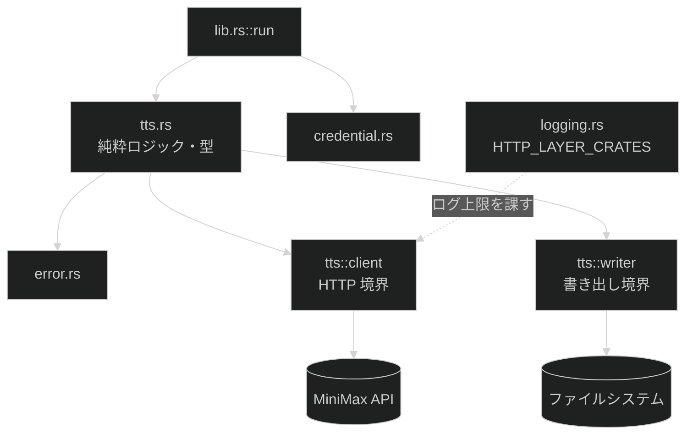

# 音声合成

**関連 Spec:** [tts-synthesis_spec.md](tts-synthesis_spec.md)
**関連 PRD:** [tts-synthesis.md](../requirement/tts-synthesis.md)
**準拠する原則バージョン:** [CONSTITUTION.md](../CONSTITUTION.md) v1.1.1

---

## 原則準拠チェックリスト

### B-001: 認証情報を AI エージェントの到達範囲に置かない（最優先・例外なし）

- [x] トークンを stdout に出力する経路が設計に存在しない（stdout は成果物のパス 1 行のみ）
- [x] 値を引数で受け取るフラグを設計していない。トークンは `credential::load` からのみ取得する
- [x] トークンを保持する型の `Display` / `Debug` を封じている（`credential::ApiToken` をそのまま使う）
- [x] エラーメッセージ・`Display` / `Debug` 実装にトークンが載らない（`TtsError` はトークンを保持しない）
- [x] 認証情報を環境変数で渡す運用を前提にしていない
- [x] **実測済み。`HTTP_LAYER_CRATES` の追加は不要と判明した。**
      `cargo tree -e normal -i tracing` / `-i log` で依存グラフ上の直接依存を確認した結果、
      reqwest の依存グラフで `tracing` クレートに直接依存するのは `hyper_util` のみ、
      `log` クレートに直接依存するのは `reqwest` のみだった（`hyper` / `rustls` / `ring` /
      `tower` / `tower-http` / `hyper-rustls` / `rustls-webpki` / `rustls-pki-types` /
      `webpki-roots` / `tokio` はいずれもログファサードに依存しておらず、イベントを一切出せない）。
      両クレートは既に `HTTP_LAYER_CRATES` に含まれているため、3.3 節の追加候補
      （`hyper_rustls`/`tower`/`tower_http` 等）はいずれも実測で不要と判明した（詳細は 3.3 節）

### B-002: stdout は成果物専用に保つ

- [x] stdout へ書く経路が許可リストに載っているものだけである
      （「（TTS 実装後）生成した音声ファイルのパス 1 行」として既載。**追記は不要**）
- [x] **該当なし**: 経路を増やさない
- [x] 成果物の書き出しに `writeln!(std::io::stdout().lock(), "{}", path.display())?` を使う。
      `#[expect(clippy::print_stdout, ...)]` は付けない
- [x] 失敗時に stdout が空であることを結合テストで固定する設計になっている（8 節）

### A-001: 境界層は薄く保ち、外部世界の読み取りをそこに閉じる

- [x] `main.rs` にロジックを追加していない
- [x] ネットワークとファイルシステムへの到達が境界の型に集約されている（`tts::client` / `tts::writer`）
- [x] 解決ロジックはプロセス環境を書き換えずに単体テストできる
      （`resolve_text_source` / `validate_text` / `format_from_path` / `check_output_path` /
      `extract_audio` は純粋関数）
- [x] 機能モジュール同士の相互依存を作っていない（`tts` → `credential` の一方向のみ）

### A-002: セキュリティに関わる仕組みを自作しない

- [x] TLS は rustls（`reqwest` は `default-features = false` + `rustls-tls`）
- [x] **実測済み**: `openssl` / `openssl-sys` は依存グラフに存在しない
      （`cargo tree -e normal -i openssl` / `-i openssl-sys` がいずれも「該当パッケージなし」）
- [x] **該当なし**: シークレットの保存は credential 側
- [x] **実測済み**: `windows-sys` 系（`windows-sys` / `windows-targets` / `windows_*` アーキ別クレート）
      のみで、`windows` クレート自体は依存グラフに存在しない（`Cargo.lock` に `name = "windows"` の
      パッケージが無い）
- [x] **実測済み**: `cargo deny check licenses` を実行し、`ISC`（`ring` / `rustls-webpki` /
      `untrusted`）、`BSD-3-Clause`（`subtle`）、`CDLA-Permissive-2.0`（`webpki-roots`）の
      3 ライセンスが新たに必要と判明した。3.2 節が推測していた候補（BSD-3-Clause / ISC）に加え、
      `webpki-roots` の `CDLA-Permissive-2.0` は推測に無かった実測結果。`deny.toml` の
      `[licenses] allow` に 3 件とも追記し、`cargo deny check` が全項目 `ok` になることを確認した

### D-001: 外形をテストで固定する

- [ ] **部分達成。** `tts` サブコマンドの終了コードを結合テストで検証する
      → **失敗経路（終了コード 1）のみ**結合テストで固定する（8.1 の表）。
      **成功経路（終了コード 0・stdout に音声パス）は実 API 呼び出しを要するため
      結合テストの対象外**で、単体テスト（`extract_audio` / `write_audio` の組み合わせ）と
      手動確認で代替する（8.1 の逸脱記録を参照）
- [x] 失敗時に stdout が空であることを検証している（結合テスト対象の失敗経路について）
- [x] テストが実行環境の環境変数に影響されない（既存の `bin()` を使う）
- [x] テスト内で `std::env::set_var` / `remove_var` を呼んでいない
- [x] **追加の制約**: 結合テストは実際の API を呼ばない（8.1）

### T-001: 実行時に落ちる余地を残さない

- [x] `unsafe` を書いていない
- [x] `unwrap()` / `expect()` を実装コードに追加していない（**本番コード 0 件を維持**）
- [x] `todo!()` / `dbg!()` を残していない
- [x] 失敗を `Result` の型で表現し、意味の異なる失敗を別 variant に分けている
      （`ApiFailure` の区分、`TtsError::Credential` が `CredentialError` を潰さない）

### 原則からの逸脱

**B-001 に関わる逸脱・例外はありません。** CONSTITUTION.md および `DESIGN_DOC_TEMPLATE.md` は
「B-001 に関わる逸脱は認められない」と明記しており、この例外プロセスは B-001 には適用できません。
B-001 に関する未確定事項（`HTTP_LAYER_CRATES` の追加候補）は実装 PR の最初のタスクで
`cargo tree -e normal` により実測し、追加不要と確定した（3.3 節）。

**D-001 に 1 件、恒久的に受け入れる設計判断としての逸脱があります。** A-002 の 3 件
（ライセンス・禁止クレート・Windows API）は実装 PR の最初のタスクで実測し、いずれも解消済み
（3.2 節）。D-001 の 1 件は成功経路を結合テストでカバーしないことを**恒久的に受け入れる設計判断**
（今後も解消しない）のため、単独の表として記録します。

| 原則 ID | 逸脱内容 | 理由 | 補償手段 | 解消条件 | 追跡 |
|:---|:---|:---|:---|:---|:---|
| D-001 | 成功経路（終了コード 0）に加え、「標準入力が端末」「認証情報が未登録」の 2 経路が結合テストでカバーされず、単体テスト + 手動確認で担保される | 成功経路は実 API 呼び出しが課金を伴い CI で動かせない（8.1）。「標準入力が端末」は pty 無しで 3 OS CI から再現できない（credential-management の D-10 と同じ理由）。「認証情報が未登録」は実際の OS 資格情報ストアに触れるため開発機の状態に依存する（`tests/auth.rs` が同じ理由で `auth status`/`auth logout` を対象外にしている前例に揃える） | `extract_audio` / `write_audio` の単体テストで成功経路の内部ロジックを担保し、実際の API 呼び出しは手動確認手順に従う。「標準入力が端末」「認証情報が未登録」はそれぞれ `src/tts.rs` / `src/credential.rs` の単体テストが担保する | **恒久的な妥協として受け入れる**（HTTP モックサーバーは技術スタック制約により導入しない。9 節 D-6） | 本機能の実装 Issue（[#8](https://github.com/ToshikiImagawa/minimax-cli/issues/8)）。恒久的な設計判断として本設計書に記録済みだが、CONSTITUTION.md の例外プロセスに従い追跡先を明示する |

---

# 1. 実装ステータス

**ステータス:** 🟢 実装済み

## 1.1. 実装進捗

| モジュール/機能 | ステータス | 備考 |
|:---|:---|:---|
| `src/tts.rs`（純粋ロジック・型） | 🟢 | 実装済み |
| `src/tts/client.rs`（HTTP 境界） | 🟢 | 実装済み |
| `src/tts/writer.rs`（書き出し境界） | 🟢 | 実装済み |
| `src/logging.rs` の `HTTP_LAYER_CRATES` | 🟢 | 実測の結果、追加不要と確定（3.3 節） |
| `src/cli.rs` の `tts` サブコマンド | 🟢 | 実装済み |
| `src/lib.rs` の `run()` の arm | 🟢 | 実装済み。`run()` 自体も型付きエラー（`Result<(), Error>`）へ移行済み |
| `tests/tts.rs`（結合テスト） | 🟢 | 実装済み |
| 両 README の CLI リファレンス表 | 🟢 | 更新済み |
| `CHANGELOG.md` の `[Unreleased]` | 🟢 | 追加済み |

**前提:** [credential-management_design.md](credential-management_design.md) の実装が完了しています。

---

# 2. 設計目標

1. **認証ヘッダがどのログ設定でも出ない状態を維持する** — HTTP クライアントを入れる本機能は、
   `HTTP_LAYER_CRATES` の上限を破りうる唯一の変更である
2. **課金する前に落とせる失敗を全部落とす** — 送信前検査を純粋関数に集め、順序を固定する
3. **HTTP の成功と API の成功を混同しない** — レスポンス本文の検査を型で強制する
4. **失敗時に出力パスを汚さない** — 一時ファイル経由で書き、成功時のみ最終パスに置く
5. **通信せずにロジックをテストできる** — リクエスト組み立てとレスポンス解釈を純粋関数にする

---

# 3. 技術スタック

CONSTITUTION.md が固定している領域（HTTP / TLS = `reqwest` + rustls）に従います。

| 領域 | 採用クレート | バージョン | features | 選定理由 |
|:---|:---|:---|:---|:---|
| HTTP クライアント | `reqwest` | 0.12 | `default-features = false` + `rustls-tls` + `json` + `blocking` | CONSTITUTION.md の技術スタック制約で固定されている。`blocking` で async ランタイムを `main` に持ち込まない（9 節 D-2） |
| JSON | `serde` | 1.0 | `derive` | リクエストの組み立てとレスポンスの解釈 |
| JSON | `serde_json` | 1.0 | （既定） | 同上 |
| hex デコード | `hex` | 0.4 | （既定） | API が音声データを hex 文字列で返す。依存ゼロ・MIT/Apache-2.0 |

> **`default-features = false` は必須です。** `reqwest` の既定 features は native-tls 経由で
> `openssl-sys` を引き込み、`deny.toml` の `[bans]` に当たって `audit.yml` が PR で落ちます。

## 3.1. API のエンドポイント

リージョンに対応するホストを選びます（spec の FR-012 / PRD DC_004）。

| `Region` | ホスト | パス |
|:---|:---|:---|
| `Global` | `https://api.minimax.io` | `/v1/t2a_v2` |
| `China` | `https://api.minimaxi.com` | `/v1/t2a_v2` |

**API キーとホストが一致しないと認証エラーになります。** そのため `Region` からホストを導出し、
両者を独立に指定できる形にしません。

## 3.2. 依存追加時の検証結果（実測済み）

- [x] **`deny.toml` の `[licenses] allow` に無いライセンスが増えるか** →
      **増えた。** `cargo deny check licenses` を実行した結果、`ISC`（`ring` / `rustls-webpki` /
      `untrusted`）、`BSD-3-Clause`（`subtle`）、`CDLA-Permissive-2.0`（`webpki-roots`。
      推測時には想定していなかった）の 3 ライセンスが必要だった。`deny.toml` の
      `[licenses] allow` に追記済みで、`cargo deny check` は全項目 `ok`
- [x] **`[bans]` の禁止クレートを推移的に引き込まないか** →
      **引き込まない。** `cargo tree -e normal -i openssl` / `-i openssl-sys` はいずれも
      該当パッケージなし。`windows` クレート自体も `Cargo.lock` に存在せず、
      `windows-sys` 系のみ（deny.toml の既存 `skip-tree` で許容済み）
- [x] **MSRV が `rust-version` 以下か** →
      **超えない。** `RUSTUP_TOOLCHAIN=1.85 cargo check --locked --all-targets --all-features`
      が成功した。`reqwest` 0.12.28 / `rustls` 0.23.43 とも MSRV 1.85 で問題なし
- [x] **配布 4 ターゲットすべてでビルドできるか** →
      **ネイティブ 3 ターゲット + MSRV は確認済み。クロスターゲットの `cargo check` には
      クロス C コンパイラが必要と判明した。** `ring`（rustls の既定の暗号バックエンド）は
      pure Rust ではなく C + アセンブリを含む。`aarch64-unknown-linux-gnu` への
      `cargo check --target` はリンクしない（クロスリンカは不要）が、`ring` の `build.rs` が
      その C コードを実際にクロスコンパイルするため**クロス gcc が必要**（当初の想定は誤り）。
      CI の `cross-check` ジョブに `gcc-aarch64-linux-gnu` を導入するステップを追加した
      （`.github/workflows/ci.yml`）。実際の配布ビルド（`dist build`）は
      `dist-workspace.toml` の `[dist.github-custom-runners]` により各ターゲットのネイティブ
      ランナー（`aarch64-unknown-linux-gnu` は `ubuntu-24.04-arm`）で実行されるため、
      この問題を元々回避できている
- [x] **`Cargo.lock` を更新してコミットする** → 依存追加時に自動更新済み

> この節はクレートを実際に追加してビルド・実測した結果です（CONSTITUTION.md の「記述の裏取り」）。

## 3.3. `HTTP_LAYER_CRATES` への追加（B-001 の中核。実測済み・追加不要と判明）

`src/logging.rs` は、環境変数由来の `EnvFilter` と HTTP レイヤを `warn` で打ち止めにする
`filter::Targets` を `FilterExt::and` で AND 結合しています。現在の対象は
`reqwest` / `hyper` / `hyper_util` / `h2` / `rustls` です。

**実測方法:** `Cargo.lock` の各パッケージの `dependencies` を確認し、`cargo tree -e normal -i tracing`
/ `-i log` で「`tracing` / `log`（ログファサード）に直接依存しているクレートはどれか」を洗い出しました。
ログファサードに依存していないクレートは、そもそもログイベントを一切出せません（`tracing::trace!` や
`log::debug!` を呼べない）。

| クレート | `tracing` に直接依存 | `log` に直接依存 | 結論 |
|:---|:---|:---|:---|
| `hyper_util` | ✅ | - | イベントを出せる。**既に対象に含まれている** |
| `reqwest` | - | ✅ | イベントを出せる。**既に対象に含まれている** |
| `hyper` | - | - | ログファサードに依存せずイベントを出せない |
| `rustls` | - | - | 同上 |
| `ring` | - | - | 同上 |
| `hyper-rustls` | - | - | 同上 |
| `tower` / `tower-http` | - | - | 同上 |
| `rustls-webpki` / `rustls-pki-types` / `webpki-roots` | - | - | 同上 |
| `tokio` | - | - | 同上 |

**結論: `HTTP_LAYER_CRATES` への追加は不要です。** 3.2 節までの推測候補
（`hyper_rustls`/`tower`/`tower_http`/`rustls_pki_types`/`webpki`/`ring`/`aws_lc_rs`/`tokio`）は
いずれもログファサードに依存しておらず、実測の結果誤りだったと判明しました。
`reqwest` が依存する `log` クレートは、本 CLI が `tracing_log::LogTracer` のようなブリッジを
`logging::init` にインストールしていない限り、グローバルロガー未設定のため呼び出しが素通りします
（`log` マクロはグローバルロガー未設定時は no-op）。したがって `reqwest` の `log` 経由の出力は
現状の実装でも構造的に出ません。念のため `reqwest` を対象に含め続けます（将来ブリッジを追加した場合の防御）。

**追加漏れがあると、ログフィルタの指定次第で `Authorization` ヘッダが stderr に出ます。**
今回は追加候補が実測で否定されたため、既存の `HTTP_LAYER_CRATES` をそのまま維持します。

**実測手順（再現用）:**

1. `cargo tree -e normal` で依存グラフを出し、HTTP / TLS 層のクレートを列挙する
2. `cargo tree -e normal -i <crate>` および `Cargo.lock` の `dependencies` で
   各クレートが `tracing` / `log` に直接依存するかを確認する
3. 既存の `the_ceiling_cannot_be_bypassed_by_any_directive` テストが新しいクレートも
   対象にすることを確認する（この配列はテストからも参照されているため自動で対象に入る）
4. 追加したクレートについて、`MINIMAX_LOG=<crate>=trace` を与えてもイベントが出ないことを確認する

`Targets` は target を `::` 区切りの**接頭辞**で照合するため、`hyper` の指定が `hyper::proto::h1` にも
効きます。**`add_directive` による後付け上書きに戻してはなりません**（深い target で貫通します）。

---

# 4. アーキテクチャ

## 4.1. システム構成図



## 4.2. モジュール分割

| モジュール（`src/*.rs`） | 責務 | 依存先 | 外部世界への到達 |
|:---|:---|:---|:---|
| `tts` | 型定義、経路の決定、入力の検証、リクエストの組み立て、レスポンスの解釈、エラーの分類 | `error`, `credential` | **なし**（純粋） |
| `tts::client` | HTTP リクエストの送信。`reqwest` を呼ぶ | `tts` | MiniMax API |
| `tts::writer` | 音声データの書き出しと後始末 | `tts` | ファイルシステム |
| `logging` | HTTP レイヤのログ上限（既存。`HTTP_LAYER_CRATES` を更新） | （なし） | stderr |

**`tts` 本体が通信もファイル I/O もしないことが A-001 / DC_007 の要点です。**

## 4.3. 処理順序（送信前検査の順序を固定する）

課金を発生させないため、**API を呼ぶ前に落とせる検査を全部先に**行います。

```
1. テキストの経路を決定（spec 5.3 の規則）        ← 引数のみ
2. テキストを取得（引数 / ファイル / 標準入力）    ← ファイル I/O
3. テキストの空・長さ上限を検査                   ← 純粋
4. 出力パスの拡張子から音声形式を決定             ← 純粋
5. 出力パスの既存ファイルを検査（--force を考慮） ← ファイルシステムの参照のみ
--- ここまで API を呼ばない。失敗しても課金されない ---
6. 認証情報を読み出す（credential::load）
7. API へ送信
8. レスポンスの業務エラーを検査
9. 音声データをデコード
10. 一時ファイルへ書き、成功したら最終パスへ rename
11. 最終パスを stdout に 1 行出力
```

**5 を 7 より先に置くことが要求です**（spec の FR-005）。逆順にすると、既存ファイルとの
衝突で失敗する実行にも課金が発生します。

---

# 5. データモデル

## 5.1. リクエスト

```rust
use serde::Serialize;

/// 同期音声合成 API へ送るリクエスト。
#[derive(Debug, Serialize)]
pub struct SynthesisRequest {
    pub model: String,
    pub text: String,
    /// 常に false（ストリーミングは扱わない）。
    pub stream: bool,
    /// 常に "hex"（音声データを本文で受け取る）。
    pub output_format: &'static str,
    /// 省略時は "auto"。
    pub language_boost: String,
    pub voice_setting: VoiceSetting,
    pub audio_setting: AudioSetting,
}

#[derive(Debug, Serialize)]
pub struct VoiceSetting {
    pub voice_id: String,
}

#[derive(Debug, Serialize)]
pub struct AudioSetting {
    /// "mp3" / "wav" / "flac"。
    pub format: &'static str,
}
```

速度・音量・音高・感情・サンプリングレート・ビットレート・チャンネル数は
**リクエストに含めません**（省略して API の既定に委ねます）。spec の 10 節のスコープに従います。

## 5.2. レスポンス

```rust
use serde::Deserialize;

/// 同期音声合成 API のレスポンス。
///
/// **HTTP ステータスが 200 でも `base_resp.status_code` が 0 以外になりうる。**
/// `data` はエラー時に欠ける場合があるため `Option` で受ける。
#[derive(Debug, Deserialize)]
pub struct SynthesisResponse {
    pub data: Option<ResponseData>,
    pub extra_info: Option<ExtraInfo>,
    pub base_resp: BaseResp,
}

#[derive(Debug, Deserialize)]
pub struct ResponseData {
    /// hex エンコードされた音声データ。
    pub audio: Option<String>,
}

#[derive(Debug, Deserialize)]
pub struct ExtraInfo {
    /// 課金対象文字数。stderr にのみ出す（成果物ではない）。
    pub usage_characters: Option<u64>,
}

#[derive(Debug, Deserialize)]
pub struct BaseResp {
    pub status_code: i64,
    pub status_msg: String,
}
```

`data` と `audio` を `Option` にしているのは、**エラー時のレスポンス形が保証されていない**ためです。
`unwrap` を使わずに `MalformedResponse` へ落とします（T-001）。

---

# 6. インターフェース定義

エラー型は spec の抽象定義（`TtsError` / `ApiFailure`）を、CONSTITUTION.md が固定する
技術スタック（エラー = thiserror）で具体化します。各 variant の `#[error("...")]` は
spec 5.2 の終了コード表の stderr 案内文と対応させます。

```rust
/// この機能で起きる失敗。バイナリ層（`main_entry`）が anyhow で受けて終了コードに変換する。
#[derive(Debug, thiserror::Error)]
pub enum TtsError {
    /// テキストの経路が 2 つ以上指定された（FR-002）。
    #[error("specify the text via exactly one of: the argument, --file, or standard input")]
    TextSourceConflict,
    /// テキストが指定されていない（FR-002）。
    #[error("no text was given; pass it as an argument, --file <PATH>, or via standard input")]
    TextSourceMissing,
    /// テキストが空または空白のみ（FR-003）。
    #[error("the text to synthesize is empty")]
    EmptyText,
    /// テキストが長さ上限を超えた（FR-006）。
    #[error(
        "the text is {chars} characters, at or above the {limit}-character limit for the \
         synchronous API; split the text, or use the asynchronous API (not implemented by this CLI)"
    )]
    TextTooLong { chars: usize, limit: usize },
    /// 出力パスの拡張子が未対応（FR-004）。
    #[error("unsupported output extension: {extension:?} (expected mp3, wav, or flac)")]
    UnsupportedExtension { extension: Option<String> },
    /// 出力先に既存のファイルがある（FR-005）。
    #[error("the output file already exists: {path} (use --force to overwrite)", path = path.display())]
    OutputExists { path: std::path::PathBuf },
    /// 認証情報の取得に失敗した。**区別を保ったまま伝える**（FR-011）。
    ///
    /// `credential::CredentialError` には `tts` の文脈では発生しない variant
    /// （`InvalidToken` / `InteractiveInputRejected` / `StdinRead`。いずれも `auth login` 専用）
    /// も含まれる。これらは `credential::load` からは返らないため到達しないが、
    /// `thiserror` の `#[error(transparent)]` で `Display` をそのまま委譲することで、
    /// 呼び出し側で網羅的な match を強制しない（万一到達しても汎用的なメッセージになるだけで、
    /// 誤った案内は出さない）。
    #[error(transparent)]
    Credential(#[from] crate::credential::CredentialError),
    /// 通信に失敗した。
    #[error("failed to reach the MiniMax API: {detail}")]
    Transport { detail: String },
    /// API が業務エラーを返した（FR-007）。
    #[error(transparent)]
    Api(#[from] ApiFailure),
    /// レスポンスの解釈に失敗した（想定外の形・デコード不能）。
    #[error("could not interpret the API response: {detail}")]
    MalformedResponse { detail: String },
    /// 音声データの書き出しに失敗した（FR-008）。
    #[error("failed to write the audio file to {path}: {detail}", path = path.display())]
    Write { path: std::path::PathBuf, detail: String },
}

/// API の業務エラーの区分（PRD DC_009 / T-001）。
#[derive(Debug, thiserror::Error)]
pub enum ApiFailure {
    /// 認証に失敗した。トークンが無効な場合と、リージョンが一致しない場合の両方がありうる。
    #[error(
        "authentication failed; check that the registered token matches the registered region \
         (run `minimax auth status`)"
    )]
    Unauthorized,
    /// アカウントの残高が不足している。
    #[error("the MiniMax account balance is insufficient")]
    InsufficientBalance,
    /// レート制限に達した。自動再送はしない（FR-010）。
    ///
    /// API 由来の `detail` をそのまま見せる。実測の結果、`2056`（Token Plan の枠超過）は
    /// 固定文言（待てば解決する）では誤案内になると判明したため（6.2 節）。
    #[error("rate limited by the API (this CLI does not retry automatically): {detail}")]
    RateLimited { detail: String },
    /// 入力に起因するエラー。
    #[error("the API rejected the input: {detail}")]
    InvalidInput { detail: String },
    /// 上記に当てはまらないエラー。
    #[error("the API returned error {code}: {message}")]
    Other { code: i64, message: String },
}
```

`TtsError::Credential` に `#[from]` を付けているのは、`credential::load` の呼び出し側で
`?` による伝播を許すためです。**変換方向が `CredentialError -> TtsError` の一方向のみ**であることに注意してください
（逆方向の変換は無い。`credential` クレートは `tts` を知らない。A-001）。

## 6.1. 純粋関数（通信せずにテストできる）

```rust
use std::path::Path;

/// 同期 API のテキスト長上限。API 仕様は「10,000 文字未満」。
///
/// API 側の数え方（コードポイント / UTF-16 / grapheme）は公開されていないため、
/// Rust の char 数で近似する。境界付近では API 側のエラーになりうる（9 節 D-5）。
pub const TEXT_LENGTH_LIMIT: usize = 10_000;

/// 位置引数・`--file`・標準入力から経路を決める（spec 5.3 の規則）。
///
/// `stdin_is_terminal` を引数で受け取るのは A-001 のため。
/// プロセスの標準入力を見るのは境界の 1 行だけにする。
///
/// # Errors
///
/// 位置引数と `--file` が同時に指定された場合 `TextSourceConflict`、
/// どちらも無く標準入力が端末の場合 `TextSourceMissing` を返す。
pub fn resolve_text_source(
    text: Option<String>,
    file: Option<std::path::PathBuf>,
    stdin_is_terminal: bool,
) -> Result<TextSource, TtsError> {
    match (text, file) {
        (Some(_), Some(_)) => Err(TtsError::TextSourceConflict),
        (Some(value), None) => Ok(TextSource::Argument(value)),
        (None, Some(path)) => Ok(TextSource::File(path)),
        (None, None) if stdin_is_terminal => Err(TtsError::TextSourceMissing),
        (None, None) => Ok(TextSource::Stdin),
    }
}

/// 出力パスの拡張子から音声形式を決める。
///
/// # Errors
///
/// 拡張子が無い、または未対応の場合 `UnsupportedExtension` を返す。
pub fn format_from_path(path: &Path) -> Result<AudioFormat, TtsError> {
    let extension = path.extension().and_then(|value| value.to_str());
    match extension.map(str::to_ascii_lowercase).as_deref() {
        Some("mp3") => Ok(AudioFormat::Mp3),
        Some("wav") => Ok(AudioFormat::Wav),
        Some("flac") => Ok(AudioFormat::Flac),
        other => Err(TtsError::UnsupportedExtension {
            extension: other.map(str::to_owned),
        }),
    }
}

/// テキストの空と長さ上限を検査する。
///
/// # Errors
///
/// 空または空白のみの場合 `EmptyText`、上限以上の場合 `TextTooLong` を返す。
pub fn validate_text(text: &str) -> Result<(), TtsError> {
    if text.trim().is_empty() {
        return Err(TtsError::EmptyText);
    }
    let chars = text.chars().count();
    if chars >= TEXT_LENGTH_LIMIT {
        return Err(TtsError::TextTooLong {
            chars,
            limit: TEXT_LENGTH_LIMIT,
        });
    }
    Ok(())
}

/// 出力先の既存ファイルを検査する（FR-005 / PRD FR_004_03）。
///
/// `exists` を**引数で受け取る**のは A-001 のため（`resolve_text_source` の
/// `stdin_is_terminal` と同じパターン）。プロセスのファイルシステムを見るのは
/// 境界（`lib.rs::run` が `path.exists()` を呼ぶ 1 行）だけにする。
///
/// # Errors
///
/// ファイルが存在し `force` が false の場合 `OutputExists` を返す。
pub fn check_output_path(path: &Path, exists: bool, force: bool) -> Result<(), TtsError> {
    if exists && !force {
        return Err(TtsError::OutputExists {
            path: path.to_path_buf(),
        });
    }
    Ok(())
}

/// レスポンスの業務エラーを検査し、音声データの hex 文字列を返す。
///
/// **HTTP ステータスとは独立に呼ぶ**（HTTP 200 でもエラーが返るため）。
///
/// # Errors
///
/// `base_resp.status_code` が 0 以外の場合 `Api`、
/// 音声データが欠けている場合 `MalformedResponse` を返す。
pub fn extract_audio(response: SynthesisResponse) -> Result<String, TtsError> {
    if response.base_resp.status_code != 0 {
        return Err(TtsError::Api(ApiFailure::from_code(
            response.base_resp.status_code,
            response.base_resp.status_msg,
        )));
    }
    response
        .data
        .and_then(|data| data.audio)
        .ok_or_else(|| TtsError::MalformedResponse {
            detail: "the response contains no audio data".to_owned(),
        })
}
```

## 6.2. 業務エラーコードの対応付け

```rust
impl ApiFailure {
    /// API のステータスコードを区分に落とす。
    ///
    /// 網羅していないコードは `Other` に落ちる。区分を増やすときは
    /// この match と、案内文を出す側の match の両方を更新する（コンパイラが漏れを検出する）。
    pub fn from_code(code: i64, message: String) -> Self {
        match code {
            1004 | 2049 => Self::Unauthorized,
            1008 => Self::InsufficientBalance,
            1002 | 1039 | 1041 | 2045 | 2056 => Self::RateLimited { detail: message },
            1026 | 1027 | 1042 | 2013 => Self::InvalidInput { detail: message },
            _ => Self::Other { code, message },
        }
    }
}
```

| コード | 区分 | 意味 |
|:---|:---|:---|
| 1004 | `Unauthorized` | 認証されていない / トークンがグループと一致しない |
| 2049 | `Unauthorized` | 無効な API キー |
| 1008 | `InsufficientBalance` | 残高不足 |
| 1002 | `RateLimited` | レート制限 |
| 1039 | `RateLimited` | トークン数の上限（TPM） |
| 1041 | `RateLimited` | 接続数の上限 |
| 2045 | `RateLimited` | リクエストの急増 |
| 2056 | `RateLimited` | Token Plan の枠超過（**実測済み**。詳細は下の注記） |
| 1026 / 1027 | `InvalidInput` | 入力 / 出力が規約に反する |
| 1042 | `InvalidInput` | 不可視文字の割合が上限超過 |
| 2013 | `InvalidInput` | 不正なパラメータ |
| その他 | `Other` | コードとメッセージをそのまま提示 |

> **`Unauthorized` の案内文には、トークンが無効な可能性と**
> **リージョンが一致しない可能性の両方を書きます**（spec の 5.2）。
> `1004` のメッセージに「token not match group」が含まれることがあり、
> リージョン不一致でもこの区分に落ちます。

> **`2056` は実装 PR で実機検証し、齟齬を確認・訂正済みです。** 実際に返ってきたのは
> `status_code: 2056` / `status_msg: "Token Plan usage limit reached: Upgrade your Token Plan
> or purchase Credits for more usage."` でした。当初の想定（「次のウィンドウまで待てば解決する」
> 単純なレート制限）とは異なり、**プランのアップグレードか Credits 購入が必要な枠超過**でした。
> `RateLimited` の案内文を固定文言から API 由来の `detail` に変更し、この種の齟齬があっても
> 常に正しい案内になるようにしました（`ApiFailure::RateLimited { detail: String }`）。
> `1002` / `1039` / `1041` / `2045` および `Unauthorized` / `InsufficientBalance` /
> `InvalidInput` の各コードは公開ドキュメントの調査結果に基づく**未実測のまま**です
> （実機でこれらのエラーを再現するには専用のテスト環境が必要なため、実装 PR の範囲では
> 見送りました）。齟齬が見つかった場合は本節を更新してください（CLAUDE.md の「事実確認ルール」）。
> この未実測課題は 9.2 節の未解決課題表にも記録しています。

## 6.3. 境界

```rust
/// HTTP 境界。テストでは呼ばない（8.1）。
///
/// # Errors
///
/// 通信に失敗した場合 `Transport`、レスポンスが JSON として解釈できない場合
/// `MalformedResponse` を返す。業務エラーの判定は `extract_audio` が行う。
pub fn send(
    region: credential::Region,
    token: &credential::ApiToken,
    request: &SynthesisRequest,
) -> Result<SynthesisResponse, TtsError>;

/// 書き出し境界。失敗時に不完全なファイルを残さない（spec の FR-008 / PRD DC_005）。
///
/// 同一ディレクトリの一時ファイルに書き、成功したら最終パスへ rename する。
/// 途中で失敗した場合は一時ファイルを削除する。
///
/// # Errors
///
/// 一時ファイルの作成・書き込み・rename のいずれかが失敗した場合 `Write` を返す。
pub fn write_audio(path: &Path, bytes: &[u8]) -> Result<(), TtsError>;
```

`send` にトークンを渡すのは `&ApiToken` です。認証ヘッダを組み立てるのは `client` 内部の
1 箇所に閉じ込め、**リクエストのログ出力にヘッダを含めません**（DC_006）。

---

# 7. 非機能要件実現方針

| 要件 | 実現方針 |
|:---|:---|
| NFR-001（認証ヘッダが出ない） | `HTTP_LAYER_CRATES` への追加（3.3）。既存の上限テストが自動で新クレートを対象にする |
| NFR-002（トークンが漏れない） | `TtsError` がトークンを保持しない。`ApiToken` の `Debug` は封じられている |
| NFR-003（不完全な成果物を残さない） | 一時ファイル + rename（6.3）。失敗時は一時ファイルを削除 |
| NFR-004（移植性） | rustls は pure Rust。`cross-check` ジョブで確認 |
| NFR-005（通信なしでテスト） | 純粋関数に分離（6.1）。レスポンス解釈は JSON 文字列を直接渡してテスト |

---

# 8. テスト戦略

| テストレベル | 対象 | 配置場所 | 固定する内容 |
|:---|:---|:---|:---|
| 単体 | `resolve_text_source` | `src/tts.rs` の `#[cfg(test)]` | spec 5.3 の表の**全 5 行** |
| 単体 | `format_from_path` | 同上 | 3 形式 + 拡張子なし + 未対応 + 大文字（`.MP3`） |
| 単体 | `validate_text` | 同上 | 空・空白のみ・上限直下・上限ちょうど（境界） |
| 単体 | `extract_audio` | 同上 | `status_code: 0` で成功、0 以外で `Api`、`data` 欠落で `MalformedResponse` |
| 単体 | `ApiFailure::from_code` | 同上 | 対応表の**全コード** + 未知のコード |
| 単体 | リクエストのシリアライズ | 同上 | JSON のフィールド名が API 仕様と一致すること |
| 単体 | `Region` → ホスト | 同上 | 2 リージョンのホストが正しいこと |
| 単体 | `write_audio` の後始末 | 同上（一時ディレクトリを使う） | 書き込み失敗時に最終パスにファイルが無いこと |
| 結合 | `tts` の失敗経路 | `tests/tts.rs` | 終了コードと stdout / stderr の出し分け |

## 8.1. 結合テストが実 API を呼ばない理由

結合テストはバイナリを spawn するため、HTTP 境界を差し替えられません。実 API を呼ぶと
**課金が発生し、トークンが必要になり、CI で動かせません**。

そのため結合テストは、**API に到達する前に完結する経路**に限定します。
4.3 の処理順序で 1〜5 に当たる部分です。

| 結合テストで検証する経路 | API を呼ぶか |
|:---|:---|
| 位置引数と `--file` の同時指定 | 呼ばない（手順 1 で失敗） |
| 空のテキストをパイプ | 呼ばない（手順 3 で失敗） |
| 長さ上限を超えるテキスト | 呼ばない（手順 3 で失敗） |
| 未対応の拡張子（`--output out.ogg`） | 呼ばない（手順 4 で失敗） |
| 既存ファイル（`--force` なし） | 呼ばない（手順 5 で失敗） |
| `--voice` / `--model` / `--output` の欠落 | 呼ばない（clap が失敗） |
| `tts --help` | 呼ばない |
| **失敗時に stdout が空であること**（上記すべて） | 呼ばない |

**「テキスト未指定（標準入力が端末）」と「認証情報が未登録」の 2 経路は実装時に結合テストの対象外とした
（当初のタスク分解からのスコープ縮小。下の D-001 の表に追加記録）。**

- 「標準入力が端末」は `credential-management` の `auth login` TTY 判定失敗経路（design 8.1 節 D-10）と
  同じ理由で対象外。`assert_cmd` の子プロセスの標準入力は pty ではないため、3 OS CI で
  `is_terminal() == true` を再現する手段が無い。`src/tts.rs` の
  `resolve_text_source_rejects_nothing_given_when_stdin_is_a_terminal` 単体テストが担保する
- 「認証情報が未登録」は `credential::load` が実際の OS 資格情報ストアに触れるため、開発機に
  既にトークンが登録されている環境ではテストが環境依存になる。`tests/auth.rs` が
  `auth status` / `auth logout` の実ストア経路を結合テストの対象外にしているのと同じ理由
  （design 6.1 節の `CredentialError` の区別自体は `src/credential.rs` の単体テストが担保する）

**HTTP モックサーバーは導入しません。** CONSTITUTION.md の技術スタック制約が
テストの手段を `assert_cmd` / `predicates` / `insta` に限っており、モックサーバーの追加は
例外プロセスを要します。境界を薄く保っているため、モックで得られる検証範囲は
`send` の内部（`reqwest` の呼び出し）に限られ、費用対効果が低いと判断しました（9 節 D-6）。

**この結果、成功経路（終了コード 0・stdout に音声パス 1 行）は結合テストでは検証されません。**
これは D-001 の「全サブコマンドの終了コードを結合テストで固定する」を部分的にしか満たさない
**正式な逸脱**です（原則準拠チェックリストの「原則からの逸脱」表に記録済み）。
成功経路の内部ロジック（レスポンスの解釈・書き出し）は `extract_audio` / `write_audio` の
単体テストで担保します。実際の API 呼び出しは**手動で確認**します。確認手順は実装 PR の説明に記載します。

## 8.2. その他の注意点

- [x] 環境変数を読む処理を追加しない
- [x] 結合テストが spawn する子プロセスの環境変数を外している（既存の `bin()`）
- [x] **該当なし**: `std::fs::read_dir` を使わない
- [x] **相対パスの正規化が必要**: stdout に出す成果物のパスは `Path::display()` を使う。
      結合テストで比較する場合は `/` 区切りに正規化する（Windows レグ対策）
- [ ] `tts --help` の全文回帰は `insta` で固定する（導入は実装時に判断）

---

# 9. 設計判断

## 9.1. 決定事項

| # | 決定事項 | 選択肢 | 決定内容 | 理由 |
|:---|:---|:---|:---|:---|
| D-1 | HTTP クライアント | `reqwest` / `ureq` / `curl` バインディング | **`reqwest`** | CONSTITUTION.md の技術スタック制約が `reqwest` を固定している。`ureq` は軽量だが、変更には例外プロセス（Issue + `deny.toml` と `CLAUDE.md` の更新）が必要 |
| D-2 | 同期 / 非同期 | `blocking` feature / tokio を `main` に持ち込む | **`blocking`** | 1 回の実行で 1 リクエストしか送らないため async の利点がない。tokio ランタイムを導入するコストに対して得るものが無い |
| D-3 | 音声データの受け取り | `output_format: "hex"` / `"url"` | **`hex`** | `url` は 24 時間有効な URL を返すため、ダウンロードのために 2 回目の HTTP リクエストが必要になる。`hex` なら 1 回で完結する |
| D-4 | 業務エラーの表現 | 文字列比較 / コードの数値をそのまま扱う / 型で区分 | **型で区分（`ApiFailure`）** | 区分ごとに案内文を変える必要があり、追加漏れをコンパイラに検出させたい（T-001 / PRD DC_009） |
| D-5 | テキスト長の数え方 | `chars().count()` / `len()`（バイト） / grapheme | **`chars().count()`** | API 側の数え方が公開されていない。バイト長は日本語で 3 倍に見積もり誤判定する。grapheme は依存追加が必要。境界付近で API 側のエラーになる余地は残るが、大半のケースで正しく落とせる |
| D-6 | HTTP のテスト | モックサーバー導入 / 純粋関数のみ | **純粋関数のみ** | CONSTITUTION.md がテスト手段を限定している。境界が薄いためモックの検証範囲が狭い |
| D-7 | 書き出しの原子性 | 直接書く / 一時ファイル + rename / `tempfile` クレート | **一時ファイル + rename（自前）** | 直接書くとクラッシュ時に不完全なファイルが残る。`tempfile` は一時ディレクトリ機能が不要で、同一ディレクトリに作る必要があるため自前で足りる |
| D-8 | 音声形式の指定手段 | 拡張子から推論 / `--format` フラグ / 両方 | **拡張子のみ** | 両方あると食い違ったときの優先順位を決める必要があり、利用者が誤る。拡張子 1 つに絞れば曖昧さがない |
| D-9 | `--model` の値の検証 | clap の列挙で固定 / 文字列のまま | **文字列のまま** | 列挙で固定すると MiniMax の新モデルが本 CLI のリリースまで使えない。誤った値は API 側が弾く |
| D-10 | 既存ファイルの扱い | 無条件上書き / 拒否 + `--force` | **拒否 + `--force`** | AI エージェントに実行させると前の成果物を黙って消す事故になる。破壊的操作は明示的な指定を要求する |
| D-11 | 送信前検査の順序 | 認証情報を先に読む / 検査を先に | **検査を先に**（4.3） | 課金は発生しないが、認証情報の読み出しは OS のストアに触るため、引数の誤りで落ちる実行では不要 |
| D-12 | `src/error.rs` の `Error` への統合 | `TtsError` を独立させたまま `anyhow` で受ける / `Error::Tts(TtsError)` として集約する | **`Error::Tts(TtsError)` として集約する** | CONSTITUTION.md が「TTS 実装時に `run()` を型付きエラーへ寄せ、`anyhow` は `main_entry` に閉じる」ことを要求している。[credential-management_design.md](credential-management_design.md) の「9.1. 決定事項」D-7（`Error::Credential` の追加）と同じ形に揃え、`run()` の tts arm も型付きエラーを返すようにする |

## 9.2. 未解決の課題

**ライセンス・MSRV・`HTTP_LAYER_CRATES` の 3 件は実装 PR の最初のタスクで実測し解消済み**（3.2 / 3.3 節）。
以下は実測では解消しない残課題です。

| 課題 | 影響度 | 対応方針 |
|:---|:---|:---|
| 業務エラーコード対応表（6.2）のうち `2056` 以外（`1002`/`1039`/`1041`/`2045`/`Unauthorized`/`InsufficientBalance`/`InvalidInput` の各コード）が公開ドキュメントの調査結果に基づく未実測のまま | 中 | `2056` は実装 PR で実機検証し、齟齬（固定文言では誤案内になる）を発見して訂正済み（6.2）。残りは再現に専用のテスト環境が必要なため、発生時に本節を更新する |
| API のテキスト長上限の数え方 | 低 | D-5 のとおり char 数で近似する。境界付近の挙動は手動確認で把握する |
| `usage_characters`（課金対象文字数）を利用者に見せるか | 低 | stderr に出す。stdout には出さない（成果物ではない） |
| 音声形式ごとの API 側の制約（ビットレートは mp3 のみ有効など） | 低 | ビットレートを露出しないため現状は影響しない。パラメータを増やす際に再検討する |

---

# 10. 変更履歴

## v0.1.0（未リリース）

**変更内容:**

- 音声合成の初回設計。同期 API + `output_format: hex` による 1 回の呼び出しで 1 ファイル生成
- `reqwest`（rustls 構成）の導入にあわせて `HTTP_LAYER_CRATES` を更新し、
  認証ヘッダがどのログ設定でも出ない状態を維持する
