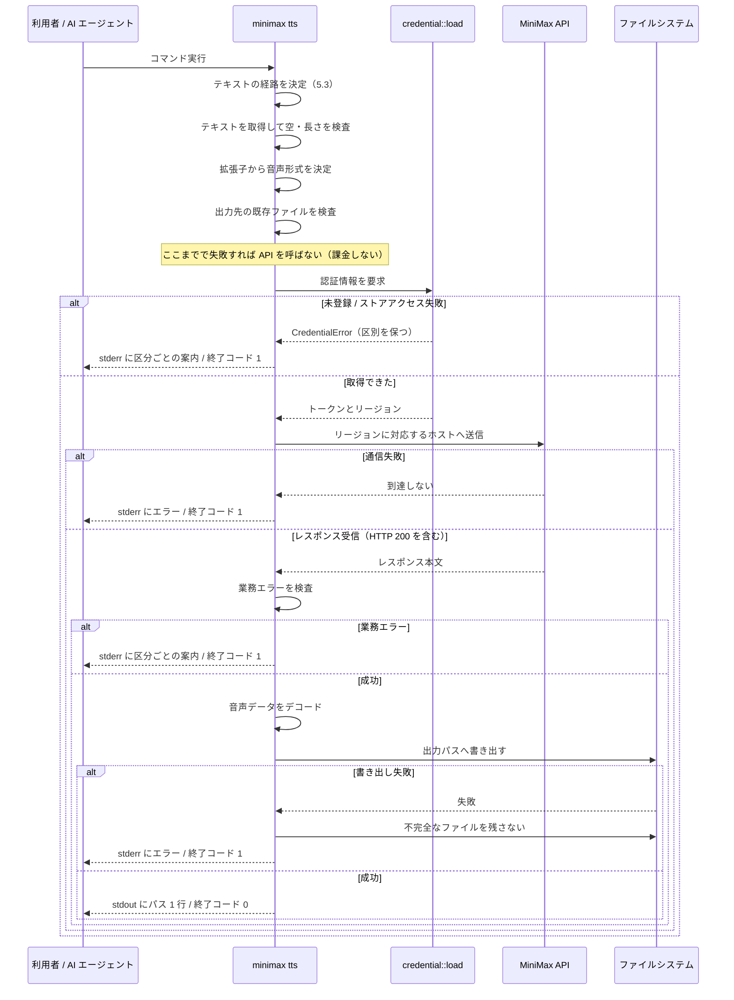
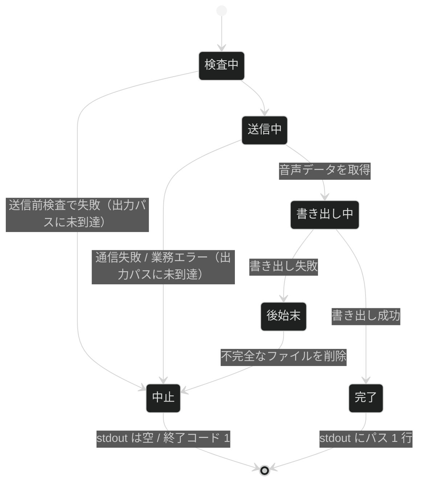

# 音声合成

**関連 Design Doc:** [tts-synthesis_design.md](tts-synthesis_design.md)
**関連 PRD:** [tts-synthesis.md](../requirement/tts-synthesis.md)

---

# 1. 背景

このプロジェクトの目的は「AI エージェントに認証情報を渡さずに読み上げ音声ファイルを生成すること」です。
[credential-management_spec.md](credential-management_spec.md) が認証情報を守る側を担い、
この仕様は**成果物を作る側**を担います。

AI エージェントに実行させる前提のため、認証情報以外にも守るべきものがあります。

- **stdout** — エージェントは stdout をそのままコンテキストに取り込むため、成果物のパス以外を書かない
- **既存のファイル** — 出力先を黙って上書きすると、エージェントが前の成果物を消す
- **課金** — 課金は文字数ベースなので、手元で落とせる失敗に料金を払わない

# 2. 概要

`minimax tts` で、テキストを 1 回の同期 API 呼び出しで 1 つの音声ファイルに変換します。

この仕様が実現することは 4 つです。

1. **テキストの経路を曖昧にしない** — 位置引数・ファイル・標準入力のどれが使われるかが常に一意に決まる
2. **送信前に落とせる失敗を先に落とす** — テキスト長・出力先の衝突は API を呼ぶ前に検査する
3. **HTTP の成功と API の成功を混同しない** — この API は HTTP 200 でも本文にエラーを返す
4. **失敗したら成果物を残さない** — 不完全な音声ファイルが成功時と同じパスに存在しないようにする

# 3. 原則への言及

この仕様が [CONSTITUTION.md](../CONSTITUTION.md)（v1.1.1）のどの原則に従って設計されているかを示します。

## 3.1. 適用する原則

| 原則 ID | この仕様における意味 | 対応する要求 ID |
|:---|:---|:---|
| B-001 | トークンは資格情報ストアから読み出すのみ。フラグ・環境変数で受け取らない。認証ヘッダをログに出さない。HTTP レイヤのログ上限の対象に新しいクレートを追加する | IR_003, DC_002, DC_006 |
| B-002 | stdout に書くのは**生成した音声ファイルのパス 1 行だけ**。進捗・警告・API のエラー内容はすべて stderr。音声バイナリを stdout に流す経路を作らない | IR_001 |
| A-001 | HTTP 通信とファイル書き出しを境界に閉じ、リクエストの組み立て・レスポンスの解釈・入力の検証は通信せずにテストできる純粋なロジックにする | DC_007 |
| A-002 | TLS は rustls に固定し、native-tls 系を依存グラフに入れない | DC_001 |
| D-001 | `tts` の終了コードと stdout / stderr の出し分けを結合テストで固定する。失敗時に stdout が空であることを含む | FR_001〜FR_008, IR_001, IR_002 |
| D-002 | この仕様書と設計書が実装より先に存在する | （仕様書全体） |
| T-001 | 業務エラーの区分と認証情報の失敗区分を型で表現する。`unwrap` / `expect` を使わない | FR_006, DC_005, DC_008, DC_009 |

## 3.2. stdout / stderr の出し分け

B-002 は非交渉です。この機能が書き込む出力をすべて列挙します。

| 出力内容 | 出力先 | 根拠 |
|:---|:---|:---|
| 生成した音声ファイルのパス（成功時のみ、1 行） | **stdout**（1 行） | 成果物。CONSTITUTION.md の許可リストに**既に記載済み** |
| 入力の検証エラー（経路の重複・空・長さ超過・未対応の拡張子・既存ファイル） | stderr | B-002 |
| 認証情報の未登録 / ストアアクセス失敗 | stderr | B-002。両者で案内を変える（DC_008） |
| API の業務エラー（区分ごとの案内） | stderr | B-002 |
| 通信エラー・書き出しの失敗 | stderr | B-002 |
| 進捗・警告 | stderr | B-002 |

- [x] stdout へ書く経路が CONSTITUTION.md の**許可リスト**に載っている
      → **載っている**（「（TTS 実装後）生成した音声ファイルのパス 1 行」）。**追記は不要**
- [x] **失敗時に stdout が空**であることを結合テストで固定する（D-001。5.2 の終了コード表）

> **音声バイナリを stdout に書く経路は定義しません。** 許可リストに無い新しい種類の出力を
> 増やさないためです（PRD の 7 節でスコープ外として明記）。

## 3.3. 原則からの逸脱

**逸脱はありません。**

# 4. 要求定義

## 4.1. トレーサビリティ

| PRD の要求 ID | この仕様での実現箇所 | 検証方法 |
|:---|:---|:---|
| FR_001 | 5.1 / 9.1（合成の振る舞い） | 結合テスト |
| FR_002 | 4.2 FR-001 / 5.3（経路の決定規則） | 単体テスト + 結合テスト |
| FR_002_01 | 5.1（位置引数）/ 5.3 | 単体テスト |
| FR_002_02 | 5.1（`--file`）/ 5.3 | 単体テスト |
| FR_002_03 | 5.3（標準入力） | 単体テスト |
| FR_002_04 | 4.2 FR-002 / 5.3 | 単体テスト + 結合テスト |
| FR_002_05 | 4.2 FR-003 | 単体テスト |
| FR_003 | 5.1（`--voice` / `--model` / `--language`） | 結合テスト |
| FR_003_01 | 5.1（`--voice` を必須にする） | 結合テスト |
| FR_003_02 | 5.1（`--model` を必須にする） | 結合テスト |
| FR_003_03 | 5.1（`--language` を省略可能にする） | 結合テスト |
| FR_004 | 5.1（`--output`）/ 4.2 FR-005 | 結合テスト |
| FR_004_01 | 5.1（`--output` を必須にする） | 結合テスト |
| FR_004_02 | 4.2 FR-004 / 6（`format_from_path`） | 単体テスト |
| FR_004_03 | 4.2 FR-005 / 5.1（`--force`） | 単体テスト + 結合テスト |
| FR_005 | 4.2 FR-006 / 6（`validate_text`） | 単体テスト |
| FR_006 | 4.2 FR-007 / 6.1（`ApiFailure`） | 単体テスト |
| FR_007 | 4.2 FR-008 / 9.1 | 単体テスト |
| FR_008 | 3.2 / 5.2 / 4.2 FR-009 | 結合テスト |
| IR_001 | 3.2 / 5.2 | 結合テスト |
| IR_002 | 5.2（終了コード表） | 結合テスト |
| IR_003 | 6（トークンは `credential::load` 経由のみ） | レビュー |
| DC_001 | 設計書の技術スタック | CI（cargo-deny） |
| DC_002 | 設計書（`HTTP_LAYER_CRATES` への追加） | 単体テスト（既存の上限テスト） |
| DC_003 | 4.2 FR-010（再送しない） | レビュー |
| DC_004 | 6（`Region` からホストを決める）/ 設計書 | 単体テスト |
| DC_005 | 4.2 FR-008（失敗時に成果物を残さない） | 単体テスト |
| DC_006 | 設計書（認証ヘッダをログに出さない） | レビュー |
| DC_007 | 6（純粋関数と境界の分離）/ 設計書のモジュール分割 | レビュー + 単体テスト |
| DC_008 | 4.2 FR-011 / 5.2（案内の出し分け） | 単体テスト + 結合テスト |
| DC_009 | 6.1（`ApiFailure` の variant 分割） | レビュー |
| DC_010 | 設計書の技術スタック | CI（MSRV ジョブ） |

## 4.2. 機能要件

| ID | 要件 | 優先度 | 根拠 |
|:---|:---|:---|:---|
| FR-001 | 位置引数・`--file`・標準入力のいずれか 1 つからテキストを取得する | 必須 | PRD FR_002 |
| FR-002 | テキストの経路が一意に決まらない指定を拒否する（5.3 の規則） | 必須 | PRD FR_002_04 |
| FR-003 | 空または空白のみのテキストを送信前に拒否する | 必須 | PRD FR_002_05 |
| FR-004 | 出力パスの拡張子から音声形式を決定し、未対応の拡張子を拒否する | 必須 | PRD FR_004_02 |
| FR-005 | 出力先に既存のファイルがある場合、`--force` が無ければ**送信前に**拒否する | 必須 | PRD FR_004_03。送信後に拒否すると課金だけが発生する |
| FR-006 | テキスト長の上限を**送信前に**検査し、超過時は非同期 API の存在を案内して中止する | 必須 | PRD FR_005 |
| FR-007 | レスポンスの業務エラーを検査し、区分ごとに利用者向けの案内へ変換する | 必須 | PRD FR_006 |
| FR-008 | 音声データをデコードして出力パスに書き出す。失敗時は不完全なファイルを残さない | 必須 | PRD FR_007 / DC_005 |
| FR-009 | 成功時に音声ファイルのパスを stdout に 1 行出力する | 必須 | PRD FR_008 |
| FR-010 | 失敗したリクエストを自動で再送しない | 必須 | PRD DC_003。非冪等な課金 API の二重課金を避ける |
| FR-011 | 認証情報の「未登録」と「ストアアクセス失敗」を区別したまま案内する | 必須 | PRD DC_008 |
| FR-012 | 保存されたリージョンに対応する API ホストを選択する | 必須 | PRD DC_004 |

## 4.3. 非機能要件

**性能の数値目標は設定しません。** 応答時間は API 側に支配されます（PRD の 4.2 と同じ判断）。

| ID | カテゴリ | 要件 | 目標 |
|:---|:---|:---|:---|
| NFR-001 | セキュリティ | 認証ヘッダがどのログ設定でも出力されない | HTTP レイヤのログ上限テストが新クレートも対象にする |
| NFR-002 | セキュリティ | トークンがエラーメッセージ・ログに現れない | `TtsError` / `ApiFailure` の `Display` 実装にトークンの値が含まれない |
| NFR-003 | 信頼性 | 失敗時に出力パスに不完全なファイルが残らない | 書き出し失敗時、出力パスにファイルが存在しない |
| NFR-004 | 移植性 | 配布対象の全ターゲットで動作する | 配布 4 ターゲットすべてでビルド・実行できる |
| NFR-005 | テスト独立性 | HTTP 通信なしでリクエスト組み立てとレスポンス解釈をテストできる | `resolve_text_source` / `format_from_path` / `validate_text` / `check_output_path` / `extract_audio` が通信・ファイル I/O なしで呼び出せる |

# 5. CLI インターフェース

**真実の源は `src/cli.rs`** です。実装後に食い違ったらこちらを直します。

## 5.1. サブコマンドとフラグ

```
minimax tts [OPTIONS] --voice <ID> --model <NAME> --output <PATH> [TEXT]
```

| サブコマンド | フラグ / 引数 | 必須 | 説明（`--help` に出る英語） |
|:---|:---|:---|:---|
| `tts` | `[TEXT]` | 条件付き | `Text to synthesize` |
| `tts` | `--file <PATH>` | 条件付き | `Read the text to synthesize from a file` |
| `tts` | `--voice <ID>` | **必須** | `Voice ID to synthesize with` |
| `tts` | `--model <NAME>` | **必須** | `Model to use for synthesis` |
| `tts` | `--output <PATH>` | **必須** | `Path of the audio file to write` |
| `tts` | `--language <LANG>` | 省略可 | `Language hint for pronunciation` |
| `tts` | `--force` | 省略可 | `Overwrite the output file if it already exists` |

- `--voice` と `--model` に**既定値を設けません**。モデルによって課金単価が異なるため、
  本 CLI が利用者の代わりに選ぶことをしません（PRD FR_003）
- `--language` を省略した場合は API 側の自動判定に委ねます
- `--model` の値を列挙型で固定しません。MiniMax が新しいモデルを出したときに
  本 CLI のリリースを待たずに使えるようにするためです（誤った値は API 側のエラーとして返ります）
- **トークンを受け取るフラグは定義しません**（IR_003）

## 5.2. 終了コード

| 状況 | 終了コード | stdout | stderr |
|:---|:---|:---|:---|
| 生成成功 | 0 | 音声ファイルのパス 1 行 | （進捗のみ） |
| テキストの経路が一意でない | 1 | **空** | どの指定が競合したか |
| テキストが指定されていない | 1 | **空** | 3 つの経路の案内 |
| テキストが空 | 1 | **空** | 空のテキストは合成できない旨 |
| テキストが長さ上限を超過 | 1 | **空** | 上限と、非同期 API が必要な旨 |
| 未対応の拡張子 | 1 | **空** | 対応する拡張子の一覧 |
| 出力先に既存ファイル（`--force` なし） | 1 | **空** | `--force` の案内 |
| 認証情報が未登録 | 1 | **空** | `auth login` の案内 |
| 資格情報ストアにアクセスできない | 1 | **空** | 原因の区分（未登録とは別の案内） |
| API の認証失敗 | 1 | **空** | トークンと**リージョンの不一致**の可能性を案内 |
| API の残高不足 | 1 | **空** | アカウントの残高確認を案内 |
| API のレート制限 | 1 | **空** | 時間を置いて再実行する案内（自動再送はしない） |
| API のその他のエラー | 1 | **空** | コードとメッセージを提示 |
| 通信エラー | 1 | **空** | 通信に失敗した旨 |
| ファイル書き出しの失敗 | 1 | **空** | 書き出しに失敗した旨（不完全なファイルは残さない） |

**失敗時に stdout が空であることを結合テストで固定します。**

## 5.3. テキストの経路の決定規則

PRD の FR_002_04（「経路が 2 つ以上または 0 個の場合は拒否する」）を、次の規則として具体化します。

| 位置引数 `[TEXT]` | `--file` | 標準入力 | 動作 |
|:---|:---|:---|:---|
| あり | あり | — | **エラー**（競合） |
| あり | なし | — | 位置引数を使う（標準入力は読まない） |
| なし | あり | — | ファイルを読む（標準入力は読まない） |
| なし | なし | 端末でない | 標準入力を読む |
| なし | なし | 端末 | **エラー**（テキストが指定されていない） |

**標準入力は「位置引数と `--file` の両方が無いときのフォールバック」として扱います。**
「標準入力が端末でないこと」を経路の指定と見なして 3 つ目の競合条件にすると、
標準入力が `/dev/null` にリダイレクトされる環境（CI・cron・一部のエージェント実行環境）で
`minimax tts "text" ...` が競合エラーになってしまいます。

この扱いでも曖昧さは生じません。位置引数か `--file` が指定されていれば標準入力は読まず、
どちらも無ければ標準入力が唯一の経路です。**暗黙の優先順位でテキストが選ばれることはありません。**

> この点は PRD の記述を実装可能な形に具体化したものです。差分として末尾の
> 「PRD 整合レビュー結果」に記録しています。

# 6. 公開 API

クレート名・バージョン・feature 指定・エンドポイント URL・上限値は
[tts-synthesis_design.md](tts-synthesis_design.md) が扱います。

| モジュール（`src/*.rs`） | 型 / 関数 | 可視性 | 概要 |
|:---|:---|:---|:---|
| `tts` | `AudioFormat` | `pub` | 出力音声形式（拡張子から決まる） |
| `tts` | `TextSource` | `pub` | 解決済みのテキスト取得元 |
| `tts` | `TtsError` | `pub` | この機能で起きる失敗 |
| `tts` | `ApiFailure` | `pub` | API の業務エラーの区分（DC_009） |
| `tts` | `resolve_text_source(text, file, stdin_is_terminal)` | `pub` | 5.3 の規則で経路を決める純粋関数。`stdin_is_terminal` は標準入力が端末かどうか |
| `tts` | `format_from_path(path)` | `pub` | 拡張子から `AudioFormat` を決める純粋関数 |
| `tts` | `validate_text(text)` | `pub` | 空・長さ上限を検査する純粋関数 |
| `tts` | `check_output_path(path, exists, force)` | `pub` | 出力先の既存ファイルを検査する純粋関数。存在するか（`exists`）と `--force` を引数で受け取る（A-001。ファイルシステムを見るのは呼び出し側） |
| `tts` | `extract_audio(response)` | `pub` | レスポンスの業務エラーを検査し、音声データを取り出す純粋関数 |
| `tts` | `send(region, token, request)` | `pub` | 境界。API を呼び、レスポンスを返す |
| `tts` | `write_audio(path, bytes)` | `pub` | 境界。音声データをファイルに書き出す |

**引数名のみを示し、具体的な型（`SynthesisResponse` 等の API リクエスト/レスポンス型を含む）は
[tts-synthesis_design.md](tts-synthesis_design.md) の 5 節・6 節に委ねます。**
**`resolve_text_source` / `format_from_path` / `validate_text` / `check_output_path` /
`extract_audio` が純粋関数であることが NFR-005 と DC_007 の要点です。**
これらは通信もファイル I/O もせずに単体テストできます。**`send` と `write_audio` だけが
境界（通信・ファイル書き出し）に触れます。**

## 6.1. 型定義

```rust
use std::path::PathBuf;

/// 出力音声形式。対応する拡張子と 1:1 に対応する。
#[derive(Debug, Clone, Copy, PartialEq, Eq)]
pub enum AudioFormat {
    Mp3,
    Wav,
    Flac,
}

/// 解決済みのテキスト取得元（5.3 の規則の結果）。
#[derive(Debug)]
pub enum TextSource {
    Argument(String),
    File(PathBuf),
    Stdin,
}

/// API の業務エラーの区分。
///
/// 実行時の文字列比較ではなく型で表現し、呼び出し側に区別を強制する（PRD DC_009 / T-001）。
/// 区分を増やすときはこの enum に variant を足すため、案内の追加漏れがコンパイル時に分かる。
#[derive(Debug)]
pub enum ApiFailure {
    /// 認証に失敗した。トークンが無効な場合と、リージョンが一致しない場合の両方がありうる。
    Unauthorized,
    /// アカウントの残高が不足している。
    InsufficientBalance,
    /// レート制限に達した。自動再送はしない（FR-010）。
    RateLimited,
    /// 入力に起因するエラー（不正なパラメータ・不可視文字の割合など）。
    InvalidInput { detail: String },
    /// 上記に当てはまらないエラー。
    Other { code: i64, message: String },
}

/// この機能で起きる失敗。
#[derive(Debug)]
pub enum TtsError {
    /// テキストの経路が 2 つ以上指定された（FR-002）。
    TextSourceConflict,
    /// テキストが指定されていない（FR-002）。
    TextSourceMissing,
    /// テキストが空または空白のみ（FR-003）。
    EmptyText,
    /// テキストが長さ上限を超えた（FR-006）。上限は設計書で定める。
    TextTooLong { chars: usize, limit: usize },
    /// 出力パスの拡張子が未対応（FR-004）。
    UnsupportedExtension { extension: Option<String> },
    /// 出力先に既存のファイルがある（FR-005）。
    OutputExists { path: PathBuf },
    /// 認証情報の取得に失敗した。**区別を保ったまま伝える**（FR-011）。
    Credential(crate::credential::CredentialError),
    /// 通信に失敗した。
    Transport { detail: String },
    /// API が業務エラーを返した（FR-007）。
    Api(ApiFailure),
    /// レスポンスの解釈に失敗した（想定外の形・デコード不能）。
    MalformedResponse { detail: String },
    /// 音声データの書き出しに失敗した（FR-008）。
    Write { path: PathBuf, detail: String },
}
```

`TtsError::Credential` が `CredentialError` を**そのまま保持する**ことが FR-011 の実現です。
「未登録」と「ストアアクセス失敗」を潰さずに上位へ運びます。

`TtsError` の文字列表現にトークンを載せません（NFR-002）。`ApiFailure::Other` の `message` は
API 由来の文字列で、トークンを含みません。**具体的なエラーメッセージの実装
（thiserror の `#[error(...)]`）は [tts-synthesis_design.md](tts-synthesis_design.md) の 6 節が定めます。**

# 7. 用語集

用語の定義は [tts-synthesis.md](../requirement/tts-synthesis.md) と
[credential-management.md](../requirement/credential-management.md) の用語集にあります。
この仕様書はその定義を継承します。

この仕様書で新たに導入する用語は次の 3 つです。

| 用語 | 説明 |
|:---|:---|
| テキストの経路 | テキストの取得元。位置引数・`--file`・標準入力の 3 つ（5.3） |
| 送信前検査 | API を呼ぶ前に完結する検査。経路の決定・空の検査・長さ上限・拡張子・出力先の衝突 |
| 業務エラー | HTTP ステータスが 200 でもレスポンス本文に含まれるエラー。`ApiFailure` で区分する |

# 8. 使用例

**トークンの実値を例に含めません**（B-001）。

```sh
# 位置引数で渡す
minimax tts --voice <VOICE_ID> --model <MODEL> --output out.mp3 "読み上げるテキスト"

# ファイルから渡す（長文・改行を含む場合）
minimax tts --voice <VOICE_ID> --model <MODEL> --output out.wav --file script.txt

# パイプで渡す（位置引数と --file の両方が無いときに標準入力を読む）
pbpaste | minimax tts --voice <VOICE_ID> --model <MODEL> --output out.mp3

# 言語を明示する
minimax tts --voice <VOICE_ID> --model <MODEL> --language ja --output out.mp3 "日本語のテキスト"

# 既存ファイルを上書きする（既定では拒否される）
minimax tts --voice <VOICE_ID> --model <MODEL> --output out.mp3 --force "テキスト"

# 成果物のパスは stdout に 1 行だけ出るので、そのまま次の処理に渡せる
afplay "$(minimax tts --voice <VOICE_ID> --model <MODEL> --output out.mp3 'テキスト')"
```

# 9. 振る舞い図

## 9.1. 音声の生成

**送信前検査をすべて通ってから API を呼ぶ**ことがこの図の要点です。



## 9.2. 失敗時に成果物を残さない



**出力パスに触れるのは「書き出し中」だけ**です。それ以前の失敗では出力パスに一切書き込みません。

# 10. 制約事項

- 同期 API のテキスト長上限を超える入力は拒否します。分割・非同期 API は扱いません（PRD の 7 節）
- 対応する音声形式は拡張子から決まる 3 つ（`.mp3` / `.wav` / `.flac`）です。
  それ以外の形式（`pcm` 等）は扱いません
- 1 回の実行で 1 ファイルです。複数ファイルの一括生成は扱いません
- 音声パラメータのうち露出するのは言語のみです。速度・音量・音高・感情・サンプリングレート・
  ビットレート・チャンネル数・字幕・発音辞書・音声加工は扱いません（PRD の 7 節）
- 自動再送をしません（FR-010）。レート制限に達した場合の再実行は呼び出し側の責務です
- API のレート制限の上限値の一部は公式に公開されていないため、クライアント側で並行度を上げる
  設計にしません（1 回の実行で 1 回しか呼びません）

---

# PRD 整合レビュー結果

**対象 PRD:** [tts-synthesis.md](../requirement/tts-synthesis.md)（`prd-tts-synthesis`）

## 要求カバレッジ

| PRD の要求 | この仕様での扱い |
|:---|:---|
| FR_001〜FR_008（+ サブ要求 8 件） | 4.2 FR-001〜FR-009 と 5.1 / 5.3 で網羅 |
| IR_001〜IR_003 | 3.2 / 5.2 / 6 |
| DC_001〜DC_010 | 4.1 のトレーサビリティ表に全件記載。DC_001 / DC_002 / DC_006 / DC_010 の具体は設計書へ委譲 |

**未カバーの要求はありません。** PRD の要求 ID は合計 **36 件**（葉の要求 FR / IR / DC が **31 件**、
親 requirement ノード `REQ_001`〜`REQ_004` および `FR_003` が **5 件**）です。4.1 の表には葉の 31 件が
それぞれ実現箇所つきで並んでいます。親ノードは PRD 側の `contains` 関係で葉に分解されているため、
個別の実装箇所は持たせていません（[credential-management_spec.md](credential-management_spec.md) と同じ扱い）。

PRD の DC_003（自動再送しない）と DC_008（認証情報の失敗区分を保つ）は、設計制約のままにせず
**機能要件（FR-010 / FR-011）としても明示**しました。振る舞いとして結合テストで固定するためです。

## 用語の整合

PRD 2 本の用語集を継承し、新規用語は 3 件のみ追加しました（7 節）。

## 検出した差分

| 項目 | 内容 | 対応 |
|:---|:---|:---|
| **テキスト経路の判定** | PRD の FR_002_04 は「経路が 2 つ以上または 0 個の場合は拒否」と書いており、字義通りに読むと「標準入力が端末でないこと」も経路の指定に数えることになる。その場合、標準入力が `/dev/null` にリダイレクトされる環境で `minimax tts "text"` が競合エラーになる | 5.3 で**標準入力をフォールバックとして扱う規則**に具体化した。位置引数と `--file` の排他は維持しており、暗黙の優先順位は生じない。PRD の意図（意図しないテキストを課金付きで合成しない）は満たしている |
| `--model` の値の検証 | PRD は既定値を置かないことのみ要求している。列挙で固定するかは未定だった | 5.1 で**固定しない**と確定した。MiniMax の新モデルを本 CLI のリリース待ちなしに使えるようにするため |
| 対応する音声形式 | PRD は「対応形式の範囲」を要求として挙げるが具体を定めていない | 10 節で `.mp3` / `.wav` / `.flac` の 3 つと確定した |
| 認証失敗時の案内 | PRD の FR_006 は「リージョン不一致の可能性を案内する」ことを要求 | 5.2 の終了コード表に反映済み。`ApiFailure::Unauthorized` の案内文で両方の可能性を示す |
