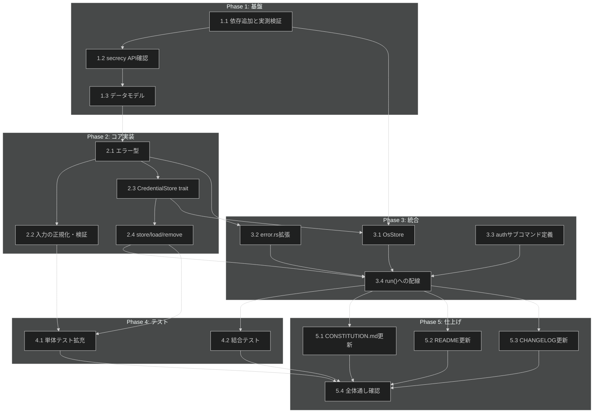

# 認証情報管理 タスク分解

**Issue:** [#6](https://github.com/ToshikiImagawa/minimax-cli/issues/6)
**設計書:** [credential-management_design.md](../../specification/credential-management_design.md)
**仕様書:** [credential-management_spec.md](../../specification/credential-management_spec.md)

## タスク一覧

### Phase 1: 基盤

| #   | タスク | 説明 | 完了条件 | 依存 |
|:----|:---|:---|:---|:---|
| 1.1 | 依存追加と実測検証 | `Cargo.toml` に `keyring = "3.6"`（`default-features = false` + `apple-native`/`windows-native`/`linux-native`）と `secrecy = "0.10"` を追加する。design 3.1 節で「未確定」とされていた `cargo deny check` のライセンス増分、`[bans]` 禁止クレートの非混入、MSRV 1.85 での `cargo check`、配布4ターゲットでのビルド可否を実際に実行して確認する | `cargo build --locked` 成功、`cargo deny check advisories bans licenses sources` 成功、`RUSTUP_TOOLCHAIN=1.85 cargo check --locked --all-features` 成功、4ターゲットの `cargo check`（cross-check相当）成功、`Cargo.lock` をコミット | - |
| 1.2 | `secrecy::SecretString::from(String)` の API 確認 | design 9.2 節の未解決課題。`SecretString::from(String)` がそのまま使えるかを実装前に単体テストで確認する（コンストラクタ API はバージョン間で変わった経緯があるため） | `secrecy` 0.10 で `SecretString::from(trimmed.to_owned())` が動くことを確認するテストが通る | 1.1 |
| 1.3 | データモデルの追加 | `src/credential.rs` を新規作成し、design 5節の `Region`（`as_str()` 含む）、`ApiToken`（`Debug` 手実装、`Display` 未実装）、`StoredCredential` を実装する | `cargo build` が通り、`ApiToken` に `derive(Debug)` を使っていないこと・`Display` が実装されていないことをコードレビューで確認できる | 1.1, 1.2 |

### Phase 2: コア実装

| #   | タスク | 説明 | 完了条件 | 依存 |
|:----|:---|:---|:---|:---|
| 2.1 | エラー型の追加 | `src/credential.rs` に design 6節の `CredentialError`（`NotFound`/`StoreUnavailable`/`InvalidToken`/`InteractiveInputRejected`/`StdinRead(#[source] std::io::Error)`）と 6.1節の `StoreFailure`（`Unavailable(String)`/`PermissionDenied(String)`/`Other(String)`）を `thiserror` で実装する | 全 variant が実装され、`StdinRead` が `StoreUnavailable` に変換される経路が無いことをコードレビューで確認できる | 1.3 |
| 2.2 | 入力の正規化・検証 | `parse_token(&str) -> Result<ApiToken, CredentialError>` と `read_token_from<R: Read>(reader: R, is_terminal: bool) -> Result<ApiToken, CredentialError>` を design 6節どおりに実装する（`is_terminal` を引数で受け取り、プロセスの標準入力を見ない） | 単体テスト: 前後空白・改行の除去、空/空白のみの入力で `InvalidToken`、`is_terminal = true` で `InteractiveInputRejected`、stdin 読み取り失敗で `StdinRead`（`StoreUnavailable` に変換されないこと）が通る | 2.1 |
| 2.3 | `CredentialStore` trait | design 6節の `CredentialStore` trait（`set`/`get`/`delete`）を `src/credential.rs` に定義する（A-001 の境界） | `cargo build` が通り、trait 定義が `credential` モジュール内に閉じている | 2.1 |
| 2.4 | `store` / `load` / `remove` | design 6.2節の3関数を実装する。特に `load` の `Ok(None) -> Err(NotFound)` 変換と、`Err` を `NotFound` に変換しない不変条件を実装する | 単体テスト（`InMemoryStore` を注入）: 上書き保存、未登録時の `NotFound`、削除の冪等性、**ストアが `Err` を返したとき `load` が `NotFound` を返さないこと**（D-4 の回帰テスト）が通る | 2.3 |

### Phase 3: 統合

| #   | タスク | 説明 | 完了条件 | 依存 |
|:----|:---|:---|:---|:---|
| 3.1 | `OsStore`（keyring 実装） | `src/credential/os_store.rs` を新規作成し、`CredentialStore` を `keyring` で実装する。design 6.1節の `keyring::Error` → `StoreFailure` 対応表（`NoEntry`→`Ok(None)`、`NoStorageAccess`→`PermissionDenied`、`PlatformFailure`→`Unavailable`、`Ambiguous`/その他→`Other`）を実装する | `cargo build` が通り、対応表の分岐が実装されている。手動確認（開発者の実キーチェーンで `login`→`status`→`logout` が一巡すること）を実施する | 1.1, 2.3 |
| 3.2 | `src/error.rs::Error` の拡張 | design 9節 D-7 の決定に従い、`Error` に `Credential(#[from] credential::CredentialError)` を追加し、未使用状態を解消する | `cargo build` が通り、`clippy::dead_code` 等の warning が出ない | 2.1 |
| 3.3 | `auth` サブコマンドの定義 | `src/cli.rs` に `auth`（親）/`auth login --region <REGION>`/`auth status`/`auth logout` を spec 5.1節どおりに追加する。`--token` フラグは作らない | `minimax auth --help` / `minimax auth login --help` が spec 5.1節の英語説明文と一致する | - |
| 3.4 | `run()` への実装配線 | `src/lib.rs::run()` に `auth` の各 arm を実装する。`login`: stdin から `read_token_from` で読み取り→`store`。`status`: `load`→成功時 `writeln!(stdout, "{}", region.as_str())`、`NotFound` は stderr 案内、その他エラーは stderr。`logout`: `remove`→結果に応じた stderr 案内。プロセスの `stdin.is_terminal()` を見るのはこの1行のみとする | spec 5.2節の終了コード表どおりに動作する（手動確認）。`writeln!(std::io::stdout().lock(), ...)` を使い `#[expect(clippy::print_stdout, ...)]` を付けない | 3.1, 3.2, 3.3, 2.4 |

### Phase 4: テスト

| #   | タスク | 説明 | 完了条件 | 依存 |
|:----|:---|:---|:---|:---|
| 4.1 | 単体テストの拡充 | Phase 2 で書いた単体テストに加え、`ApiToken` の `Debug` 出力にトークンの値が含まれないことを検証するテストを `src/credential.rs` の `#[cfg(test)]` に追加する | `cargo test --locked --all-features` が通り、`format!("{:?}", token)` が `"ApiToken(<redacted>)"` であることを検証している | 2.2, 2.4 |
| 4.2 | 結合テスト `tests/auth.rs` | design 8.1節が定義する「ストアに触れる前に完結する経路」のみを対象に、新規結合テストバイナリを作成する: 空入力パイプ、`--region` 未指定/不正値（終了コード2）、`auth --help`/`auth login --help`、**すべての失敗経路で stdout が空であること**。**`auth login` の TTY 判定失敗経路は対象外**（design 8.1節 D-10。3 OS CI で pty を使わずに固定する手段が無いため、Phase 2 の単体テスト `read_token_from_rejects_a_terminal` のみで担保する） | `cargo test --test auth --locked` が通る。既存の `tests/common/mod.rs::bin()` を使い、子プロセスの環境変数（`LogEnv::NAMES`）を明示的に外す | 3.4 |

### Phase 5: 仕上げ

| #   | タスク | 説明 | 完了条件 | 依存 |
|:----|:---|:---|:---|:---|
| 5.1 | CONSTITUTION.md の stdout 許可リスト更新 | B-002 の逸脱（design 85-98行目に記録済み）を解消する。`auth status` の登録済みリージョン1行を許可リストに追記する | CONSTITUTION.md の許可リストに項目が追加され、design/spec の「原則からの逸脱」表の B-002 行を解消済みとして更新できる状態になる | 3.4 |
| 5.2 | README 更新 | `README.md` と `README.ja.md` の両方の CLI リファレンス表に `auth login`/`auth status`/`auth logout` を追加する。Linux での揮発性（再起動で失われる）の明示を含める（FR-010） | 両 README の表が spec 5.1/5.2節と一致する | 3.4 |
| 5.3 | CHANGELOG 更新 | `CHANGELOG.md` の `[Unreleased]` に英語1行を追加する | CHANGELOG のエントリが追加されている | 3.4 |
| 5.4 | 全体通し確認 | `cargo fmt --all --check` / `cargo clippy --locked --all-targets --all-features -- -D warnings` / `cargo test --locked --all-features --all-targets` / `cargo test --locked --all-features --doc` / `RUSTDOCFLAGS="-D warnings" cargo doc --locked --no-deps --all-features` / `cargo deny --all-features check advisories bans licenses sources` をすべて実行する | 上記すべてが成功する | 4.1, 4.2, 5.1, 5.2, 5.3 |

## 依存関係図

## 実装の注意事項

- **1.1（依存追加の実測検証）を最初に実施する。** design 3.1節・9.2節がいずれも「未確定」として実装フェーズに先送りしている項目であり、ここで詰まると後続タスクの前提が崩れる
- **`credential` モジュール本体を外部世界に触れさせない。** ストアへの実際のアクセスは `credential::os_store` の1モジュールに閉じ込める（A-001）
- **D-4 の回帰テスト（2.4）を落とさない。** `load` がストアの `Err` を `NotFound` に変換しないことは、この機能の中核的な安全性であり、`gh` cli/cli#13317 と同種の事故を防ぐためのもの
- **3.4（`run()` への配線）が B-001/B-002 の実装上の要となる。** stdin を見るのはこの1行のみ、stdout に書くのは `region.as_str()` の1行のみであることを守る
- design が正式に記録している逸脱（B-002 の許可リスト未追記＝5.1で解消／D-001 の結合テスト範囲縮小＝解消せず受容）を実装中に不用意に広げない。特に D-001 の逸脱は「実ストアに触れる結合テストを追加しない」という制約であり、4.2 のスコープを超えないこと

## 要求カバレッジ

| PRD/Spec 要求 ID | 内容 | 対応タスク |
|:---|:---|:---|
| FR-001 / PRD FR_001_01 | 標準入力全体を1トークンとして読む | 2.2 |
| FR-002 / PRD FR_001_02 | 前後の空白・改行を除去 | 2.2 |
| FR-003 / PRD FR_001_03 | 空になる入力を拒否 | 2.2 |
| FR-004 / PRD FR_001_05 | 既存登録を確認無しで上書き＋stderr通知 | 3.4 |
| FR-005 / PRD FR_001_06 | TTY接続時は拒否 | 2.2, 3.4 |
| FR-006 / PRD FR_002 | 登録有無とリージョンを返す（トークンは返さない） | 3.4 |
| FR-007 / PRD FR_003 | 削除。未登録でも成功 | 2.4, 3.4 |
| FR-008 / PRD FR_005 / DC_003 | 未登録とストア失敗を区別 | 2.1, 2.4 |
| FR-009 / PRD FR_004 / IR_001 | 内部API提供（サブコマンドとしては非公開） | 2.4 |
| FR-010 / PRD DC_004 | Linux揮発性の明示 | 5.2 |
| NFR-001 | トークンが漏れない | 1.3, 2.1, 4.1 |
| NFR-002 | 全配布ターゲットで動作 | 1.1 |
| NFR-003 | ストア状態に依存しないテスト | 2.3, 2.4, 4.1 |
| IR_001 | `--token` フラグを作らない | 3.3 |
| IR_002 | `auth status` の stdout許可リスト | 5.1 |
| IR_003 | 終了コード | 4.2 |
| DC_001 / DC_006 | `CredentialStore` の境界抽象 | 2.3, 3.1 |
| DC_002 | `ApiToken` の文字列表現封じ | 1.3, 4.1 |
| DC_004 | Linux揮発性の受容 | 5.2 |
| DC_005 | 環境変数を読まない | 1.3〜3.4（全体） |
| DC_007 | MSRV維持 | 1.1 |

## 参照ドキュメント

- 抽象仕様書: `.sdd/specification/credential-management_spec.md`
- 技術設計書: `.sdd/specification/credential-management_design.md`
- PRD: `.sdd/requirement/credential-management.md`
- GitHub Issue: [#6](https://github.com/ToshikiImagawa/minimax-cli/issues/6)

## 推奨する手動検証

- [ ] タスクの粒度が適切か（1タスク = 数時間〜1日程度）を確認
- [ ] 依存関係図が論理的に正しいか確認
- [ ] 要求カバレッジ表で漏れがないことを確認
- [ ] Phase 分類が適切か確認
