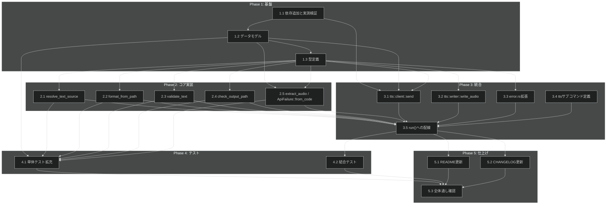

# 音声合成 タスク分解

**Issue:** [#8](https://github.com/ToshikiImagawa/minimax-cli/issues/8)
**設計書:** [tts-synthesis_design.md](../../specification/tts-synthesis_design.md)
**仕様書:** [tts-synthesis_spec.md](../../specification/tts-synthesis_spec.md)

**前提:** [credential-management](https://github.com/ToshikiImagawa/minimax-cli/issues/6)（`src/credential.rs`）の実装が先に必要。

## タスク一覧

### Phase 1: 基盤

| #   | タスク | 説明 | 完了条件 | 依存 |
|:----|:---|:---|:---|:---|
| 1.1 | 依存追加と実測検証 | `Cargo.toml` に `reqwest = "0.12"`（`default-features = false` + `rustls-tls` + `json` + `blocking`）、`serde = "1.0"`（`derive`）、`serde_json = "1.0"`、`hex = "0.4"` を追加する。design 3.2 節で「未確定」とされていた `cargo deny check` のライセンス増分、`[bans]` 禁止クレート（`openssl-sys`/`windows`）の非混入、MSRV 1.85 での `cargo check`、配布4ターゲットでのビルド可否を実際に実行して確認する。design 3.3 節の `HTTP_LAYER_CRATES` 追加候補（`hyper_rustls`/`tower`/`tower_http`/`rustls_pki_types`/`webpki`/`ring`/`aws_lc_rs`/`tokio` 等）を `cargo tree -e normal` で実測し、`src/logging.rs` の `HTTP_LAYER_CRATES` を更新する（design 9.2 節・原則からの逸脱の「未確定の検証項目」を解消する最重要タスク） | `cargo build --locked` 成功。`cargo deny check advisories bans licenses sources` 成功（新規ライセンスがあれば同 PR で `deny.toml` の `[licenses] allow` に追記）。`RUSTUP_TOOLCHAIN=1.85 cargo check --locked --all-features` 成功。4ターゲットの `cargo check`（cross-check相当）成功。`Cargo.lock` をコミット。`HTTP_LAYER_CRATES` が更新され、既存の `the_ceiling_cannot_be_bypassed_by_any_directive` テストが新クレートも対象にすることを確認。`MINIMAX_LOG=<新クレート>=trace` を与えてもイベントが出ないことを確認。design 冒頭の原則準拠チェックリストの B-001/A-002 の該当項目を `[x]` に更新する | - |
| 1.2 | データモデルの追加（リクエスト/レスポンス） | `src/tts.rs` を新規作成し、design 5節の `SynthesisRequest`/`VoiceSetting`/`AudioSetting`（リクエスト）、`SynthesisResponse`/`ResponseData`/`ExtraInfo`/`BaseResp`（レスポンス）を `serde` で実装する | `cargo build` が通り、design 5節のフィールド名・型と一致する。`data`/`audio` が `Option` であることを維持する | 1.1 |
| 1.3 | 型定義（`AudioFormat`/`TextSource`/`TtsError`/`ApiFailure`） | `src/tts.rs` に design 6節の `AudioFormat`、`TextSource`、`TtsError`（`thiserror`。`Credential` は `#[from] credential::CredentialError` で一方向のみ変換）、`ApiFailure` を実装する。`TextTooLong` のエラーメッセージには非同期 API の案内を含める（design 6節の文言どおり） | `cargo build` が通り、`TtsError::Credential` が `#[from]` で一方向のみ変換すること、`unwrap`/`expect` を使っていないことをコードレビューで確認できる | 1.2 |

### Phase 2: コア実装（純粋関数）

| #   | タスク | 説明 | 完了条件 | 依存 |
|:----|:---|:---|:---|:---|
| 2.1 | `resolve_text_source` | spec 5.3 節の規則（design 6.1節）で経路を決める純粋関数を実装する。`stdin_is_terminal` を引数で受け取り、プロセスの標準入力を見ない（A-001） | 単体テストで spec 5.3 節の表の**全5行**（位置引数のみ / `--file` のみ / 両方同時=競合 / どちらも無く端末=missing / どちらも無く非端末=stdin）を固定する | 1.3 |
| 2.2 | `format_from_path` | 出力パスの拡張子から `AudioFormat` を決める純粋関数を実装する | 単体テストで3形式（mp3/wav/flac）+拡張子なし+未対応拡張子+大文字（`.MP3`）を固定する | 1.3 |
| 2.3 | `validate_text` | 空・長さ上限（`TEXT_LENGTH_LIMIT = 10_000`。`chars().count()` で近似、D-5）を検査する純粋関数を実装する | 単体テストで空・空白のみ・上限直下・上限ちょうど（境界）を固定する | 1.3 |
| 2.4 | `check_output_path` | 出力先の既存ファイルを検査する純粋関数を実装する。`exists`/`force` を引数で受け取り、プロセスのファイルシステムを見ない（A-001） | 単体テストで `exists=true & force=false` → `OutputExists`、それ以外 → `Ok` を固定する | 1.3 |
| 2.5 | `extract_audio` と `ApiFailure::from_code` | レスポンスの業務エラーを検査し音声データの hex 文字列を取り出す `extract_audio` と、design 6.2節の対応表（`1004`/`2049`→`Unauthorized`、`1008`→`InsufficientBalance`、`1002`/`1039`/`1041`/`2045`/`2056`→`RateLimited`、`1026`/`1027`/`1042`/`2013`→`InvalidInput`、その他→`Other`）でコードを区分する `ApiFailure::from_code` を実装する。**design 6.2節の対応表は公開ドキュメント調査に基づく未実測情報のため、実際の API レスポンスと照合し、齟齬があれば表を訂正してから実装する**（design 9.2節） | 単体テストで `status_code: 0` で成功、0 以外で `Api`、`data` 欠落で `MalformedResponse` を固定する。`ApiFailure::from_code` の単体テストで対応表の全コード+未知のコードを固定する。対応表を実測で確認した結果を design 6.2節に反映する | 1.2, 1.3 |

### Phase 3: 統合

| #   | タスク | 説明 | 完了条件 | 依存 |
|:----|:---|:---|:---|:---|
| 3.1 | `tts::client::send`（HTTP境界） | `src/tts/client.rs` を新規作成し、design 6.3節の `send` 関数（`reqwest` の `blocking`）を実装する。認証ヘッダの組み立てをこの内部1箇所に閉じ込め、リクエストのログ出力にヘッダを含めない（DC_006）。`Region` から design 3.1節の2エンドポイントを導出する。レート制限等のエラーでも自動再送しない（DC_003 / FR-010） | `cargo build` が通り、認証ヘッダをログに出していないことをコードレビューで確認できる。単体テストで `Region` → ホストの対応（2リージョン）を固定する。再送コードが存在しないことをコードレビューで確認できる | 1.1, 1.2, 1.3 |
| 3.2 | `tts::writer::write_audio`（書き出し境界） | `src/tts/writer.rs` を新規作成し、design 6.3節の `write_audio` 関数（同一ディレクトリの一時ファイルに書き、成功したら最終パスへ `rename`。途中で失敗した場合は一時ファイルを削除）を実装する | 単体テスト（一時ディレクトリを使う）で書き込み失敗時に最終パスにファイルが存在しないことを固定する | 1.3 |
| 3.3 | `src/error.rs::Error` の拡張 | design 9節 D-12 の決定に従い、`Error` に `Tts(#[from] tts::TtsError)` を追加する | `cargo build` が通り、`clippy::dead_code` 等の warning が出ない | 1.3 |
| 3.4 | `tts` サブコマンドの定義 | `src/cli.rs` の既存 `tts` スタブを、spec 5.1節のフラグ（`[TEXT]` / `--file <PATH>` / `--voice <ID>` 必須 / `--model <NAME>` 必須 / `--output <PATH>` 必須 / `--language <LANG>` 省略可 / `--force`）で置き換える。`--token` フラグは作らない（IR_003） | `minimax tts --help` が spec 5.1節の英語説明文と一致する | - |
| 3.5 | `run()` への実装配線 | `src/lib.rs::run()` の `tts` スタブ（`anyhow::bail!`）を、design 4.3節の処理順序（1. 経路決定 → 2. テキスト取得 → 3. 空/長さ検査 → 4. 形式決定 → 5. 既存ファイル検査 →〔ここまで API 未呼出〕→ 6. 認証情報読み出し → 7. API 送信 → 8. 業務エラー検査 → 9. デコード → 10. 一時ファイル書き出し+rename → 11. stdout 出力）どおりに実装する。**5 を 7 より先に置くことを厳守する**（課金回避。spec FR-005）。`stdin.is_terminal()` と `path.exists()` を見るのはこの箇所のみとする | spec 5.2節の終了コード表どおりに動作する（手動確認）。`writeln!(std::io::stdout().lock(), "{}", path.display())?` を使い `#[expect(clippy::print_stdout, ...)]` は付けない。認証情報の「未登録」と「ストアアクセス失敗」の区別を保ったまま stderr へ案内する（DC_008） | 2.1, 2.2, 2.3, 2.4, 2.5, 3.1, 3.2, 3.3, 3.4 |

### Phase 4: テスト

| #   | タスク | 説明 | 完了条件 | 依存 |
|:----|:---|:---|:---|:---|
| 4.1 | 単体テストの拡充 | design 8節のテスト戦略表に基づき、Phase 2 で書いた単体テストに加え、リクエストのシリアライズ（JSON のフィールド名が API 仕様と一致すること）の単体テストを追加する | `cargo test --locked --all-features` が通る | 1.2, 2.1, 2.2, 2.3, 2.4, 2.5 |
| 4.2 | 結合テスト `tests/tts.rs` | design 8.1節が定義する「API に到達する前に完結する経路」のみを対象に、新規結合テストバイナリを作成する: 位置引数と `--file` の同時指定、テキスト未指定（標準入力が端末）、空のテキストをパイプ、長さ上限超過テキスト、未対応の拡張子（`--output out.ogg`）、既存ファイル（`--force` なし）、`--voice`/`--model`/`--output` の欠落、認証情報が未登録、`tts --help`、**すべての失敗経路で stdout が空であること** | `cargo test --test tts --locked` が通る。既存の `tests/common/mod.rs::bin()` を使い、子プロセスの環境変数（`LogEnv::NAMES`）を明示的に外す。成功経路（終了コード0）はこの結合テストの対象外とする（design 8.1節の正式な逸脱。範囲を広げない） | 3.5 |

### Phase 5: 仕上げ

| #   | タスク | 説明 | 完了条件 | 依存 |
|:----|:---|:---|:---|:---|
| 5.1 | README 更新 | `README.md` と `README.ja.md` の両方の CLI リファレンス表に `tts` サブコマンドの全フラグを追加する | 両 README の表が spec 5.1節と一致する | 3.5 |
| 5.2 | CHANGELOG 更新 | `CHANGELOG.md` の `[Unreleased]` に英語1行を追加する | CHANGELOG のエントリが追加されている | 3.5 |
| 5.3 | 全体通し確認 | `cargo fmt --all --check` / `cargo clippy --locked --all-targets --all-features -- -D warnings` / `cargo test --locked --all-features --all-targets` / `cargo test --locked --all-features --doc` / `RUSTDOCFLAGS="-D warnings" cargo doc --locked --no-deps --all-features` / `cargo deny --all-features check advisories bans licenses sources` をすべて実行する | 上記すべてが成功する。design 冒頭の原則準拠チェックリストの未達項目（B-001 の `HTTP_LAYER_CRATES`、A-002 の3項目）がすべて `[x]` に更新されていることを確認する | 4.1, 4.2, 5.1, 5.2 |

## 依存関係図

## 実装の注意事項

- **1.1（依存追加の実測検証）を最初に実施する。** design 3.2節・3.3節・9.2節がいずれも「未確定」として
  実装フェーズに先送りしている項目であり、特に `HTTP_LAYER_CRATES` の確定は B-001（認証情報を AI エージェントの
  到達範囲に置かない）の最重要タスクである。ここで詰まると後続タスクの前提が崩れる
- **4.3節の処理順序（5 を 7 より先に置く）を厳守する。** 送信前検査をすべて通ってから API を呼ぶことで、
  失敗するリクエストに課金しない（spec FR-005）。実装時にこの順序を入れ替えない
- **`tts` モジュール本体を外部世界に触れさせない。** 通信は `tts::client`、ファイル書き出しは `tts::writer` の
  1モジュールずつに閉じ込める（A-001 / DC_007）
- **業務エラーコード対応表（2.5）は未実測情報である。** 実装 PR で実際の API レスポンスと照合し、
  齟齬があれば design 6.2節を訂正してから実装する（CLAUDE.md の「事実確認ルール」）
- **credential-management（#6）に依存する。** `credential::load` / `credential::ApiToken` / `credential::Region` /
  `credential::CredentialError` が実装済みであることが前提
- design が正式に記録している逸脱（D-001 の結合テスト範囲縮小＝解消せず受容）を実装中に不用意に広げない。
  4.2 のスコープ（API に到達する前に完結する経路のみ）を超えて実 API を呼ぶ結合テストを追加しない

## 要求カバレッジ

| Spec 要件 ID | 対応する PRD 要求 ID | 内容 | 対応タスク |
|:---|:---|:---|:---|
| FR-001 | FR_002 | 位置引数・`--file`・標準入力のいずれか1つからテキストを取得する | 2.1, 3.5 |
| FR-002 | FR_002_04 | テキストの経路が一意に決まらない指定を拒否する | 2.1 |
| FR-003 | FR_002_05 | 空または空白のみのテキストを送信前に拒否する | 2.3 |
| FR-004 | FR_004_02 | 出力パスの拡張子から音声形式を決定し、未対応の拡張子を拒否する | 2.2 |
| FR-005 | FR_004_03 | 出力先に既存のファイルがある場合、`--force` が無ければ送信前に拒否する | 2.4, 3.5 |
| FR-006 | FR_005 | テキスト長の上限を送信前に検査し、非同期 API の存在を案内する | 1.3, 2.3 |
| FR-007 | FR_006 | レスポンスの業務エラーを検査し、区分ごとの案内へ変換する | 2.5 |
| FR-008 | FR_007 / DC_005 | 音声データをデコードして書き出す。失敗時は不完全なファイルを残さない | 1.2, 3.2 |
| FR-009 | FR_008 | 成功時に音声ファイルのパスを stdout に1行出力する | 3.5 |
| FR-010 | DC_003 | 失敗したリクエストを自動で再送しない | 3.1 |
| FR-011 | DC_008 | 認証情報の「未登録」と「ストアアクセス失敗」を区別したまま案内する | 1.3, 3.5 |
| FR-012 | DC_004 | 保存されたリージョンに対応する API ホストを選択する | 3.1 |
| NFR-001 | DC_002 | 認証ヘッダがどのログ設定でも出力されない | 1.1 |
| NFR-002 | DC_006 | トークンがエラーメッセージ・ログに現れない | 1.3 |
| NFR-003 | DC_005 | 失敗時に出力パスに不完全なファイルが残らない | 3.2 |
| NFR-004 | - | 配布対象の全ターゲットで動作する | 1.1 |
| NFR-005 | DC_007 | HTTP 通信なしでリクエスト組み立てとレスポンス解釈をテストできる | 2.1, 2.2, 2.3, 2.4, 2.5, 4.1 |
| IR_001 | - | stdout は成果物のパス1行のみ | 3.5 |
| IR_002 | - | 失敗時の終了コード1・stdout は空 | 3.5, 4.2 |
| IR_003 | - | トークンは資格情報ストアからのみ取得する（`--token` フラグを作らない） | 3.4 |
| DC_001 | - | TLS は rustls 固定 | 1.1 |
| DC_009 | - | 業務エラー区分を型で表現する | 1.3, 2.5 |
| DC_010 | - | MSRV を引き上げない | 1.1 |

## 参照ドキュメント

- 抽象仕様書: `.sdd/specification/tts-synthesis_spec.md`
- 技術設計書: `.sdd/specification/tts-synthesis_design.md`
- PRD: `.sdd/requirement/tts-synthesis.md`
- 依存機能の設計書: `.sdd/specification/credential-management_design.md`
- GitHub Issue: [#8](https://github.com/ToshikiImagawa/minimax-cli/issues/8)

## 推奨する手動検証

- [ ] タスクの粒度が適切か（1タスク = 数時間〜1日程度）を確認
- [ ] 依存関係図が論理的に正しいか確認
- [ ] 要求カバレッジ表で漏れがないことを確認
- [ ] Phase 分類が適切か確認
